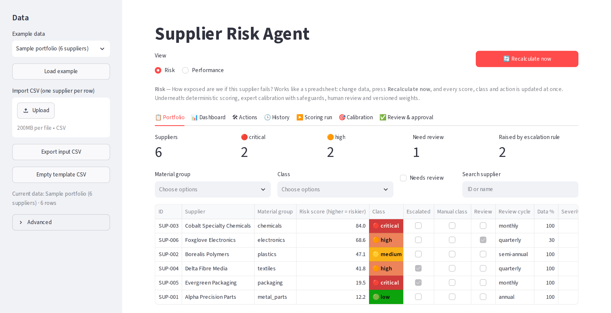
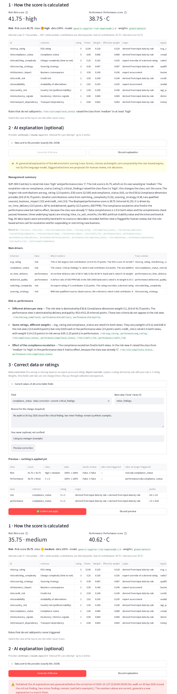
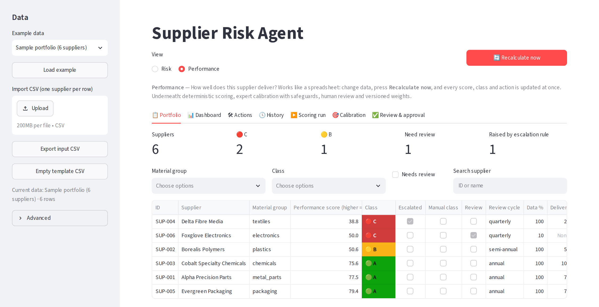
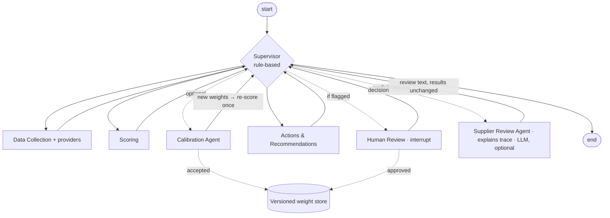

# Lean Agentic AI for Supplier Risk & Performance Evaluation

[](https://github.com/CsabaRanks/lean-agentic-supplier-risk/actions/workflows/ci.yml)


**Supplier risk and supplier performance on one criteria catalogue, with deterministic scoring,
weights calibrated against expert judgement, and human approval built into a LangGraph
multi-agent workflow.** Runs locally, open source, all sample data fictional.

📄 **Working paper:** [Lean Agentic AI for Supplier Risk Management and Performance Evaluation](https://github.com/CsabaRanks/lean-agentic-supplier-risk/blob/main/docs/paper/paper.pdf)
(PDF, draft v0.8; LaTeX and Markdown sources in [docs/paper/](docs/paper/))



---

## The problem

Many procurement organisations license a platform for *supplier risk management* and still run
*supplier performance evaluation* in spreadsheets. The same supplier is then judged in two places,
with different criteria and update cycles. The weights behind both scores are usually set once
and rarely checked against the judgement of the category managers who know the suppliers best.

## What this project does

- **Explain & correct.** For any supplier, a calculation trace shows why it got its rating: inputs and
  their sources, missing data, rules, weights and each criterion's contribution in points. An optional
  LLM explains the trace in plain language and must cite its entries. Wrong data or ratings can be
  corrected with a reason, the effect is shown in both views before anything changes, and confirmed
  corrections are recorded.
- **One catalogue, two views.** Risk ("How exposed are we if this supplier fails?", low → critical)
  and performance ("How well does this supplier deliver?", A / B / C) are computed from the same
  data sheet. Each view has its own weights, classes, escalation rules and actions.
- **Transparent, reproducible scoring.** 1–5 ratings per criterion, weighted per dimension,
  normalised to 0–100. Same input, same result. Escalation rules keep a single severe finding
  (e.g. a critical compliance issue) from being averaged away.
- **Weights checked against expert judgement.** A calibration step fits factor weights to category
  managers' holistic 0–100 judgements and applies them only if the improvement holds out of sample.
- **Humans stay in charge.** Proposed weights, thin data and class overrides go to a review step;
  approved weights are versioned with approver and timestamp.
- **Familiar front end.** A spreadsheet-like Streamlit table: suppliers in rows, criteria in
  columns, CSV import/export, **Recalculate now**.

The method stays with procurement: criteria, weights, thresholds and actions live in readable YAML
files, not in a vendor's black box.

## Explain & correct: why this rating, and is it right?

A category manager looks at a supplier, wants to know why it is rated the way it is, spots a wrong
input, and corrects it in a controlled way. The tab **Explain & correct** walks through four steps:

1. **How the score is calculated.** A trace generated from the scoring engine's own results, without
   any API key. It shows per criterion the inputs with source and data date (or "missing"), the rating
   rule, the rating and where it came from, the nominal and effective weight, and the contribution in
   points; the contributions add up exactly to the score. Rules that do not add points are listed
   separately: escalation rules that set a class floor, the data-completeness check, a reviewer's
   class override.
2. **AI explanation (optional).** A language model explains the trace for both views. Every summary,
   driver, view difference and action must cite trace entries (e.g. `risk:rule:compliance_status`);
   answers citing unknown entries are rejected. See [LLM explanation](#llm-explanation-optional).
3. **Correct data or ratings.** A *data correction* fixes an input (e.g. a compliance status or a
   credit score). An *expert override* replaces a rating that a rule derived from data. A reason is
   required. Both views are recomputed deterministically and shown before and after: scores,
   classes, changed criteria and rules. Nothing changes until you confirm. Weights and rules are not
   editable here; they stay in calibration and approval.
4. **Dispute assessment.** Records that you disagree with a criterion. It changes no score and does
   not train weights.

The same rule applies to the input table in **Scoring run**: new suppliers are entered directly, but
a changed cell of a supplier that already has a result is held back as a pending correction and
applied only after a reason, the before/after preview and your confirmation. Deleting such a
supplier in the table is not applied.

Confirmed corrections are written to `corrections.jsonl` in the history folder: old and new value,
kind, reason, time, model and weight version, before and after per view, and the name you typed,
marked as not verified. An existing AI explanation is then marked **Outdated**.

**Example (fictional supplier SUP-004).** The risk score is 41.75, which would be "medium", but the
class is "high": a critical compliance finding triggers an escalation rule. The trace shows this
separately from the points (ESG rating 12.0 points, compliance status 8.0, …). A re-audit closed the
finding, so the category manager corrects `compliance_status` from `critical_findings` to
`minor_findings` with that reason. The preview shows risk 41.75 → 35.75, class high → medium, the
escalation rule no longer triggered; performance 38.75 → 40.62, class C unchanged. After confirmation
the correction is recorded and the earlier AI explanation is flagged as outdated.



*Real run on 12 October 2026 with fictional data; the AI explanation is a real answer of
`claude-opus-5-5`.*

What has and has not been shown:

- **Technical verification:** tests check that contributions add up to the score for every sample
  supplier and view, escalation effects, preview without adoption, confirmed correction and history,
  disputes, and the outdated flag (198 tests pass; the real-API smoke test runs only with a key and
  passed on 12 October 2026).
- **Not validated in practice:** no category managers have used it, no real supplier data was
  involved, and nothing here measures explanation quality, correction accuracy or false alarms.

## Two examples

### 1. The same supplier, seen from two sides

```bash
supplier-risk --data data/sample_suppliers.json                      # risk view
supplier-risk --data data/sample_suppliers.json --view performance   # performance view
```

| Supplier (fictional) | Risk score | Risk class | Performance score | Performance class |
|---|---:|---|---:|---|
| Cobalt Specialty Chemicals | 84.0 | critical | 75.6 | A |
| Evergreen Packaging | 19.5 | critical\* | 79.4 | A |
| Delta Fibre Media | 41.8 | high\* | 38.8 | C |
| Alpha Precision Parts | 12.2 | low | 77.5 | A |

\* class raised by an escalation rule (Evergreen: acute insolvency signals; Delta: critical
compliance finding).

Cobalt and Evergreen deliver well (A suppliers) but are critical from a risk perspective: single
source and high country risk for Cobalt, acute insolvency signals for Evergreen despite a low
weighted score. A performance-only evaluation would not show this; a risk platform alone would not
show that these are suppliers worth protecting rather than replacing.
`supplier-risk --data data/sample_suppliers.json --supplier SUP-003` explains every factor, its
weight, its data source and the resulting actions.



### 2. Checking the weights against the category managers

```bash
supplier-risk --data data/calibration_portfolio.json --calibrate --weights-dir data/weights --review interactive
```

The demo portfolio contains 36 synthetic suppliers, 32 of them with a synthetic expert judgement.
The Calibration Agent fits new weights and tests them out of sample before accepting them:

```
Calibration [global] — 32 labelled supplier(s): accepted: cross-validated MSE 37.8 -> 22.8, z = 2.4
  in-sample MSE 37.77 -> 13.265  |  class agreement 84% -> 88%  |  applied: False
  mean label - score: +2.2 points (t = +2.1)
  factor                     old     new  delta
  business_impact          14.0%   18.1%  +4.1%
  sourcing_strategy         8.8%   14.6%  +5.8%
  esg_rating               12.0%    7.5%  -4.5%
  ...
```

Read as: the synthetic "experts" weight sourcing strategy and business impact more and ESG less
than the template. The change is accepted because the error drops by about 40 % on held-out
suppliers *and* the drop is clearly larger than its own uncertainty (z ≥ 2). With fewer or noisier
labels the same step rejects the change, or flags patterns that weights cannot express (a level
offset between experts and model, knock-out logic). Accepted weights are only **proposed**: the run
pauses, a reviewer approves or rejects them in the terminal or in the **Review & approval** tab, and
approved weights are stored as a new version with the reviewer's name.

## What is deterministic, what is "agentic", what uses an LLM

"Agentic" here means **an orchestrated multi-agent workflow**: specialised agents with a single
responsibility, a shared typed state, a supervisor that routes between them, a bounded feedback
loop and a human-in-the-loop pause. All agents that produce numbers, including the supervisor, are
deterministic Python, so that every score is reproducible and auditable. **A language model is used
in one place only: the optional Supplier Review Agent**, which explains results that are already
final (see [LLM explanation](#llm-explanation-optional)). Without an API key it is simply unavailable.

| Component | What it does | How | Status |
|---|---|---|---|
| Supervisor | Decides the next step | Rule-based routing (`Supervisor.route()`), bounded loops | Implemented |
| Data Collection Agent | Loads suppliers, fills indicators from providers | JSON / CSV sources, provider interface | Implemented |
| Scoring Agent | Ratings, dimension scores, class, escalation rules, completeness | Pure functions, configurable YAML | Implemented |
| Calibration Agent | Fits weights to expert judgements | Constrained ridge least squares (SciPy), cross-validated acceptance, diagnostics | Implemented; validated on **synthetic** labels only |
| Action & Recommendation Agent | Actions per class, dimension and factor | Rule-based action framework from YAML | Implemented |
| Human Review | Approve weights, override classes, defer | LangGraph `interrupt()`; CLI prompt or UI tab | Implemented (in-memory checkpointer; no persistence across sessions by default) |
| Weight store, history, audit trail | Versioned weights, snapshots, corrections, disputes, append-only log | YAML / JSONL files | Implemented |
| Scoring trace | Why one supplier got its score and class | Derived from the engine's results; contributions add up to the score | Implemented |
| Correction & dispute | Data corrections and expert overrides with reason, before/after, confirmation; disputes | Deterministic recomputation of both views | Implemented; single user, names not verified |
| WGI political stability | Country indicator | From your own World Bank CSV download | Implemented; `--wgi-mock` uses **fictional** values |
| Live provider APIs (WGI online, ESG platform, ERP, credit agency) | External data | Interfaces raise `NotImplementedError` | Placeholder |
| Supplier Review Agent (optional) | Explains the trace: summary, drivers, risk vs. performance, action proposals, open questions, each citing trace entries | **LLM** (Claude via the Anthropic SDK), structured output, validated against the trace; on explicit request only | Implemented; **experimental**, tested with mocked responses plus a real smoke test |
| LLM supervisor, document extraction | Route steps, extract indicators from documents | — | Planned, not implemented |

### Architecture



Each agent returns a partial state update and hands control back to the supervisor. Calibration,
re-scoring and human review run at most once per run, so loops are bounded by construction. The
risk template uses four dimensions (severity, financial stability, supply chain risk, ESG &
compliance); the performance template uses five (delivery, quality, commercial, cooperation,
stability & compliance), sharing criteria such as credit risk, ESG and compliance with the risk view.
Details: [docs/architecture.md](docs/architecture.md), [docs/scoring-model.md](docs/scoring-model.md),
[docs/calibration.md](docs/calibration.md), [docs/data-providers.md](docs/data-providers.md).

## Quick start

Requires Python 3.10 or newer.

```bash
git clone https://github.com/CsabaRanks/lean-agentic-supplier-risk.git
cd lean-agentic-supplier-risk
python -m venv .venv && source .venv/bin/activate      # Windows: .venv\Scripts\activate
pip install -e ".[dev,ui]"
pytest -q                                               # optional: run the test suite
```

### CLI

```bash
supplier-risk --data data/sample_suppliers.json                         # risk view
supplier-risk --data data/sample_suppliers.json --view performance      # performance view
supplier-risk --data data/sample_suppliers.json --supplier SUP-003      # one supplier in detail
supplier-risk --data data/calibration_portfolio.json --calibrate --weights-dir data/weights
supplier-risk --data data/sample_suppliers.json --review interactive    # decide pending reviews
supplier-risk --data data/sample_suppliers.json --wgi-mock --history-dir data/history
```

`supplier-risk --help` lists all options. Generated weights (`data/weights/<view>/`) and history
(`data/history/`) are git-ignored.

### Streamlit app

```bash
streamlit run ui/app.py      # http://localhost:8501
```

Tabs: **Portfolio** · **Dashboard** · **Actions** · **History** · **Scoring run** ·
**Calibration** · **Review & approval** · **Explain & correct**, with the risk / performance
switch on top. The app only
collects input and displays results; every number comes from the package. **Empty template CSV**
in the sidebar is the starting point for your own data (semicolon-separated files are accepted).

### Python

```python
from supplier_risk_agent import SupplierRiskEvaluator

evaluator = SupplierRiskEvaluator.from_json("data/sample_suppliers.json", view="risk")
result = evaluator.assess("SUP-003")
print(result.overall_score, result.risk_class)          # 84.0 critical
for action in result.recommendations:
    print(action.priority, action.action)
```

## LLM explanation (optional)

The **Supplier Review Agent** sends the calculation trace of one supplier (both views) to a language
model and returns a management summary, the main drivers, where risk and performance differ,
prioritised action proposals and open questions, each with references to trace entries.

| Deterministic evaluation | LLM explanation |
|---|---|
| Ratings, weights, scores, classes, escalation rules, completeness, rule-based actions, calibration, the trace | Summary, drivers, view differences, action proposals, open questions |
| Same input → same result | Wording can differ between calls |
| Always runs; needs no key | Only when you press **Generate AI Review** or use `--ai-review` |

Safeguards:

- **Explicit trigger and preview.** Nothing is sent until you press the button (or confirm in the
  CLI). The exact JSON is shown beforehand: the trace with inputs, sources, rules, ratings, weights,
  contributions and rule-based actions. Supplier name, country, spend and expert labels are not sent.
  Use synthetic or approved data only.
- **Results stay deterministic.** The agent writes only its explanation into the run; it cannot change
  a score, class or weight. Scores shown next to it come from the deterministic results.
- **Validated output, within limits.** The answer must match a fixed schema. The summary, every driver,
  view difference and action must cite trace entries that exist; criterion keys must exist; both views
  must be compared; missing data must produce at least one open question. Otherwise the whole answer
  is rejected.
- **What validation does not check.** The free text can still contain numbers, and a misquoted value
  is not detected. Validation checks *that* an existing trace entry is cited, not *whether* it supports
  the sentence, and not whether explanations and priorities are sensible or every gap is addressed.
  The prompt restricts the model to the trace and withholds the supplier's name, which reduces but
  does not rule out invented facts or reasons. Read it as a draft.
- **Proposals, not decisions.** Suggested actions are marked as proposals for human review.
- **Bounded cost and failure.** Timeout and retry limit are configurable. A result is kept per exact
  input, so app reruns never call the provider again; after a correction the old explanation is
  flagged as outdated, not silently replaced. Errors are shown as messages, and the deterministic
  workflow continues unchanged.

Setup:

```bash
pip install -e ".[llm]"
cp .env.example .env          # then set ANTHROPIC_API_KEY (and optionally model, timeout, retries)
supplier-risk --data data/sample_suppliers.json --ai-review SUP-004     # shows the payload, asks before sending
streamlit run ui/app.py                                                 # tab "Explain & correct"
```

The LLM explanation is **experimental**. Automated tests use mocked responses; a real smoke test with
`claude-opus-5-5` passed on 12 October 2026. In manual spot checks of three fictional suppliers (one
with complete data, one with many gaps, one with an escalation rule), every number in the text was
found in the input or was a sum of input values, and data gaps became open questions. Three answers
are examples, not an evaluation. The first real call was rejected by validation (12 drivers, no
actions), which led to stating the limits explicitly in the prompt.

## How this compares to other approaches


The chart profiles four approaches on 15 success factors (model v0.5). **It is a qualitative
assessment by the author, not a measurement**: based on public information and code review (October
2026), with a rationale, a confidence mark and sources per value in
[research/comparison-matrix.md](research/comparison-matrix.md). Factors 2 (explainability &
traceability), 3 (method transparency) and 6 (human review & correction) have written rating anchors.
Where no public evidence was found, a value is marked unknown ("?"), not rated low; "≥" marks a
documented minimum and "*" an uncertain value kept at its earlier level; no value is lowered only
because evidence is missing. The author also built one of the rated approaches and wrote the anchors after
building Explain & correct, so the ratings are not independent. No totals or rankings are derived.

The profiles differ in focus. Commercial risk platforms (Prewave and Sphera are used as public
examples) are built around external signals, coverage, regulatory evidence and operational
maturity, none of which this project offers. This project focuses on the method: one catalogue for
risk and performance, calibration against expert judgement and a transparent, editable model.
A realistic setup is hybrid: signals from a platform or open data, and a scoring method that the
procurement team owns. Factor model: [research/success-factors.md](research/success-factors.md).

## Limitations

- **Template, not a validated model.** The bundled criteria, weights and thresholds are
  illustrative. Adapt them to your categories and calibrate them on your own supplier base before
  using results for decisions.
- **Synthetic evidence only.** The calibration experiments in the paper use synthetic expert labels
  from constructed expert policies. There is no field validation with real category managers yet.
- **No live data connections.** External risk signals (sanctions, insolvencies, events) and live
  APIs are not implemented; indicators come from files.
- **Single-user prototype.** Review state lives in memory per session; there are no roles,
  authentication or multi-user workflows.
- **Explain & correct is not validated in practice.** Its usefulness for category managers, the
  quality of the explanations and the accuracy of corrections have not been evaluated, and no
  reduction of false alarms is claimed. The LLM explanation sends data to an external provider when
  you trigger it, and its text can contain errors.
- **Corrections are single-user.** Names are typed in and not verified; there are no roles or
  approval of corrections by a second person. A CSV import or "Load example" replaces the whole data
  set and is not recorded as a correction.

## About the author

Built by **Csaba Bakay** as a first Agentic-AI portfolio project. The domain questions come from
practical work in **procurement, supplier development and cost engineering**: evaluating suppliers,
developing them, and making cost and risk transparent enough for decisions. The project explores
how far a lean, auditable workflow can carry these tasks before external platforms or language
models are needed.

## Contributing

Issues and pull requests are welcome.

- Run `ruff check .` and `pytest` before opening a pull request; CI runs both.
- Keep numbers deterministic and covered by tests. Language models may explain results but must
  not produce scores.
- Change benchmark ratings only in `research/comparison-matrix.yaml`, with a rationale and a
  confidence mark, then run `python scripts/generate_spider.py` (needs the `research` extra).
- Use fictional or synthetic data only. Never commit real supplier data.

## License

[MIT](LICENSE), Copyright (c) 2026 Csaba Bakay. This covers the code, the documentation, the working
paper and the figures. No third-party code is included; dependencies, references, data and
trademarks are listed in [THIRD_PARTY_NOTICES.md](THIRD_PARTY_NOTICES.md). All sample data is
fictional; all expert labels are synthetic.
