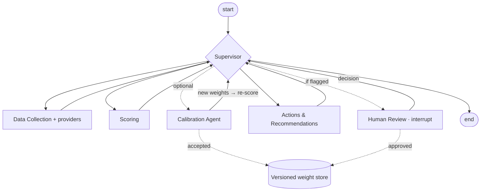

# Supplier Risk Agent

**Lean Agentic AI for supplier risk management and performance evaluation.** Two views on one
criteria catalogue, deterministic scoring, weights calibrated against expert judgement, and a
human review step built into a LangGraph multi-agent workflow.


Many procurement teams license a risk platform for *supplier risk management* and still run
*supplier performance evaluation* in spreadsheets. The same supplier is then judged in two
systems, with different criteria and update cycles, and the weights behind both scores are rarely
checked against the judgement of the people who know the suppliers.

Supplier Risk Agent evaluates both on one consistent basis. The method is transparent,
reproducible and owned by procurement. It runs locally and is open source.

📄 **Working paper:** [Lean Agentic AI for Supplier Risk Management and Performance Evaluation](docs/paper/paper.pdf)
(PDF, draft v0.5)

---

## Where this approach sits


Four approaches profiled on **15 success factors** (model v0.4), read factor by factor:

- **Risk platforms** (Prewave and Sphera as examples) lead on external signals and coverage,
  regulatory evidence, scalability and operational maturity.
- **This project** leads where the method matters:
  - integration of risk management and performance evaluation
  - expert calibration
  - agentic orchestration
  - methodological transparency, reproducibility and customisability

  It is close to the platforms on actions and human review, and covers external signals in part.
- **Spreadsheets** stay transparent and flexible but carry high manual effort; **open-source agent
  repos** offer architecture without a defensible scoring method.

The profiles are complementary, not ranked. The most realistic setup is hybrid: signals from a
platform or open data, and a method the procurement team owns.

> Values are **illustrative and justified, not measured**: public information and code review,
> October 2026. Each value has a rationale and a confidence mark in
> [research/comparison-matrix.md](research/comparison-matrix.md); the chart is generated from
> [research/comparison-matrix.yaml](research/comparison-matrix.yaml). No weighting, total or
> ranking is derived. Factor model: [research/success-factors.md](research/success-factors.md).

## Key features

| | |
|---|---|
| **Dual view** | Supplier **risk** (low → critical) and **performance** (A / B / C) on one shared criteria catalogue and one data sheet. Each view has its own weights, classes, escalation rules, actions, expert labels and approvals. |
| **Calibration Agent with safeguards** | Learns factor weights from category managers' holistic 0–100 judgements by constrained, regularised least squares. Weights are applied only if the improvement holds **out of sample** and is clear relative to its own uncertainty. A level-offset check and fit diagnostics flag what weights cannot express. |
| **Human-in-the-loop** | The run **pauses in the graph** (LangGraph `interrupt()`) for proposed weights or thin data. Reviewers approve weights, override classes with a comment, or defer. Approved weights are versioned with approver and timestamp. |
| **Action framework** | Concrete measures per risk class, per elevated dimension and per factor level, each with owner and review cycle; an exportable action plan per material group. |
| **History** | Timestamped snapshots per view. Scores over time per supplier and per material group; approved reviews are recorded automatically. |
| **Spreadsheet-like UI** | Streamlit app: suppliers in rows, criteria in columns, CSV import and export, dashboards per material group, and **🔄 Recalculate now** at any time. |
| **Provider interface** | Fills missing indicators from open data and system exports and records origin and vintage: World Bank WGI political stability (your own download, or a fictional mock), generic CSV exports (ERP, ESG platform, credit agency). Live APIs are documented placeholders. |
| **Deterministic and governed** | Same input, same score. Escalation rules keep one severe finding from being averaged away; data-completeness checks; append-only audit trail. No language model touches the numbers. |

> ⚠️ The bundled criteria, weights and thresholds are an **illustrative template**. Adapt them to
> your categories and calibrate them on your own supplier base before using results for decisions.
> All sample data and expert labels are fictional or synthetic.

## Quick start

```bash
git clone <repository-url> supplier-risk-agent && cd supplier-risk-agent
python -m venv .venv && source .venv/bin/activate
pip install -e ".[dev,ui]"
```

### CLI

```bash
# risk view of the fictional sample portfolio
supplier-risk --data data/sample_suppliers.json

# performance view, and one supplier in detail
supplier-risk --data data/sample_suppliers.json --view performance
supplier-risk --data data/sample_suppliers.json --supplier SUP-003

# calibrate weights against (synthetic) expert labels and store them as a new version
supplier-risk --data data/calibration_portfolio.json --calibrate --weights-dir data/weights

# decide pending reviews in the terminal
supplier-risk --data data/sample_suppliers.json --review interactive

# political stability from the WGI placeholder, plus a history snapshot
supplier-risk --data data/sample_suppliers.json --wgi-mock --history-dir data/history
```

```
ID        Supplier                      Score  Class      Data  Weights              Review
----------------------------------------------------------------------------------------------
SUP-003   Cobalt Specialty Chemicals     84.0  critical   100%  global/default
SUP-006   Foxglove Electronics           68.6  high        30%  global/default       yes
SUP-002   Borealis Polymers              47.1  medium     100%  global/default
SUP-004   Delta Fibre Media              41.8  high*      100%  global/default
SUP-005   Evergreen Packaging            19.5  critical*  100%  global/default
SUP-001   Alpha Precision Parts          12.2  low        100%  global/default

* class raised by an escalation rule
```

Cobalt and Evergreen are critical in the risk view but **A suppliers** in the performance view:
exactly the case that separate systems hide.

### Streamlit app

```bash
streamlit run ui/app.py      # http://localhost:8501
```

Tabs: **Portfolio** · **Dashboard** · **Actions** · **History** · **Scoring run** ·
**Calibration** · **Review & approval**, with the risk / performance switch on top. All numbers
come from the package; the app only collects input and shows results. Use **Empty template CSV**
in the sidebar to start with your own data (semicolon-separated files are accepted).

### Python

```python
from supplier_risk_agent import SupplierRiskEvaluator

evaluator = SupplierRiskEvaluator.from_json("data/sample_suppliers.json", view="risk")
result = evaluator.assess("SUP-003")
print(result.overall_score, result.risk_class)
for action in result.recommendations:
    print(action.priority, action.action, action.owner)
```

## How it works



Specialised agents share one typed state; a rule-based supervisor routes between them, and every
loop runs at most once per run. Ratings on a 1–5 scale are aggregated per dimension and normalised
to 0–100 (`(R − 1) / 4 × 100`). The risk template uses four dimensions: severity, financial
stability, supply chain risk (political stability, sourcing strategy, transport dependency) and
ESG & compliance.

| Topic | Documentation |
|---|---|
| Architecture and agents | [docs/architecture.md](docs/architecture.md) |
| Scoring model, views, sub-scores, action framework | [docs/scoring-model.md](docs/scoring-model.md) |
| Calibration and its safeguards | [docs/calibration.md](docs/calibration.md) |
| Data providers | [docs/data-providers.md](docs/data-providers.md) |
| Benchmark, success factors, decision log | [research/](research/) |
| Working paper (PDF, LaTeX, Markdown) | [docs/paper/](docs/paper/) |

## Customising

| Goal | How |
|---|---|
| Change criteria, weights, thresholds or actions | Edit or copy the view YAML in `src/supplier_risk_agent/config/` and run with `--model`. Criteria are defined once in `criteria.yaml`. |
| Add a view | Add a YAML file that selects criteria from the catalogue. |
| Weights per material group | Set `material_group_weights`, or calibrate with `--material-group`. |
| Connect your data | Implement `SupplierDataSource`, or import a CSV in the app. |
| Fill indicators from other systems | Pass `providers=[...]`, e.g. `CsvIndicatorProvider` for system exports. |
| Add an agent | Register a node in `graph/builder.py` and one routing rule in `Supervisor.route()`. |

## Roadmap

- [x] Deterministic, configurable scoring with escalation rules and completeness checks
- [x] Two views: risk management and performance evaluation
- [x] Calibration Agent with cross-validated acceptance, level-offset check and fit diagnostics
- [x] Graph-based human review and versioned weight store
- [x] Action framework, dashboards, assessment history, spreadsheet UI
- [x] Provider interface (WGI from CSV or mock, generic CSV exports)
- [ ] Live provider integrations (WGI online, ESG platform, ERP, credit agency)
- [ ] External-signal agent (sanctions, insolvencies, events) as time-varying indicators
- [ ] Joint portfolio reading of performance grade and risk class
- [ ] Persistent checkpointer and roles for review across sessions
- [ ] LLM explanation agent that narrates locked numbers without changing them

## Contributing

Contributions are welcome: issues, ideas and pull requests.

- Run `ruff check .` and `pytest` before opening a pull request; CI runs both.
- Keep numbers deterministic and covered by tests. Language models may explain results but must
  not produce scores.
- Change benchmark ratings only in `research/comparison-matrix.yaml`, with a rationale and a
  confidence mark, then run `python scripts/generate_spider.py` (needs the `research` extra).
- Use fictional or synthetic data only. Do not commit real supplier data (`data/history/` is
  git-ignored).

## License

[MIT](LICENSE). All sample data is fictional; all expert labels are synthetic.
