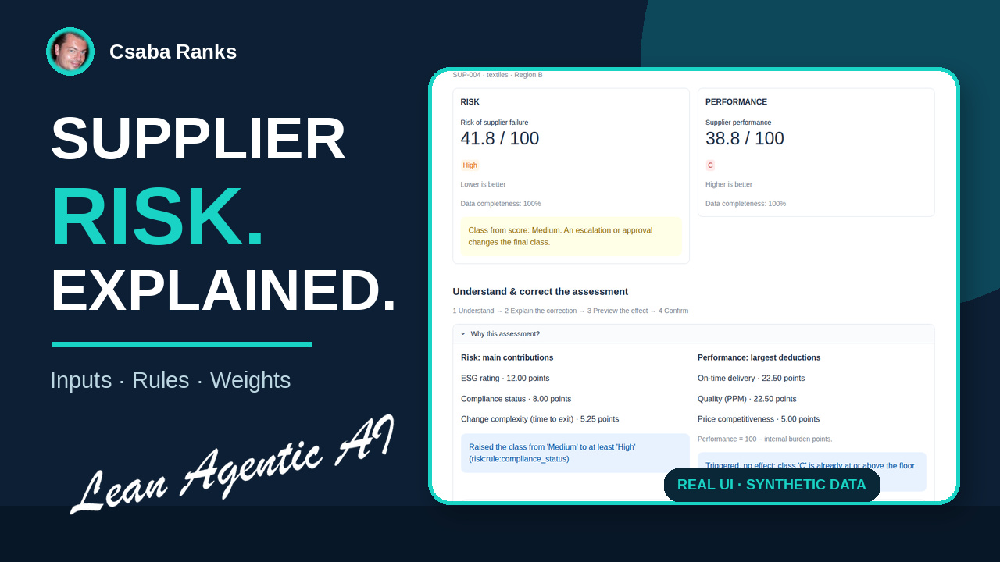
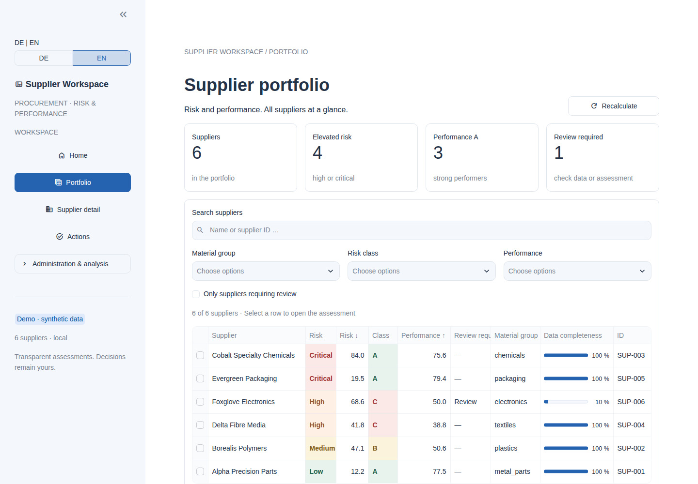
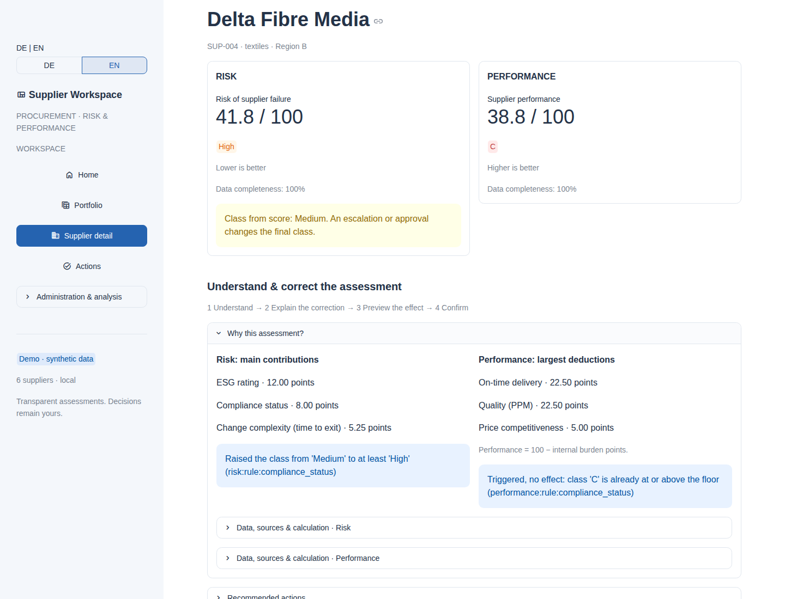
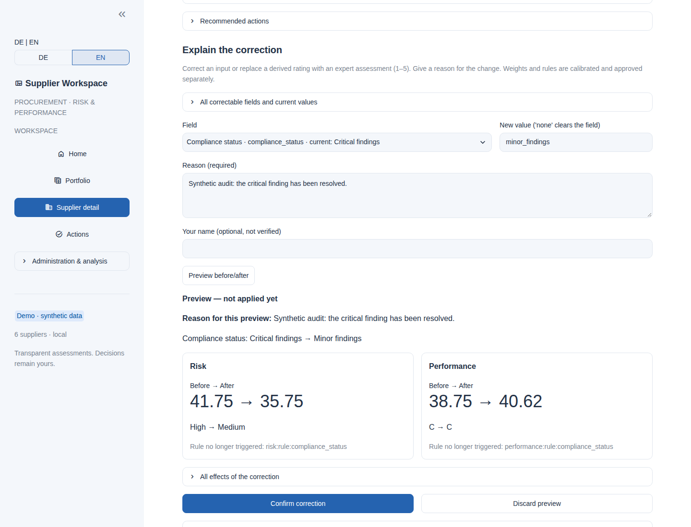
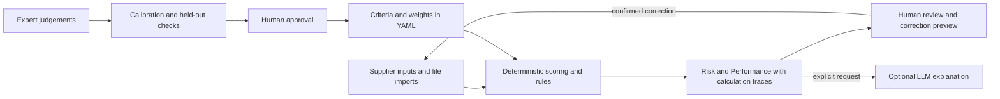

*The author's qualitative assessment, not an empirical measurement or an overall ranking.
[Scoring basis and rationale](research/comparison-matrix.md) ·
[Commercial-platform sources](research/saas-references.md) · [Repository sources](research/github-references.md).*

[](https://youtu.be/PbGzJOmzwV0)

*Watch the 42-second product demo · Synthetic demo data*

[Watch the product demo on YouTube](https://youtu.be/PbGzJOmzwV0)

# Lean Agentic AI - Supplier Risk System

**Assess supplier risk and performance together, understand each result, and correct assumptions with confidence.**

[](https://github.com/CsabaRanks/Lean-Agentic-AI-Supplier-Risk-System/actions/workflows/ci.yml)

[](LICENSE)

A local procurement workspace for category managers and procurement teams.
**Open-source prototype with synthetic demo data:** no real-world validation or continuous live monitoring yet.

## Key benefits

1. **Risk and performance together.** Assess supplier exposure and delivery performance side by side on a shared criteria catalogue.
2. **Trace every assessment.** Follow results back to inputs, rules, weights and each criterion's contribution.
3. **Correct with confidence.** Fix assumptions with a reason, a before/after preview, explicit confirmation and a recorded history.
4. **Calibrate against expertise.** Fit weights to expert judgements and check improvements on held-out data before proposing adoption.
5. **Keep people in control.** Reproduce scores while retaining human control over rules, escalations and approvals.
6. **Use AI where it helps.** Request readable explanations from an optional LLM while all assessments remain deterministic.
7. **Adapt an open, modular system.** Extend criteria, rules, data sources and specialised agents to fit your procurement method.
8. **Turn benchmarks into priorities.** Use systematic comparison to identify improvement opportunities and guide development priorities.

[How these benefits map to the 15 benchmark dimensions](research/benefit-mapping.md), including evidence and limits.
Benchmarking is a development process; regular updates are a goal, not an established cadence.

## Try the demo

Requires **Python 3.10 or newer**. Clone the repository, or use your existing checkout:

```bash
git clone https://github.com/CsabaRanks/Lean-Agentic-AI-Supplier-Risk-System.git
cd Lean-Agentic-AI-Supplier-Risk-System
```

Create and activate an environment — **Windows PowerShell**:

```powershell
py -3 -m venv .venv
.\.venv\Scripts\Activate.ps1
```

Or **macOS / Linux**:

```bash
python3 -m venv .venv
source .venv/bin/activate
```

Install and launch from the repository folder:

```bash
python -m pip install -e ".[ui]"
python -m streamlit run ui/app.py
```

Open **[localhost:8501](http://localhost:8501)** and select **Try the demo**.
The base demo needs **no API key** and contains six **synthetic suppliers**.
Use **DE | EN** at the top of the sidebar; the initial language follows your browser
(German for `de`, English otherwise). Switching preserves your selection, filters and correction preview.

**First walkthrough:** load the demo → select **Delta Fibre Media** in **Portfolio** →
open **Why this assessment?** in **Supplier detail** → enter a correction and reason →
**Preview before/after** → **Confirm correction**.
[Follow the worked example](docs/demo-guide.md) to see a compliance correction affect both assessments.

Optional AI explanations need [separate LLM configuration](docs/llm-explanation.md#setup)
and an explicit request; the demo never calls an AI provider automatically.

## See it in action

Actual English UI, synthetic data. Open an image for the full-size view.



*Compare exposure and performance in one table, then focus your review with search and filters.*



*See what drives each assessment and why a rule can raise the risk class beyond the numeric score.*



*Check the effect on both assessments before confirming a reasoned correction.*

## How it works



A LangGraph supervisor coordinates specialised agents. Scoring, escalation rules, calibration,
rule-based actions and routing are deterministic Python. Corrections recompute both views;
approved weights and confirmed corrections are recorded in local files.
The optional LLM explains the calculation trace and cannot change scores, classes or weights.

The main navigation is **Home → Portfolio → Supplier detail**, with **Actions** alongside.
**Administration & analysis** groups Dashboard, History, Data & import, Calibration, Approvals and Settings.
[Architecture and component status](docs/architecture.md) explain the implementation and extension points.

## Paper and documentation

- **Working paper:** [Lean Agentic AI for Supplier Risk Management and Performance Evaluation](docs/paper/paper.pdf) — draft v0.8; [readable source](docs/paper/paper.md).
- **Method:** [scoring model](docs/scoring-model.md), [expert calibration](docs/calibration.md), [benchmark evidence and benefit mapping](research/benefit-mapping.md).
- **Using the workspace:** [English demo guide](docs/demo-guide.md), [Explain & correct](docs/explain-correct.md), [UI design, DE/EN checks and Streamlit limits](docs/professional-ui.md) (German).
- **Technical reference:** [architecture](docs/architecture.md), [data providers](docs/data-providers.md), [CLI / Python and worked examples](docs/usage-examples.md), [optional LLM setup and validation](docs/llm-explanation.md).

## Limitations

The templates and calibration evidence are illustrative and synthetic; **no field validation with
category managers or real supplier data** has been completed. There is **no continuous live monitoring**;
external APIs are placeholders and inputs come from files or manual entry.
This is a single-user prototype without authentication or verified reviewer identities.
LLM explanations can contain errors. See [validation boundaries and operational limits](docs/limitations.md).

## Contributing

Issues and pull requests are welcome. Install development tools with `python -m pip install -e ".[dev,ui,research,llm]"`,
then run `ruff check src tests examples scripts ui` and `pytest -q` as in CI.
Keep scoring deterministic and test changed behaviour; use synthetic data only.
Benchmark changes belong in `research/comparison-matrix.yaml`, with rationale and confidence,
followed by `python scripts/generate_spider.py` — see the [benchmark workflow](research/benefit-mapping.md#benchmarking-as-a-development-process).

Built by **Csaba Bakay**, drawing on procurement, supplier development and cost engineering experience,
as a first Agentic-AI portfolio project.

## License

[MIT](LICENSE), Copyright © 2026 Csaba Bakay: code, documentation, working paper and figures.
See [third-party notices](THIRD_PARTY_NOTICES.md) for dependencies, references, data and trademarks.
