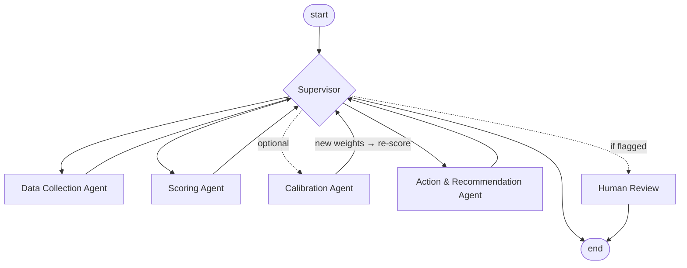

# Supplier Risk Agent

**Transparent, configurable and self-calibrating supplier risk evaluation, built as a LangGraph multi-agent workflow.**


---

## The problem

Supplier risk evaluation usually falls into one of two camps:

| | Spreadsheet scorecards | Enterprise SCRM / SaaS platforms |
|---|---|---|
| Cost | ✅ free | ❌ expensive licences |
| Transparency | ✅ formulas visible | ❌ black-box scores |
| Consistency | ❌ copy-paste errors, drifting versions | ✅ |
| Governance | ❌ no audit trail, weights set once and never validated | ⚠️ varies |
| Extensibility | ❌ hard to add data feeds or automation | ⚠️ vendor roadmap |

**Supplier Risk Agent sits in the gap.** You get the transparency of a scorecard, the structure of
a real system and an architecture ready for automation and AI. It is open source and
runs locally.

## What it does

- **Structured scoring.** Multi-dimensional, weighted scoring with 1–5 factor ratings and min-max normalisation to 0–100.
- **Configurable model.** Criteria, **default weights**, thresholds, escalation rules and actions live in one YAML file. Nothing is hard-coded.
- **Calibration against expert judgement.** A dedicated agent learns weights from category managers' holistic assessments (see below).
- **Material-group aware.** Weights can differ per commodity or material group instead of one-size-fits-all.
- **Governance built in.**
  - Escalation rules: one severe finding cannot be averaged away.
  - Data-completeness checks.
  - A human-review exit.
  - An append-only audit trail.
- **Actionable output.** Each supplier gets a risk class with a review cycle and concrete mitigation actions.
- **Deterministic and tested.** Same input always gives the same score, backed by a pytest suite.

> ⚠️ **The bundled criteria, weights and thresholds are illustrative examples.** They are a
> template to start from. Adapt them to your categories and calibrate them on your own supplier
> base before using the results for decisions.

## ⭐ Differentiator: calibration against expert judgement

Most supplier-risk scorecards and open-source supply-chain agents use weights that are hard-coded
or decided by an LLM. Nobody checks them against reality. This project adds a
**Calibration Agent** that closes the loop:

1. **Input.** Category managers give a holistic risk label (0–100) for some suppliers, e.g. during the annual review.
2. **Fit.** The agent adjusts the factor weights to **minimise the mean squared error** between model score and expert label.
3. **Constraints.** Weights stay ≥ a minimum and sum to 1, with regularisation towards the configured defaults. Calibration *refines* the methodology. It does not replace it.
4. **Feedback loop.** If the improvement is significant, the new weights are applied and the **Scoring Agent re-runs**. Otherwise they are only proposed for approval.
5. **Logging.** Old vs. new weights and MSE before/after are logged in the state and the audit trail.
6. **Scope.** Calibration runs **globally** or **per material group**.

```
Calibration [global] — 32 labelled supplier(s): accepted: MSE 37.8 -> 13.3 (64.9% better)
  factor                     old     new  delta
  business_impact          14.0%   18.1%  +4.1%
  sourcing_strategy         8.8%   14.6%  +5.8%
  esg_rating               12.0%    7.5%  -4.5%
  ...
```

This makes the system **able to learn** and brings it **closer to how category managers actually
judge risk**, while every weight stays explainable. Details: [docs/calibration.md](docs/calibration.md).

## Architecture



| Agent | Responsibility |
|---|---|
| **Supervisor** | Rule-based routing over the shared state. It is the single extension point for an LLM supervisor. |
| **Data Collection** | Loads suppliers in scope (optionally one material group), indicators and expert labels from a pluggable data source. |
| **Scoring** | Resolves weights per supplier, rates factors, aggregates dimensions, normalises, classifies, applies escalation rules and checks data completeness. |
| **Calibration** *(optional)* | Fits weights to expert labels (constrained least squares) and triggers re-scoring. |
| **Action & Recommendation** | Maps class, elevated dimensions and escalations to actions and review cycles. |
| **Human Review** | Marks results that need a human decision. A LangGraph `interrupt()` is planned. |

The flow is `collect_data → score → [calibrate → score] → recommend → [human_review] → end`.
All agents share one typed `SupplierRiskState`. More in [docs/architecture.md](docs/architecture.md).

### Default scoring template

| Dimension | Default weight | Factors |
|---|---|---|
| Severity Index | 35 % | availability of alternatives · change complexity · business consequence |
| Financial Stability | 20 % | credit risk · insolvency signals |
| Supply Chain Risk | 25 % | country risk · sourcing strategy · transport dependency |
| ESG & Compliance | 20 % | ESG rating · compliance status |

`score = (weighted rating − 1) / 4 × 100`. The classes are Low < 30 ≤ Medium < 50 ≤ High < 70 ≤ Critical.
See [docs/scoring-model.md](docs/scoring-model.md).

## Quick start

```bash
git clone <this-repo> && cd supplier-risk-agent
python -m venv .venv && source .venv/bin/activate
pip install -e ".[dev]"

# assess the fictional sample portfolio
supplier-risk --data data/sample_suppliers.json

# one supplier in detail
supplier-risk --data data/sample_suppliers.json --supplier SUP-003

# calibrate weights against expert labels (synthetic, fictional data)
supplier-risk --data data/calibration_portfolio.json --calibrate
supplier-risk --data data/calibration_portfolio.json --material-group plastics --calibrate

# machine-readable output
supplier-risk --data data/sample_suppliers.json --json

pytest
```

```
ID        Supplier                      Score  Class      Data  Weights              Review
----------------------------------------------------------------------------------------------
SUP-003   Cobalt Specialty Chemicals     84.0  critical   100%  global/default
SUP-006   Foxglove Electronics           68.6  high        30%  global/default       yes
SUP-002   Borealis Polymers              47.1  medium     100%  global/default
SUP-004   Delta Fibre Media              41.8  high*      100%  global/default
SUP-005   Evergreen Packaging            19.5  critical*  100%  global/default
SUP-001   Alpha Precision Parts          12.2  low        100%  global/default

* class raised by an escalation rule
```

### Python API

```python
from supplier_risk_agent import SupplierRiskEvaluator

evaluator = SupplierRiskEvaluator.from_json("data/sample_suppliers.json")  # optional: model_path="my_model.yaml"

result = evaluator.assess("SUP-003")
print(result.overall_score, result.risk_class)
for action in result.recommendations:
    print(action.priority, action.action, action.review_cycle)

state = evaluator.run(calibrate=True)  # full state incl. calibration report and audit trail
```

## Project structure

```
├── src/supplier_risk_agent/
│   ├── agents/        # Supervisor, Data Collection, Scoring, Calibration, Recommendation
│   ├── graph/         # LangGraph StateGraph + SupplierRiskEvaluator facade
│   ├── models/        # RiskModelConfig, WeightSet, domain objects, graph state
│   ├── tools/         # indicator → rating sources, scoring engine, calibration, data sources
│   ├── config/        # default_risk_model.yaml (example template)
│   └── cli.py
├── data/              # fictional sample data
├── docs/              # architecture, scoring model, calibration
├── examples/          # runnable scripts
├── research/          # reviewed open-source projects, comparison, decision log
└── tests/
```

## Customising

| Goal | How |
|---|---|
| Change criteria, weights or thresholds | Copy `src/supplier_risk_agent/config/default_risk_model.yaml` and run with `--model my_model.yaml`. |
| Use different weights per material group | Set `material_group_weights` in the YAML, or run calibration with `--material-group`. |
| Connect your own data | Implement `SupplierDataSource` (`get_supplier`, `list_supplier_ids`). |
| Derive a rating from a new indicator | Add a function with `@register_source("my_source")` in `tools/indicators.py`. |
| Add an agent | Register a node in `graph/builder.py` and add one routing rule in `Supervisor.route()`. |

## Roadmap

- [x] Deterministic, configurable scoring with escalation rules and data-completeness checks
- [x] LangGraph supervisor workflow with audit trail
- [x] Calibration Agent (global and per material group)
- [ ] Persist approved weights (versioned weight store)
- [ ] Cross-validated calibration report
- [ ] Real human-in-the-loop with LangGraph `interrupt()` and a checkpointer
- [ ] LLM explanation agent: narrative per supplier, without changing numbers
- [ ] LLM extraction agent: indicators from audit reports and questionnaires
- [ ] External risk monitoring agent: news, disasters, geopolitical alerts as a time-varying factor
- [ ] Dashboard: portfolio heatmap, before/after calibration view

## Background

This project builds on ideas from several open-source supply-chain agent projects. It extends
them with config-driven scoring, governance features and calibration against expert labels. See
[research/](research/) for the reviewed projects and the design decisions.

## License

MIT. See [LICENSE](LICENSE). All sample data is fictional.
