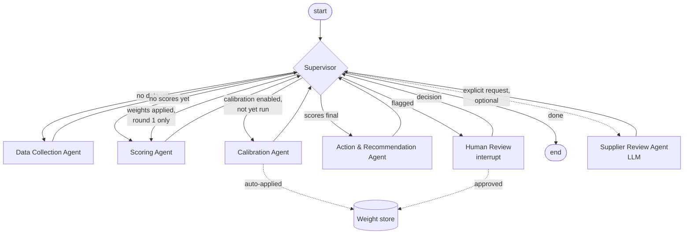

# Architecture

## Design principles

1. **Deterministic numbers, explainable results.** Every score is computed by pure Python functions
   (`tools/scoring.py`). Given the same data, model and weights, the result is identical. Every
   agent that produces numbers, including the supervisor, is deterministic Python. **The only LLM
   call is the optional Supplier Review Agent** (see below): on explicit request it interprets
   results that are already final, and it cannot change a score, class or weight.
2. **Configuration over code.** Criteria, default weights, class thresholds, escalation rules, actions
   and calibration settings live in one YAML file (`RiskModelConfig`). Swapping the model does not
   touch the agents.
3. **Weights are a first-class object.** The scoring engine consumes a `WeightSet` (effective factor
   weights summing to 1). Configured defaults, material-group defaults and calibrated weights are
   interchangeable.
4. **Agents with a single responsibility, coordinated by a supervisor.** The graph is a hub-and-spoke
   LangGraph `StateGraph`; each worker returns a partial state update and hands control back.
5. **Governance built in.** Append-only audit trail, data-completeness checks, escalation rules that
   cannot be averaged away, human review with `interrupt()`, and versioned weight files.

## Graph



The routing rules live in one method, `Supervisor.route()`:

| Condition (checked in order) | Next step |
|---|---|
| `suppliers` not in state | `collect_data` |
| no suppliers loaded | `end` |
| `results` not in state | `score` |
| calibration enabled and not yet performed | `calibrate` |
| calibration applied (auto or approved) and `scoring_round < 2` | `score` (feedback loop) |
| recommendations not yet created (or invalidated by a review decision) | `recommend` |
| `ai_review_request` set (explicit follow-up request) | `ai_review` |
| `requires_human_review` and no `review_status` yet | `human_review` |
| otherwise | `end` |

The loops are bounded by construction: calibration runs at most once, re-scoring happens at most
once, and human review happens at most once per run.

## Human-in-the-loop

`human_review` calls LangGraph's `interrupt()` with a review request:

- flagged suppliers and their reasons
- proposed weights with old/new values and MSE
- the allowed classes

The graph is compiled with a checkpointer. The paused run is stored under its `run_id` (the
LangGraph thread id) and continues with `SupplierRiskEvaluator.resume(run_id, ReviewDecision(...))`:

| Decision | Effect |
|---|---|
| `approve_weights=True` | proposed weights become active and are stored (with reviewer); the portfolio is re-scored and recommendations rebuilt |
| `overrides={id: {risk_class, comment}}` | manual class per supplier (`manual_override=True`), kept across re-scoring; recommendations rebuilt |
| `defer=True` | the run closes without decisions, and flagged items stay open |

Invalid decisions (unknown supplier or class, approval without pending weights) are reported in
`errors` and ignored. The checkpointer only restores allow-listed types (`state_serializer()`).
Use the same serializer for a persistent checkpointer, e.g. to resume a run in another process.

## Deterministic evaluation vs. LLM interpretation

| | Deterministic evaluation | LLM interpretation (optional) |
|---|---|---|
| What | ratings, weights, scores, classes, escalation rules, completeness, rule-based actions, calibration | management summary, main drivers, differences between the views, action proposals, open questions |
| Where | Data Collection, Scoring, Calibration, Recommendation agents | Supplier Review Agent (`agents/ai_review.py`) |
| Reproducible | yes, same input gives the same result | no, the wording can differ between calls |
| Runs | on every run | only on explicit request (button or `--ai-review`), never in a loop |
| Needs | nothing external | `pip install -e ".[llm]"` and `ANTHROPIC_API_KEY` |

The Supplier Review Agent is a follow-up step on an existing run:

1. `ai_review_payload(supplier_id, (risk_evaluator, risk_state), (perf_evaluator, perf_state))`
   builds the data to be sent (`tools/ai_review.py`): per view the criteria with rating, weight and
   rating basis, dimension scores, score, class, fired escalation rules, data completeness, missing
   criteria and rule-based actions. Not sent: supplier name, country, spend, the raw indicator
   record and expert labels. The UI and the CLI show this JSON before anything is sent.
2. `SupplierRiskEvaluator.ai_review(run_id, payload)` continues the run's thread with an
   `ai_review_request`. The node checks that the payload still matches the run's results, sends
   exactly that payload, and validates the answer against `AIReviewDraft` (text fields only; no
   numbers). It then checks the content: every referenced criterion must exist in the input, both
   views must be compared, and missing data must lead to open questions. A failing answer is
   rejected as a whole.
3. The result (`AIReviewResult`) carries the deterministic scores copied from the payload, the
   data gaps determined by the tool, the provider and model, and a hash of the input. Errors
   (no key, timeout, rate limit, invalid answer) are stored in `ai_review_errors`; the run itself
   stays intact, and a pending human review stays pending.

The provider is configured through environment variables (`.env.example`): provider, model, API
key, timeout, retries and maximum output length. Retries on timeouts, rate limits and server
errors are handled by the SDK and bounded by `SRA_LLM_MAX_RETRIES`. For Claude models that support
it, the request enables the server-side refusal fallback.

## Agents

| Agent | Module | Responsibility |
|---|---|---|
| Supervisor | `agents/supervisor.py` | Rule-based routing; single extension point for an LLM supervisor. |
| Data Collection | `agents/data_collection.py` | Loads suppliers in scope (optionally one material group) and expert labels from a `SupplierDataSource`, then fills missing indicators from external data providers (`providers/`, see [data-providers.md](data-providers.md)). |
| Scoring | `agents/scoring.py` | Resolves the weight set per supplier, computes factor ratings, dimension scores, overall score, class, escalations, completeness checks. |
| Calibration | `agents/calibration.py` | Fits weights to expert labels (min. MSE, constraints), logs old vs. new weights and MSE, applies (and stores) or proposes them. |
| Action & Recommendation | `agents/recommendation.py` | Maps class, elevated dimensions and escalations to actions and a review cycle. |
| Human Review | `agents/human_review.py` | Pauses the run with `interrupt()`; applies the reviewer's decision (approve weights, class overrides, defer). |
| Supplier Review (optional, LLM) | `agents/ai_review.py` | Sends one supplier's structured results from both views to a language model and validates the structured answer: summary, drivers, view differences, action proposals, open questions. |

## State (`models/state.py`)

One `SupplierRiskState` (TypedDict) per run over a portfolio:

| Group | Fields |
|---|---|
| Input | `run_id`, `supplier_ids`, `material_group`, `calibrate` |
| Data | `suppliers`, `expert_labels` |
| Weights | `active_weights` (per scope: `global` or a material group), `calibrated_weights` |
| Scoring | `results` (supplier id → `RiskAssessment`), `scoring_round` |
| Calibration | `calibration_performed`, `calibration_applied`, `mse_before`, `mse_after`, `calibration_report` |
| Recommendation | `recommendations_done` (actions are stored on each `RiskAssessment`) |
| Optional LLM review | `ai_review_request` (one-shot), `ai_reviews` (supplier id → `AIReviewResult`), `ai_review_errors` |
| Governance | `next_step`, `requires_human_review`, `review_status`, `review_decision`, `manual_overrides`, `review_reasons`*, `errors`*, `audit_trail`* |

\* append-only (`Annotated[list, operator.add]`): LangGraph concatenates updates from all nodes.

### Why portfolio scope?

Calibration needs many expert-labelled suppliers at once, and class distributions are only
meaningful across a portfolio. A single supplier is assessed by running the same graph with
`supplier_ids=[id]`.

## Weight resolution

For each supplier the Scoring Agent picks the most specific weight set:

Active weights come from the weight store (latest version per scope) when one is configured,
and are updated by calibration within a run.

1. active (e.g. calibrated) weights for the supplier's material group
2. configured defaults for that material group (`material_group_weights`)
3. active global weights (e.g. globally calibrated)
4. configured global defaults

## Module map

```
src/supplier_risk_agent/
├── agents/          # one class per agent, each a LangGraph node (callable)
├── graph/           # StateGraph construction + SupplierRiskEvaluator facade
├── models/          # config (RiskModelConfig, WeightSet), domain objects, state
├── tools/           # indicators -> ratings, scoring, calibration, data sources, weight store,
│                    # AI review payload and output validation (ai_review.py)
├── config/          # criteria.yaml (shared catalogue) + one YAML per view (risk, performance)
├── llm.py           # optional LLM provider: settings from the environment, Anthropic adapter, errors
└── cli.py           # `supplier-risk` command
```

## Extension points

| You want to… | Change |
|---|---|
| use different criteria / weights / thresholds | copy a view YAML, pass `--model` |
| add a view (e.g. sustainability) | new YAML that picks criteria from `config/criteria.yaml`; register it in `VIEW_RESOURCES` to make it a bundled view |
| add a criterion | add it to `config/criteria.yaml` (or under `criteria:` in a view) with a rating source |
| add a data feed (credit API, ESG platform, news) | new `@register_source` function in `tools/indicators.py` and/or a new `SupplierDataSource` |
| add an agent (e.g. external risk monitoring) | new node in `graph/builder.py` + one rule in `Supervisor.route()` |
| use an LLM supervisor | replace `Supervisor.route()` |
| resume runs across processes | pass a persistent checkpointer with `serde=state_serializer()` |
