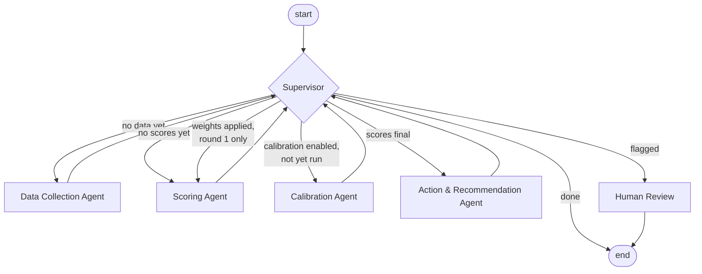

# Architecture

## Design principles

1. **Deterministic numbers, explainable results.** Every score is computed by pure Python functions
   (`tools/scoring.py`). Given the same data, model and weights, the result is identical. LLMs are
   *planned* for data extraction and narrative explanations, but they never compute or change a score.
2. **Configuration over code.** Criteria, default weights, class thresholds, escalation rules, actions
   and calibration settings live in one YAML file (`RiskModelConfig`). Swapping the model does not
   touch the agents.
3. **Weights are a first-class object.** The scoring engine consumes a `WeightSet` (effective factor
   weights summing to 1). Configured defaults, material-group defaults and calibrated weights are
   interchangeable.
4. **Agents with a single responsibility, coordinated by a supervisor.** The graph is a hub-and-spoke
   LangGraph `StateGraph`; each worker returns a partial state update and hands control back.
5. **Governance built in.** Append-only audit trail, data-completeness checks, escalation rules that
   cannot be averaged away, and a human-review exit.

## Graph



The routing rules live in one method, `Supervisor.route()`:

| Condition (checked in order) | Next step |
|---|---|
| `suppliers` not in state | `collect_data` |
| no suppliers loaded | `end` |
| `results` not in state | `score` |
| calibration enabled and not yet performed | `calibrate` |
| calibration applied and `scoring_round < 2` | `score` (feedback loop) |
| recommendations not yet created | `recommend` |
| `requires_human_review` and not yet reviewed | `human_review` |
| otherwise | `end` |

The calibration feedback loop is bounded by construction: calibration runs at most once per run and
triggers at most one re-score.

## Agents

| Agent | Module | Responsibility |
|---|---|---|
| Supervisor | `agents/supervisor.py` | Rule-based routing; single extension point for an LLM supervisor. |
| Data Collection | `agents/data_collection.py` | Loads suppliers in scope (optionally one material group) and expert labels from a `SupplierDataSource`. |
| Scoring | `agents/scoring.py` | Resolves the weight set per supplier, computes factor ratings, dimension scores, overall score, class, escalations, completeness checks. |
| Calibration | `agents/calibration.py` | Fits weights to expert labels (min. MSE, constraints), logs old vs. new weights and MSE, applies or proposes them. |
| Action & Recommendation | `agents/recommendation.py` | Maps class, elevated dimensions and escalations to actions and a review cycle. |
| Human Review | `agents/supervisor.py` (`human_review_node`) | Placeholder; marks the run as pending review. Planned: LangGraph `interrupt()`. |

## State (`models/state.py`)

One `SupplierRiskState` (TypedDict) per run over a portfolio:

| Group | Fields |
|---|---|
| Input | `supplier_ids`, `material_group`, `calibrate` |
| Data | `suppliers`, `expert_labels` |
| Weights | `active_weights` (per scope: `global` or a material group), `calibrated_weights` |
| Scoring | `results` (supplier id → `RiskAssessment`), `scoring_round` |
| Calibration | `calibration_performed`, `calibration_applied`, `mse_before`, `mse_after`, `calibration_report` |
| Recommendation | `recommendations_done` (actions are stored on each `RiskAssessment`) |
| Governance | `next_step`, `requires_human_review`, `review_status`, `review_reasons`*, `errors`*, `audit_trail`* |

\* append-only (`Annotated[list, operator.add]`): LangGraph concatenates updates from all nodes.

### Why portfolio scope?

Calibration needs many expert-labelled suppliers at once, and class distributions are only
meaningful across a portfolio. A single supplier is assessed by running the same graph with
`supplier_ids=[id]`.

## Weight resolution

For each supplier the Scoring Agent picks the most specific weight set:

1. active (e.g. calibrated) weights for the supplier's material group
2. configured defaults for that material group (`material_group_weights`)
3. active global weights (e.g. globally calibrated)
4. configured global defaults

## Module map

```
src/supplier_risk_agent/
├── agents/          # one class per agent, each a LangGraph node (callable)
├── graph/           # StateGraph construction + SupplierRiskEvaluator facade
├── models/          # config (RiskModelConfig, WeightSet), domain objects, state
├── tools/           # pure functions: indicators -> ratings, scoring, calibration, data sources
├── config/          # bundled example risk model (YAML)
└── cli.py           # `supplier-risk` command
```

## Extension points

| You want to… | Change |
|---|---|
| use different criteria / weights / thresholds | copy the YAML, pass `--model` |
| add a data feed (credit API, ESG platform, news) | new `@register_source` function in `tools/indicators.py` and/or a new `SupplierDataSource` |
| add an agent (e.g. external risk monitoring) | new node in `graph/builder.py` + one rule in `Supervisor.route()` |
| use an LLM supervisor | replace `Supervisor.route()` |
| real human-in-the-loop | replace `human_review_node` with LangGraph `interrupt()` + checkpointer |
