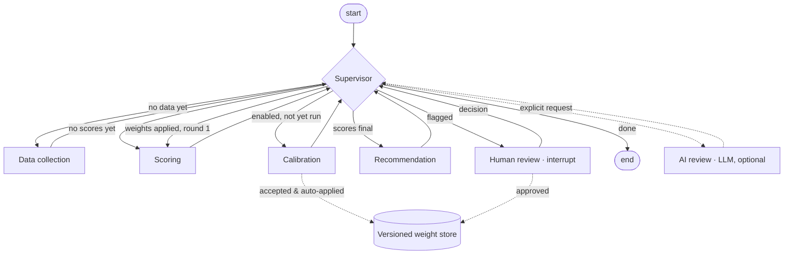
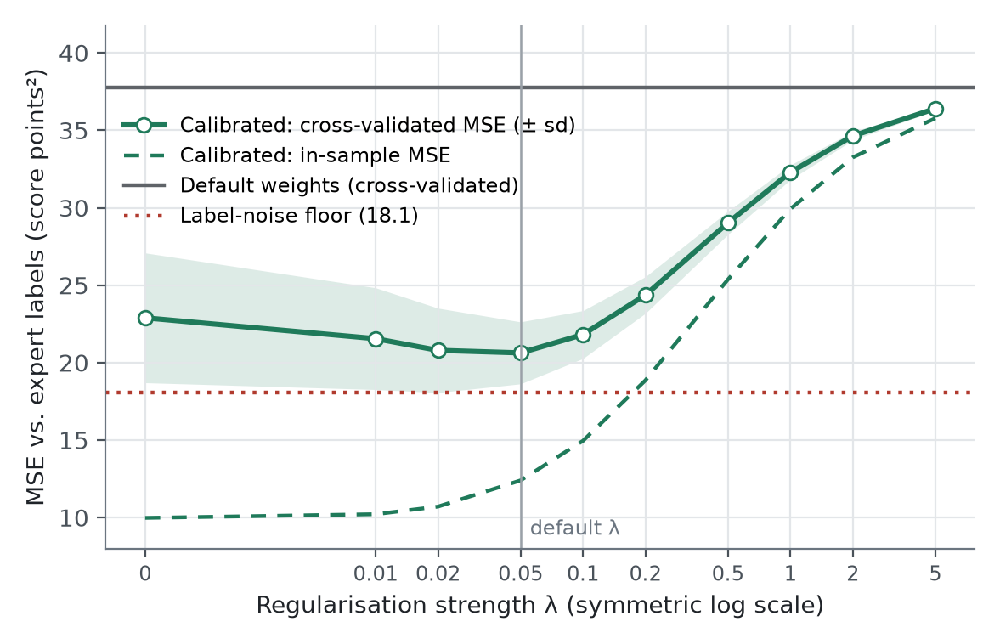
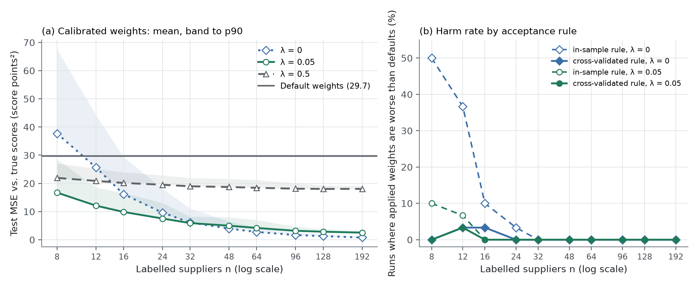
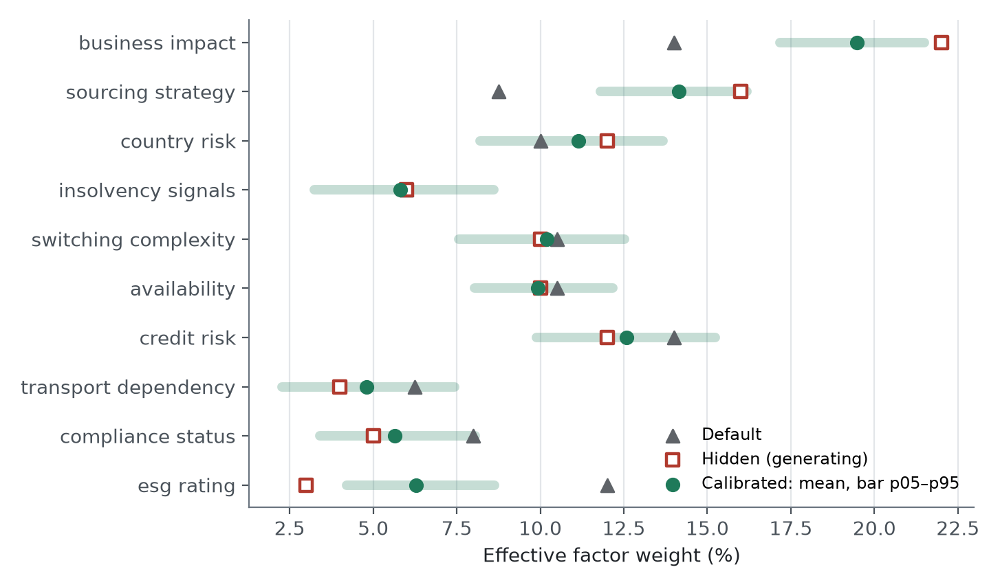
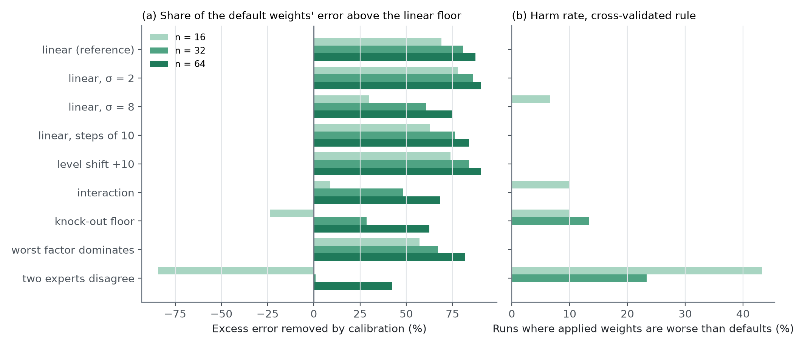

# Lean Agentic AI for Supplier Risk Management and Performance Evaluation

### Turning spreadsheet scorecards into transparent, expert-calibrated multi-agent systems: a benchmark of four approaches and an open-source demonstrator

*Csaba Bakay · Working paper, draft v0.7 · October 2026*

> **Draft status.** All sections (1–12) exist as a first, continuous draft. Remaining gaps are
> marked in the text and summarised in [paper-outline.md](paper-outline.md). Markers in the text:
> - **[TBD-RESULT]** — to be completed or confirmed with results from the local calibration runs
> - **[TBD-LIT]** — literature still to be cited (all such markers resolved in draft v0.2;
>   references verified via Crossref or OpenAlex, read at abstract level)
> - **[TBD-INPUT]** — needs a decision or input from the author
>
> Numbers quoted from the demonstrator come from runs of commit `6bb05b9` on synthetic data. They
> were re-checked on commit `c9a500f`, which adds the two views, the supply chain sub-score, change
> complexity from the time to exit, the action framework, data providers and the history: the
> reference run (Section 7.2) reproduces exactly, and the synthetic suppliers of E1–E5 receive
> identical factor ratings, so Sections 7.2–7.8 and Figures 4–7 are unaffected.
>
>
> Draft v0.5 updates the benchmark to factor model v0.4 (Section 3.1) and puts the integration of
> supplier risk management and performance evaluation at the centre of the positioning.
> Draft v0.6 reconciles the text with the code and result files, states explicitly that no
> language model was used at that point, marks the benchmark as the author's
> qualitative assessment and the experiments as synthetic-only, and softens comparative claims
> about third-party products. No rating value and no experimental number was changed.
> Draft v0.7 describes the one component that now uses a language model: an optional,
> explicitly triggered Supplier Review Agent that interprets final results (Section 6.9). Scoring,
> calibration, recommendations and routing remain deterministic and LLM-free. The review agent is
> experimental and unevaluated (Section 10). The text also states that both bundled templates now
> propose accepted weights for approval by default. No rating value and no experimental number
> was changed.

---

## Abstract

Procurement organisations evaluate their suppliers twice. *Supplier risk management* asks how
exposed the company is if a supplier fails; *supplier performance evaluation* asks how well the
supplier delivers. In practice the two are often split: a commercial risk platform is licensed for
risk, while performance evaluation stays in spreadsheets, so that one supplier is judged on two
inconsistent bases. The available options each fall short:
- a spreadsheet scorecard is transparent but cannot learn or scale, and does not keep an audit
  trail
- a commercial supply-chain risk platform brings data coverage and workflows, but at a cost, with
  limited control over how scores are formed, and without performance evaluation

Open-source agent projects show how such systems could be built, but mostly as demonstrators
whose focus is the agent architecture rather than the scoring method. A further problem cuts across all of them: the weights that
turn criteria into a score are typically set once and never checked against the judgement of the
people who know the suppliers.

This paper makes three contributions.
1. It proposes fifteen success factors, including the integration of risk management and
   performance evaluation. They were derived and then corrected in three documented reviews: the
   first removed means-as-ends and added two factors on which commercial platforms are strong; the
   second added the integration factor and sharpened agentic orchestration; the third folded
   material-group adaptation into customisability to remove a subset overlap.
2. It profiles four approaches on these factors without aggregating them. The profiles are the
   author's qualitative expert assessment from public information and code review (October
   2026), not a measurement:
   - spreadsheet practice
   - two commercial platforms, Prewave and Sphera
   - five open-source repositories
   - the approach proposed here
3. It presents *Lean Agentic AI* and an open-source demonstrator. Its main difference from pure
   risk platforms, as far as their public documentation shows, is the integration of both views:
   risk management and performance evaluation on one criteria catalogue, each with its own
   weights, classes and actions. The demonstrator is an agentic workflow in a narrow sense: an
   orchestrated multi-agent workflow of deterministic agents (Python nodes in a LangGraph state
   graph) over a shared state, including a calibration agent, routed by a rule-based supervisor and
   paused for human review inside the graph. Scoring, calibration, recommendations and routing
   use no language model. One optional component, triggered only on explicit request, uses a
   language model to interpret a supplier's final results and cannot change scores, classes or
   weights; it is experimental and unevaluated. "Agentic" denotes orchestration, not autonomy. The approach starts from existing scorecard practice. Its scoring is deterministic and
   configurable, with material-group-specific weights. Weights are calibrated against category
   managers' expert labels by constrained least squares. A human-in-the-loop step pauses the
   workflow for approval, and approved weights are versioned. The same criteria serve two views,
   supplier performance evaluation and supplier risk management, and results map to concrete
   actions per factor.

All experimental results are on synthetic data only: portfolios whose "expert" labels were
generated from a hidden weighting plus noise or, in the robustness experiments, from constructed
expert policies. No real expert labels were used and no field validation was performed. On these
synthetic portfolios:
- **Cross-validated error.** Calibration reduced the cross-validated mean squared error between
  model score and expert label from 37.8 to 20.6 score points², close to the irreducible label
  noise of 18.1.
- **Recovery of the hidden weighting.** It moved the weights roughly half-way towards the hidden
  weighting.
- **Effect of regularisation.** Regularisation was essential: without it, calibration on eight
  labels was worse than the default weights in half of the runs.
- **Robustness.** When the simulated experts judge non-additively, apply knock-outs, are
  uniformly stricter or disagree, calibration degrades in characteristic ways. These are the
  limits of what weights can express. Each points to a design response other than calibration.
- **A weakness found and fixed.** The validation exposed that the demonstrator's original
  acceptance rule, based on in-sample error, let through harmful calibrations. It is now replaced
  by a cross-validated rule that also requires the improvement to be clear relative to its own
  uncertainty. Across all simulated scenarios, harmful acceptances fell from up to 50 % of runs to
  at most 4 %. The price is that calibration is withheld when labels are few or inconsistent.

The paper states what this does not establish:
- the labels are synthetic, and even the robustness experiments use constructed expert policies;
  there are no real expert labels and no field validation
- the benchmark ratings are the author's own judgement, including of the author's own demonstrator, and
  have not been independently re-rated
- predictive validity against real disruptions is untested
- the demonstrator provides partial external signal coverage, without live monitoring, at about
  half the level of the strongest platform

No ranking of approaches is derived at any point.

---

## 1 Introduction

Supplier risk evaluation has moved from an annual formality to a recurring management task.
Disruptions in logistics, energy and geopolitics have made supply concentration visible. Supply-chain
risk management research has long described identifying, assessing, treating and monitoring risk as
one connected process (Tang, 2006; Ho et al., 2015; Fan & Stevenson, 2018). This paper is concerned
with the *assessment* stage. Due-diligence regulation expects documented risk analysis along the
supply chain. Procurement teams
are asked to show not only *which* suppliers are risky, but *why*, and what was done about it.

A common organisational response is to extend the supplier scorecard. The criteria sheet gains
columns for financial stability, supply-chain exposure and ESG. A weighted average turns the
columns into a score, and the score into a traffic light. Where budgets allow, a commercial
platform is licensed to supply alerts and external data.

Both responses leave a gap. The spreadsheet keeps the method in the procurement team's hands but
does not keep a record: weights drift between versions, and no one can say afterwards why a
supplier was rated as it was. The platform brings data coverage and workflows, but the method by
which its score is formed is, depending on the vendor, partly or largely outside the customer's
view and control. Open-source agent projects, the third option a technically minded team might
consider, offer modern architecture patterns but rarely a scoring method that could stand up in an
audit.

A second gap is rarely discussed. Risk platforms address *supplier risk management*. *Supplier
performance evaluation* (delivery reliability, quality, price, responsiveness, graded A, B or C) is
a separate, established process. A common pattern in practice is that a company licenses a risk
platform and still runs its supplier evaluation in spreadsheets. The same supplier is then judged
in two systems, with different criteria, scales and update cycles, and nobody sees both pictures
side by side. A supplier can deliver excellently and still be a critical dependency, and that is
exactly the case the split hides.

One problem cuts across all three options and is rarely named: **the weights are not validated.**
A scorecard may weight business impact at fourteen per cent and ESG at twelve. Those numbers
usually come from a workshop, a template or a vendor default. They are seldom checked against the
holistic judgement of the category managers who know the suppliers best, and seldom revised when
the two disagree.

This paper takes a deliberately lean route. It does not propose a new risk taxonomy or a new data
source. Instead it starts from the scorecard practice that already exists, for risk and for
performance, and asks what it would take to evaluate both on one consistent basis and to make that
practice:
- **transparent**, with method and weights documented and inspectable
- **reproducible**, with every number recomputable from its inputs
- **governed**, with human approval at the points where judgement is required
- **able to learn**, by systematically aligning weights with expert judgement

It also asks whether this can be done at the cost profile of open-source software rather than an
enterprise licence.

The argument proceeds in two steps.
- **A benchmark.** Fifteen success factors are proposed, and four approaches are profiled on them
  (Figure 1). The profile is read factor by factor, without weighting, total or ranking. It is a
  qualitative expert assessment by the author, not a measurement.
- **A demonstrator.** The proposed approach is implemented as an open-source multi-agent workflow.
  Each claimed property can then be inspected in code, tests and documentation rather than
  asserted.

A note on terminology. "Agentic" is used here for an *orchestrated multi-agent workflow*:
specialised agents (data collection, scoring, calibration, recommendation, human review) are
deterministic Python functions that act as nodes of a LangGraph state graph, a rule-based
supervisor routes between them, and the workflow pauses for human approval. Scoring,
calibration, recommendations and routing use no language model. The only exception is an
optional *Supplier Review Agent*: on explicit request, it asks a language model to interpret one
supplier's final results, and it cannot change scores, classes or weights (Section 6.9). Other
language-model roles (document extraction, an LLM-based supervisor) are planned extensions only
(Sections 8.5 and 11). The term does not imply autonomous, LLM-driven decision making.

The demonstrator runs on synthetic data, and so do all experiments: no real expert labels and no
field data were used. This is a deliberate constraint, and it has a cost, discussed in Section 10. It also has a benefit: because the expert labels in the
calibration experiment were generated from a known hidden weighting, it can be checked whether
calibration recovers that weighting, which no field dataset would allow.


*Figure 1. Four approaches to supplier risk management and performance evaluation profiled on
fifteen success factors (model v0.4); half points mark a profile between two levels. Illustrative, qualitative assessment by the author based on public information and code review (October 2026); expert judgement, not an empirical measurement. The author also built one of the rated approaches (Section 4.4).
Proprietary SaaS is plotted as the mean of Prewave and Sphera; shaded bars mark where the two
differ. Rationale and confidence for every value: Table 2 and `research/comparison-matrix.md`. No
weighting is applied, and no total or ranking is derived.*

**Contributions.**
1. **Fifteen success factors** for supplier risk management and performance evaluation, including
   their integration, each with a definition and the evidence by which it can be assessed. They are
   presented as a working model, together with the documented reviews that produced the current
   version (Section 3).
2. **A profile benchmark** of four approaches on these factors. Every value comes from a single
   machine-readable source with a rationale and a confidence mark. The two commercial examples are
   rated separately and their spread is shown (Section 4).
3. **The Lean Agentic approach**: a synthesis of scorecard practice, platform expectations and open
   agentic architecture. Its positioning rests on two features: the integration of risk management
   and performance evaluation, and calibration against expert labels inside an agentic workflow
   (Section 5).
4. **An open-source demonstrator.** It is a LangGraph workflow of deterministic agents, with:
   - deterministic, configurable scoring
   - material-group weights
   - constrained least-squares calibration
   - a graph-interrupt human-review step
   - a versioned weight store
   - two views on one criteria catalogue: performance evaluation and risk management
   - an action framework and an assessment history
   - an optional, experimental review agent that uses a language model to interpret final
     results, without changing any number
   - an automated test suite (Section 6)
5. **An explicit statement of what is not established**, and of the work that would close each gap
   (Sections 10–11).

---

## 2 Background and related work

### 2.1 Supplier risk assessment in practice

Weighted multi-criteria aggregation is the dominant instrument for evaluating suppliers. Reviews of
the supplier-selection literature catalogue a wide range of methods: the analytic hierarchy
process, outranking, data envelopment analysis, mathematical programming, fuzzy and hybrid
approaches (Ho, Xu & Dey, 2010; Chai, Liu & Ngai, 2013). Most of them share one structure: criteria,
weights and an aggregation rule. Case studies of purchasing organisations show formal and informal
supply-risk assessment processes in use, frequently in scoring form (Zsidisin et al., 2004). A
typical supplier-risk scorecard has these parts:
- **dimensions.** A *severity* component asks how replaceable a supplier is and how badly a failure
  would hurt. *Likelihood* components cover financial stability, supply-chain exposure (country,
  sourcing strategy, transport) and ESG or compliance.
- **ratings** on an ordinal scale, often 1–5
- **weights** per criterion
- **an aggregation** into a single score and a class

The method is not in question here. What is in question is how it is run:
- definitions and scales are informal
- weights are set once
- results are not reproducible after the file has changed
- consequences are written as free text, if at all

### 2.2 Commercial supply-chain risk platforms

Commercial platforms address the data side of the problem. Two are used as named examples, assessed
**on public information only** (vendor websites, help-centre articles, press releases and
vendor-commissioned studies, as of October 2026). Nothing here is a product test.
→ `research/saas-references.md`.

**Prewave** combines continuous media and trade-data monitoring with supplier assessments and
due-diligence modules for several European regulations.
- **Signals.** It claims millions of processed signals per day in several hundred languages, and
  Tier-N mapping from trade data.
- **Scoring.** Unusually for the category, Prewave publishes the composition of its supplier
  score: a peer component (country, industry, commodity) at 30 %, alerts at 40 %, assessments at
  20 % and external data at 10 %. It describes the aggregation as non-linear and weighted.
- **Configuration.** Event types and their weights can be adjusted in customer-specific
  "perspectives", partly through the vendor's customer-success function.
- **Not disclosed:** how sources are weighted and how media signals are classified.

**Sphera Supply Chain Risk Management** (formerly riskmethods) offers:
- portfolio risk views, multi-tier mapping and early warnings
- response playbooks, incident management and supplier engagement campaigns
- a documented bundle for the German supply-chain due-diligence act (2023)

Its scores are described as "AI-scoring" tied to business impact, using indicator scorecards. No
public description of the scoring method or of customer-adjustable weights was found.

Both use AI: Prewave for signal processing and with connectors for external AI agents; Sphera with
fine-tuned generative models for supplier risk summaries and marketed "agentic AI" capabilities.

Three observations matter for this paper.
1. **"Platform" is not one methodological profile.** On methodological transparency the two
   examples differ by a full scale point. This is why they are rated separately in Section 4 rather
   than as a stereotype.
2. **Neither vendor documents calibration against the customer's own expert judgement** in public
   sources. Weight adjustment exists (Prewave), but as configuration, not as a fitted and reported
   procedure.
3. **Both are risk platforms.** Neither documents a supplier performance evaluation with its own
   criteria and grades. Neither documents a customer-inspectable multi-agent workflow in public
   sources: specialised agents over a shared state, a calibration agent, a review pause in the
   workflow graph. This describes public documentation as of October 2026, not the products
   themselves; capabilities that are not documented publicly may still exist.

Other vendors were checked only briefly and are not part of the benchmark:
- **Resilinc:** fixed score components against universal standards.
- **EcoVadis:** published criteria with qualitatively described weighting.
- **Everstream, Interos:** no public scoring method found.

### 2.3 Open-source agentic supply-chain projects

Five public repositories were reviewed at source-code level (→ `research/github-references.md`,
`research/comparison.md`). They converge on one architectural pattern: specialised agents sharing a
typed state, coordinated either as a directed graph or by a supervisor. They diverge sharply on
scoring.
- **No scoring.** One repository returns fixed, simulated outputs and contains no scoring at all.
- **Deterministic, hard-coded weights.** Two compute deterministic weighted scores. One of them
  deliberately overwrites any numbers produced by the language model with values computed in code.
- **LLM-judged.** Two leave the risk judgement to a language model. In one of them, a published
  example contains arithmetic errors in the weighted totals, which illustrates the risk of letting
  a language model generate numbers.
- **Licensing and tests.** Two repositories carry no licence, one is under a copyleft licence, and
  none ships an automated test suite.

The repositories are therefore most useful here as **architectural blueprints**; their focus
differs from the scoring-method focus of this paper, and as demonstrators they were not built to
meet it. The approach in this paper reuses ideas from them, but no code.

### 2.4 Calibrating weights against expert judgement

Two distinct practices both go by the name of "setting weights":
- **eliciting** weights directly, by asking experts how important each criterion is
- **inferring** them from holistic judgements, by asking experts how risky each supplier is overall
  and finding weights that reproduce those answers

**Direct elicitation is method-dependent.** Experimental comparisons show that different weighting
procedures (swing, SMART, trade-off, pairwise comparison and others) produce systematically different
weights for the same problem (Borcherding, Eppel & von Winterfeldt, 1991; Pöyhönen & Hämäläinen,
2001). Weight judgements are also subject to behavioural effects such as range insensitivity and
splitting biases (Weber & Borcherding, 1993). For practice, this means that weights agreed in a
workshop are one plausible answer among several. They are not a measurement, and they should be
checked.

**Inferring weights from holistic judgements has two research traditions.**
- **Judgement analysis and policy capturing**, rooted in Brunswik's lens model (Hammond, 1955).
  These studies regress holistic judgements on the cues presented, to recover the weights a judge
  implicitly uses (Aiman-Smith, Scullen & Barr, 2002; Karren & Barringer, 2002). Meta-analytic
  evidence indicates that linear models reproduce such judgements well (Karelaia & Hogarth, 2008). A
  linear model of a judge can even outperform the judge, because it applies the judge's policy
  consistently (Goldberg, 1970). This tradition also contains an important caution. Even "improper"
  weights, for example equal weights, often perform about as well as optimally fitted ones (Dawes,
  1979). Gains from fitting weights should therefore be expected to be modest, and fitted weights
  should not stray far from sensible priors without good reason.
- **Preference disaggregation**, or "inverse" MCDA, infers an additive value model from a decision
  maker's holistic evaluations. The UTA family does this by linear programming on rankings
  (Jacquet-Lagrèze & Siskos, 1982, 2001).

The calibration in this paper belongs to the same family. It differs in three respects:
- it fits *cardinal* risk scores by least squares instead of rankings by linear programming
- it constrains the weights to a simplex with a lower bound
- it shrinks them towards a prior

The inferential route has a practical advantage in procurement. Category managers often find it
easier to judge a supplier than to state the relative importance of abstract criteria. It also has a
known risk: with few judgements and many weights, the fit adapts to noise. Ridge regularisation
trades a small bias for a large reduction in variance (Hoerl & Kennard, 1970). Shrinking towards a
prior weight vector instead of towards zero is a direct generalisation (Hastie, Tibshirani &
Friedman, 2009, ch. 3). The approach in Section 5 combines the two practices: directly elicited
weights serve as the prior, and holistic labels adjust them under constraints.

### 2.5 Language models and determinism

Agentic systems invite the use of language models throughout. For risk scores this is the wrong
default.
- A score that changes when the same input is presented twice cannot be audited. Language-model
  outputs can vary across identical requests, even at temperature zero. This has been shown
  empirically for code generation (Ouyang et al., 2025), and nothing suggests that risk judgements
  are immune.
- A score that cannot be recomputed by hand cannot be challenged.

The reviewed repositories show both patterns:
- language-model-judged tiers without stable criteria
- language-model arithmetic that does not add up

The more mature designs among them compute numbers in code and reserve the language model for
language. This paper adopts that division strictly: the one component that calls a language
model (Section 6.9) only interprets numbers that code has already computed.

---

## 3 Success factors

An approach to supplier risk evaluation is easier to assess when the properties that matter are
named before any approach is rated. This section proposes fifteen such properties, called *success
factors*. Each is defined, and for each the observable evidence is named that would allow someone
else to check a rating (→ `research/success-factors.md`).

The factors form a **flat list**. They are not arranged in a hierarchy, not weighted and not
combined into a total. An approach is read as a **profile** across all fifteen. A profile that is
strong on twelve factors and absent on one is a different proposition from one that is uniformly
adequate. A single figure would treat the two alike.

**Table 1. Success factors for supplier risk management and performance evaluation (model v0.4).**

| # | Factor | What it means | Assessable by |
|---|---|---|---|
| 1 | Structured criteria & weights (objective + subjective) | Explicit criteria, scales and weights combining measurable indicators and structured expert assessment | Criteria with definition and scale; explicit weights; both input types with provenance |
| 2 | Traceability & reproducibility | Every result can be reconstructed afterwards and recomputed from documented inputs | Per-result record; change history; recomputation possible; tests |
| 3 | Methodological transparency | The method is documented and checkable *before* use | Published formula, weights, sources, rules |
| 4 | Expert calibration / ability to learn | Parameters are systematically fitted to expert judgement, with approval | Procedure; fit metric; logged old/new parameters; approval |
| 5 | Action framework | Results map to defined actions, review cycles and owners | Actions per class and driver; tracking to closure |
| 6 | Human-in-the-loop & governance | Defined review and approval points, recorded decisions, roles | Approval steps; recorded overrides; roles |
| 7 | External signals & data coverage | Current external data and breadth of supplier coverage | Sources, update frequency, languages, Tier-N |
| 8 | Regulatory evidence | Support for due-diligence documentation duties | Regulation-specific workflows and reports |
| 9 | Cost / TCO | Total cost of use, including recurring internal effort, and access barriers | Licence model, prices, implementation effort, manual effort per cycle |
| 10 | Time-to-value | Time and effort to the first usable result | Time to first portfolio assessment |
| 11 | Customisability & data sovereignty | The organisation can change method and implementation, including material-group configuration, and controls its data | Configurable without vendor; per-group criteria, weights or thresholds; licence; data location |
| 12 | Scalability | Works as suppliers, users, groups and update frequency grow | Suppliers handled; marginal effort; automation |
| 13 | Agentic orchestration & extensibility | Work is orchestrated as an explicit workflow of specialised agents; new capabilities can be added without rebuilding the core | Specialised agents over a shared, inspectable state; review pauses in the workflow; extension points; APIs |
| 14 | Operational maturity & support | Production readiness | Support, SLAs, security, release process |
| 15 | Integration of risk management and performance evaluation | Supplier risk and supplier performance are evaluated on one consistent basis, each with its own logic | Shared criteria and data; separate weights, classes and actions per view; both results per supplier |

### 3.1 How the factor model was derived, and corrected

The fifteen factors are the fourth version of a working model. The first version (v0.1) was drawn
up from the requirements of the proposed approach. A critical review identified four problems.
Each was corrected, and the corrections are documented because they bear on how far the benchmark
can be trusted.

1. **Means presented as ends.** Two v0.1 factors named a *means*: "open source" and "multi-agent
   orchestration". Rating approaches on the means one has chosen makes the comparison circular.
   Both were reframed as outcomes: *customisability & data sovereignty* and *extensibility &
   automation potential*.
2. **Home-field bias.** v0.1 contained no factor on which commercial platforms are clearly
   stronger, apart from external signals. Two were added: *regulatory evidence* and *operational
   maturity & support*. Without them, the profile would flatter the proposed approach.
3. **Overlaps.** Two pairs measured the same strength twice and were merged:
   - *structured criteria* with *objective + subjective inputs*
   - *audit trail* with *determinism*

   *Methodological transparency* was kept separate from *traceability*. The first concerns
   understanding the method before use; the second concerns reconstructing a result afterwards.
4. **Validity, the factor that is missing.** No factor asks whether a score *predicts*
   disruptions. Calibration against experts measures agreement with judgement, not predictive
   validity. No approach reviewed reports predictive validity publicly, so the factor cannot be
   rated today. It is deliberately left off the radar and treated as an open question
   (Section 11).

v0.2 kept fifteen axes and contains four factors on which the commercial examples are clearly
ahead: 8, 9, 13 and 15 in v0.2 numbering (now 7, 8, 12 and 14).

**A second review (v0.3)** followed informal practitioner feedback, not a structured survey (the numbers in this paragraph refer to v0.3).
- **Added:** factor 16, *integration of risk management and performance evaluation*. The common
  split between a risk platform and spreadsheet-based evaluation was not captured by any factor.
- **Sharpened:** factor 14, now *agentic orchestration & extensibility*. "Uses AI" and "is an
  agentic workflow" were indistinguishable. The factor stays an outcome (explicit, inspectable,
  extensible orchestration), but its evidence now names agents with shared state and review
  pauses.
- **Widened:** factor 10, now the total cost of ownership, including recurring manual effort.

Factor 16 is one on which the proposed approach is strong, and factor 14 moves partly back towards
an architecture property that v0.2 had reframed. Both are disclosed as such. The four factors on
which the commercial examples are clearly ahead are unchanged.

**A third review (v0.4)** reduces the model from sixteen to **fifteen** factors. Material-group
adaptation (old 5) becomes evidence under customisability & data sovereignty (old 12, now 11):
changing criteria, weights or thresholds by commodity is a specific case of changing the method.
The separate axis double-counted this capability. Integration of risk management and performance
evaluation remains unchanged (old 16, now 15); old 1–4 retain their numbers and old 6–16 become 5–15.
All retained scores, confidence marks and per-vendor values remain unchanged. The customisability
rationales now include group configuration and its limits; the old adaptation scores are retired,
not averaged into another axis. The retained customer-control ratings are Excel 4/M, SaaS 2/M,
open repos 3/H and Lean Agentic 5/H. Source visibility in open repos supports modification but
neither supplies ready-made group adaptation nor removes licence constraints.

This removes a subset overlap while keeping distinct questions separate: structured criteria
versus permission to change them; configuration versus fitted calibration; method transparency
before use versus run traceability afterwards; action selection versus decision approval;
lifecycle cost versus time to first output versus capacity; customer control versus workflow
extension; generic audit records versus regulatory documentation; and one structured model versus
two integrated evaluation views. Governance concerns decision rights, while operational maturity
concerns reliable service, infrastructure security and support. These boundaries reduce conceptual
double-counting, not empirical correlation. Four profiles cannot establish fifteen linearly
independent dimensions: the 4 × 15 rating matrix has rank at most four, or three after centring.
The model remains a hypothesis requiring independent validation. The platform strengths keep
their scores (now factors 7, 8, 12 and 14). See `research/success-factors.md` for the overlap review.

---

## 4 Benchmark: four approaches profiled

### 4.1 Method

Four approaches are rated on the fifteen factors on a five-point scale (1 weak or absent, 3
adequate, 5 very strong). A half point marks a profile clearly between two levels. The ratings
are the author's qualitative expert judgement, formed from public information, source-code review
and practitioner experience. They are not measurements, and no rating was obtained by testing a
product. Each rating carries a short rationale and a confidence mark:
- **H**: verified from code or primary documentation
- **M**: plausible, partly documented
- **L**: assumption

All ratings live in one machine-readable file, `research/comparison-matrix.yaml`. Table 2 and
Figure 1 are generated from it by a script that also validates the file. A consistency check fails
if the published table no longer matches the source. The evidence differs by approach, and this is
disclosed rather than hidden:

| Approach | What is rated | Evidence |
|---|---|---|
| Excel / manual | A typical procurement scorecard (criteria sheet, weights, annual update) | The author's practitioner experience; assumption-based |
| Proprietary SaaS | Prewave and Sphera, **rated separately**; the profile plots their mean and shows the spread | Public information only, October 2026 |
| Open-source repos | The five reviewed repositories | Source-code review |
| Lean Agentic | The demonstrator **as implemented**, not its roadmap | Code, tests and documentation |

**Table 2 (condensed).** Strongest and weakest factors per approach (author's assessment, not a
measurement). The full matrix, with a rationale and confidence mark for every cell, is in
Appendix A.

| Approach | Strongest (4–5) | Weakest (1) | Also low (2) |
|---|---|---|---|
| Excel / manual | Method transparency; customisability | Expert calibration; external signals; agentic orchestration | Traceability; action framework; human-in-the-loop; regulatory evidence; scalability; risk & performance integration |
| Proprietary SaaS (Prewave, Sphera) | External signals & coverage; scalability; operational maturity; regulatory evidence; criteria & weights; action framework; human-in-the-loop | — | Cost; customisability & data sovereignty; expert calibration; risk & performance integration |
| Open-source repos | Cost; agentic orchestration | Expert calibration; regulatory evidence; operational maturity | Most other factors (criteria & weights, traceability, actions, human-in-the-loop, external signals, time-to-value, scalability, integration) |
| Lean Agentic (this work) | Method transparency; customisability; risk & performance integration; expert calibration; agentic orchestration; traceability & reproducibility; criteria & weights; cost; time-to-value | — | Regulatory evidence; operational maturity |

### 4.2 Reading the profiles

Figure 1 is read factor by factor. Four patterns stand out.

**Spreadsheet practice is strong where simplicity helps.** It keeps formulas visible and can be
changed by the team itself. It costs no licence but a great deal of recurring manual work, and a
governed scorecard takes weeks to build. It is weak everywhere a system property is needed: an
audit trail, learning, external data, orchestration. Risk and performance usually live in separate
files. The profile describes a stereotype. Real spreadsheet
practices vary widely, and a well-governed workbook can do better on traceability than the rating
suggests.

**The commercial platforms are strongest on data, scale and operations.** They lead on four
factors:
- external signals and coverage
- regulatory evidence
- scalability
- operational maturity

They are also well developed on workflows and review steps. They are weaker on four others:
- cost
- self-determined customisation
- recomputability by the customer, which is a design consequence of continuous monitoring rather
  than a flaw
- for one of the two, methodological transparency

The spread between them is largest exactly there. Prewave publishes its score composition; Sphera
does not. Both are risk platforms: performance evaluation is not part of their documented scope,
and their AI is not exposed as an inspectable multi-agent workflow.

**The open-source repositories are blueprints.** They are free to license but demo-grade, and
their agent architectures are their main asset. On most methodological factors they are rated
rudimentary here, which reflects a different focus (architecture demonstration) rather than a
failed attempt at a scoring method.

**The Lean Agentic demonstrator is strongest where the method itself matters:**
- methodological transparency
- traceability and reproducibility
- expert calibration
- customisability, including material-group configuration

It is also strong on the two factors that set it apart from pure risk platforms: the integration
of risk management and performance evaluation, and agentic orchestration (both 4, against 2 and
2.5 for the platforms). It is close to the platforms on actions and human review (3.5 against 4):
the action framework and the graph-based review pause exist, but tracking to closure and roles do
not. It is better than spreadsheets on cost of ownership and time-to-value, because scoring,
actions and reports run automatically from a template.

On external signals it reaches about half of the strongest platform (2.5 against 5). The provider
interface reads open data and system exports and records their origin; live APIs are still
placeholders, and there is no continuous monitoring. The architecture allows further providers, and
an external-signal agent is a natural extension. This upside is not rated.

It remains weak on two factors:
- regulatory evidence
- operational maturity

These dips are not hidden. They define what the approach is not.

### 4.3 Complementary, not ranked

The profiles do not order the approaches. In particular, Lean Agentic does not replace the data
coverage of a platform. The most realistic reading of Figure 1 is **complementary**. A platform
subscription or open data can serve as the *signal source*. A transparent, calibrated model owned
by the procurement team turns signals and internal knowledge into risk classes and actions.
Section 8.2 develops this hybrid reading.

### 4.4 Threats to validity of the benchmark

- **Author bias.** The factors and all ratings come from a single rater, the author, who also
  built one of the rated approaches and therefore rates their own work. Mitigations:
  - the v0.2 correction against home-field bias
  - rating the demonstrator as implemented rather than as planned
  - a rationale and confidence mark for every value

  These reduce the bias; they do not remove it. The v0.3 review works in the other direction. It
  added a factor on which the proposed approach is strong, and re-rated five factors after
  practitioner feedback, all of them in its favour: action framework, human-in-the-loop,
  time-to-value and external signals upwards; the cost of spreadsheets and repositories downwards.
  The re-ratings are documented with their rationale and rate the implementation, not the
  roadmap; expected upside, for example in signal processing, is named but not rated. An
  independent re-rating by three to five practitioners, reporting the spread of their ratings, is left to
  future work (Section 11).
- **Public information only for the platforms.** Hands-on evaluation could move several ratings,
  especially those on traceability, customisability (including material-group configuration),
  workflows and time-to-value.
- **Date dependency.** Products change. All platform ratings refer to public information as of
  October 2026.
- **Ordinal scale.** Ratings are ordinal judgements. Differences of one point should not be read as
  measured distances.

---

## 5 The Lean Agentic approach

### 5.1 Definition

*Lean Agentic AI* is defined here as an approach that:
- starts from the evaluation practice an organisation already has
- uses open agentic workflows as blueprints
- builds a tailored, transparent and low-cost system on top of that practice rather than
  replacing it

"Lean" means three things:
- **build only what adds value**
- **reuse open blueprints**
- **keep the method in the hands of the team that is accountable for it**

(→ `research/lean-agentic-positioning.md`.)

**Positioning: one basis for risk and performance.** The approach is not a further risk platform.
Its main difference from pure risk platforms such as Prewave and Sphera, as far as their public
documentation shows (October 2026), is that it evaluates
*supplier risk management* and *supplier performance evaluation* on one consistent basis: one
criteria catalogue, one data sheet, one engine, and two views with their own logic (Section 6.6).
This closes the gap described in the introduction, where a risk platform and a spreadsheet
evaluation judge the same supplier separately. It does not replace the platform's signals; it can
consume them as indicators (Section 8.2). The second pillar is that the method is run by an
agentic workflow whose agents, including a calibration agent, share an inspectable state and stop
for human approval inside the graph. The agents that score, calibrate, recommend and route are
deterministic code without a language model (Section 2.5); an optional review agent uses one only
to interpret final results (Section 6.9).

### 5.2 A synthesis of three traditions

The approach inherits deliberately from each of the three traditions in Section 2.

**From scorecard practice**, it takes the domain logic:
- named criteria and 1–5 ratings
- weighted dimensions, including a severity component that combines availability of alternatives,
  change complexity and business consequence
- a class-based action framework

Procurement keeps its method and its vocabulary. What changes is that the method becomes explicit,
versioned and testable.

**From commercial platforms**, it takes the expectations placed on a professional system:
- review and approval steps
- an audit trail
- integration of objective indicators with expert assessment
- an action framework with review cycles

External signal feeds are not implemented. They are intended to come from open data or an existing
platform subscription, through the provider interface described in Section 6.7.

**From open-source agent projects**, it takes the architecture: a supervisor coordinating
specialised agents over a typed shared state. It also takes the lesson the better projects teach:
numbers are computed in code, and language models are reserved for language.

### 5.3 Distinguishing features

Eight features distinguish the approach. The first three carry its positioning.

**(1) Integration of risk management and performance evaluation.** Each criterion is defined once,
with its meaning and rating source, and shared where both views need it (for example credit risk or
compliance status). Each view has its own dimensions, weights, classes, escalation rules, actions,
expert labels and approvals. Risk is classed low to critical; performance is graded A to C. A
supplier is seen in both views from the same data, and calibrating one view never changes the
other. Neither commercial example documents performance evaluation as part of its platform.

**(2) Calibration against expert judgement**, the central methodological contribution. Weights are not only configurable; they are fitted
to the holistic judgements of category managers.
- Each labelled supplier receives a risk score from 0 to 100 on the model's own scale.
- The weights are chosen to minimise the mean squared error between model score and label.
- Constraints: every weight stays above a minimum, and the weights sum to one.
- A ridge term pulls the solution towards the configured default weights. This keeps the
  procedure from overfitting small samples, and keeps it from silently switching off criteria the
  methodology considers relevant.

The anchor of the regularisation is always the configured default, never the result of a previous
calibration. This prevents repeated calibration on the same labels from drifting a little further
from the methodology each time. The problem was found by a test, and the fix is documented.

Calibrated weights are applied only if the *cross-validated* error falls by a minimum relative
amount, so that a fit which merely reproduces label noise is rejected (Section 7.6). Depending on
configuration, they are either applied automatically or proposed for approval; the bundled risk
and performance templates both propose by default. Old and new weights,
the error before and after, and the share of suppliers whose model class matches the class implied
by the expert label are all reported. Formulation: Section 6.4.

None of the reviewed repositories, and neither commercial example in its public documentation
(as of October 2026), offers this. It turns the scorecard from a fixed instrument into one that learns from the people
accountable for it, while every weight remains explainable.

**(3) Agentic orchestration.** The method runs as a graph of specialised agents (data collection,
scoring, calibration, recommendation, human review) over one typed, inspectable state, coordinated
by a rule-based supervisor with bounded loops. Each of these agents is a deterministic Python
function without a language model; only the optional review agent calls one, to interpret final
results (Section 6.9). The calibration agent proposes weights; the review is a pause in
the graph that resumes with a recorded decision. The commercial examples use AI for signal
processing, summaries and, in one case, marketed "agentic" capabilities, but neither documents such
a workflow publicly. The agents orchestrate; they do not decide (Section 8.5).

**(4) Weights as first-class, versioned objects.** Default weights, material-group weights and
calibrated weights are interchangeable objects. They are never hard-coded. Every applied weight set
is written as a new, never-overwritten version, recording:
- timestamp
- approver
- model version
- calibration metrics

**(5) Material-group awareness.** One weighting rarely fits every commodity. Weights can be set,
and calibrated, per material group. Each supplier is scored with the most specific weight set
available.

**(6) Human-in-the-loop as a real pause.** When data is insufficient or weights are proposed, the
workflow stops and waits for a decision. A reviewer can:
- approve the weights
- set a supplier's class manually, with a comment
- defer

The decision is recorded, and manual classes survive re-scoring.

**(7) Deterministic scoring.** Every number is produced by pure, tested functions. The same input
always gives the same score, and every score can be recomputed by hand. Language models are kept
out of the numbers entirely. Their one implemented role is an optional, experimental
interpretation of final results (Section 6.9); extraction from documents is planned.

**(8) Governance by construction.** Several controls are built into the method rather than added
around it:
- Escalation rules set a class floor that no weighted average can hide, for example for a
  critical compliance finding or acute insolvency signals.
- A data-completeness check flags results that rest on too little data.
- The audit trail is append-only.
- Every feedback loop is bounded.

### 5.4 What the approach is not

Equally important for the positioning, the approach is **not**:
- a data provider: it monitors no news, disasters or Tier-N networks. It has an interface for
  external indicators, but ships no real data (Section 6.7)
- a regulatory compliance product
- production-hardened: it has no roles or permissions and no central run store (assessment
  snapshots are local files)
- empirically validated: its calibration has so far been shown on synthetic labels only

The claim of this paper is narrower. The *method layer* of supplier risk evaluation can be made
transparent, reproducible, governed and able to learn at low cost. It is a layer that commercial
platforms leave partly opaque and spreadsheets leave ungoverned.

---

## 6 Architecture of the demonstrator

This section summarises the demonstrator. Design details are in `docs/architecture.md`,
`docs/scoring-model.md`, `docs/calibration.md` and `docs/data-providers.md`.

### 6.1 Workflow

The demonstrator is a LangGraph state graph in hub-and-spoke form (Figure 3). A rule-based
**supervisor** inspects the shared state and routes to one of five workers, plus an optional
sixth:
- **data collection**: loads the suppliers in scope, optionally restricted to one material group,
  together with indicators and expert labels from a pluggable source. Optional data providers then
  fill missing indicators (Section 6.7)
- **scoring**: rates factors, aggregates, normalises and classifies, applies escalation rules and
  checks data completeness
- **calibration**: optional
- **recommendation**: maps classes, elevated dimensions and factor levels to actions, owners and
  review cycles (Section 6.7)
- **human review**
- **AI review** (optional): the Supplier Review Agent, run only on explicit request (Section 6.9)

Every worker returns control to the supervisor. The supervisor and the five core workers are
deterministic Python code without a language model; the AI review node is the only place that
calls one. The routing rules fit in one function, which is also the single, so far unused,
extension point for a planned language-model-based supervisor.



*Figure 3. Workflow of the demonstrator. Every worker returns to a rule-based supervisor; the
calibration loop and the human-review loop each run at most once per run. All nodes that score,
calibrate, recommend and route are deterministic and call no language model. The optional AI
review node (dashed) is entered only on an explicit request and interprets final results without
changing them (Section 6.9).
(Rendered as a static figure in the typeset version.)*

```
collect_data → score → [calibrate → score] → recommend → [human_review ⏸ → score? → recommend] → end
```

Each loop runs at most once per run, by construction:
- calibration
- the re-score it triggers
- human review

### 6.2 Scoring model

**Ratings.**
- Each factor is rated on an ordinal scale from 1 (low risk) to 5 (high risk).
- A rating comes either from an expert or from a rule that converts a raw indicator, such as a
  credit score, a country risk index or the number of qualified sources.
- An expert rating always takes precedence, so judgement can override any derived value. The
  provenance of every rating is recorded.

**Aggregation.** With effective factor weights θ (non-negative, summing to one):
- dimension ratings are weighted means of their available factors
- the overall rating *R* is the weighted mean of the dimension ratings

**Normalisation.** *R* is mapped to a score *S* by min-max normalisation:

  *S* = (*R* − 1) / 4 · 100

The 1–5 scale has no zero. Min-max normalisation maps its actual range onto 0–100: the best
possible supplier scores 0, the scale midpoint 50 and the worst 100. A naive *R*/5 would start at
20 and leave a fifth of the range unused. The 0–100 scale is also the scale on which expert labels
are given. Because the mapping is affine, rankings are unchanged and calibration remains a linear
problem.

**Classes, escalations and missing data.**
- Classes follow from thresholds on *S* (in the default template: low below 30, medium below 50,
  high below 70, critical from 70).
- Escalation rules can raise a class but never lower it.
- Missing factors are excluded and the remaining weights re-normalised within their dimension. The
  share of weight actually backed by data is reported. Below a threshold, the result is flagged for
  review.

**Sub-scores.** Dimension scores are reported alongside the overall score. Two of them combine
data from different origins:
- **Supply chain risk** combines three factors:
  - *political stability*, from the percentile rank of the World Bank Worldwide Governance
    Indicator "Political Stability and Absence of Violence/Terrorism" (Kaufmann et al., 2011) in
    bands of 20 points: ≥ 80 → 1 … < 20 → 5. A generic country risk index is the fallback
  - *sourcing strategy*, from the number of qualified sources
  - *transport dependency*, from transport mode and routes
- **Severity** includes *change complexity*: how long it would take to move the volume to another
  source, including qualification, tooling and ramp-up. It can be derived from the *time to exit*
  in months (≤ 3, ≤ 6, ≤ 12, ≤ 24, > 24 → 1 … 5). An expert rating still takes precedence.

Both mappings are ordinary rating sources. Their bands are illustrative and are not calibrated;
only the weights are (Section 6.4).

The default criteria, weights and thresholds are an **illustrative template**, not a
recommendation.

### 6.3 Weights as objects

The scoring engine never reads weights from code. It receives a *weight set* (effective factor
weights) chosen for each supplier from the most specific available source:
1. calibrated weights for its material group
2. configured weights for that group
3. calibrated global weights
4. configured global defaults

Applied weight sets are persisted in a versioned store and loaded at the start of the next run.

### 6.4 Calibration

For *n* suppliers with complete factor ratings **x**ᵢ and expert labels *y*ᵢ ∈ [0, 100], the
calibrated weights θ solve:

  minimise  (1/*n*) Σᵢ ((*s*ᵢ(θ) − *y*ᵢ) / 100)² + λ ‖θ − θ_anchor‖²
  subject to θ_f ≥ *w*_min for all *f*, and Σ_f θ_f = 1,

where *s*ᵢ(θ) = (**x**ᵢ · θ − 1) / 4 · 100, and θ_anchor is the configured default weighting.

The problem is a convex quadratic program, that is, least squares with linear equality and
inequality constraints (Lawson & Hanson, 1995). It is solved with a sequential least-squares method
and an analytic gradient. In the default configuration:
- λ = 0.05 × 32 / *n*, i.e. 0.05 at 32 labels, decreasing as labels accumulate (Section 7.4)
- *w*_min = 0.02
- at least eight labelled suppliers with complete data are required
- acceptance requires a relative reduction of the *cross-validated* error of at least 5 %
  (5 folds × 3 repeats) **and** a per-supplier error reduction of at least two standard errors
  (z ≥ 2). See Sections 7.6 and 7.8. The in-sample variant is kept only as an experimental option.

Only suppliers with complete data are used. Missing-data re-weighting would make the score
non-linear in θ.

Before fitting, the report also checks for a **level offset** between labels and scores, which
weights cannot express (Section 7.7). A flagged offset withholds the calibration for review.

The expert's class is derived from the label with the model's own thresholds. Labels are therefore
expected as scores rather than classes: a score carries more information than a class, and it keeps
the fit linear. Class agreement is reported alongside the error.

How well this procedure works, out of sample, across sample sizes and across random draws, is
examined in Section 7.

### 6.5 Human review

The review step uses the graph framework's interrupt mechanism.
- **Pausing.** The run is checkpointed under its identifier. A structured request lists the
  flagged suppliers with their reasons and any proposed weights with their error metrics.
- **Resuming.** The run continues with a decision object.
- **Effects of a decision.**
  - Approved weights are stored with the reviewer's name, and the portfolio is re-scored.
  - Manual classes are kept across re-scoring and marked as overrides.
  - Recommendations are rebuilt after any change.
- **Invalid decisions** are reported and ignored.

### 6.6 Two views: performance evaluation and risk management

Practice distinguishes two questions about the same supplier:
- **Performance evaluation:** how well does the supplier deliver? It looks back, at delivery
  reliability, quality, price and responsiveness, and grades suppliers A, B or C.
- **Risk management:** how exposed are we if the supplier fails? It looks forward, at
  replaceability, financial stability, supply chain structure and compliance, and assigns a risk
  class.

The two answers can diverge. A supplier can deliver excellently and still be a critical
dependency; in the sample portfolio, two suppliers are critical in the risk view and A in the
performance view. The demonstrator therefore keeps both as separate **views** on one engine. This
integration is the approach's main difference from pure risk platforms as publicly documented
(Section 5):
- **Shared catalogue.** Each criterion, with its meaning and rating source, is defined once.
  Criteria such as credit risk or compliance status are used by both views.
- **One configuration per view.** It selects criteria and sets its own dimensions, weights,
  classes, escalation rules and actions.
- **One direction internally.** Every view computes 0 = favourable … 100 = unfavourable. The
  performance view is only *displayed* as higher-is-better.
- **Separation where it matters.** Expert labels, weight versions, runs and reviews are kept per
  view, so calibrating one view never changes the other.

Everything in Sections 6.1–6.5 applies to each view unchanged. The calibration experiments in
Section 7 use the risk view. In both templates calibration is disabled by default and enabled per
run; the performance view has not been calibrated in any experiment.

### 6.7 Actions, data providers and history

**Action framework.** Recommendations are produced at three levels, all configured per view:
1. per class, with a review cycle
2. per elevated dimension score
3. per factor and level, with a typical owner; the most specific level reached applies

An example of the third level: availability of alternatives rated 4 leads to a market scan for
alternative sources, rated 5 to the qualification of an alternative source. The actions of a
portfolio form an exportable action plan. Tracking actions to closure is not implemented.

**Data providers.** A slim provider interface fills indicators that are missing in the supplier
data and records the origin of each value. Values entered by hand are never overwritten, and a
failing provider is reported without stopping the assessment. Bundled are:
- a provider for the political stability indicator, reading a user-downloaded table. A fictional
  table, explicitly marked as such, serves the sample data
- a generic provider for tabular exports, for example from an ERP system, an ESG rating platform
  or a credit agency
- documented placeholders for API integrations

Providers deliver indicators only. Turning them into ratings stays with the rating sources, so the
method does not change when a source does.

**History.** Assessments can be recorded as timestamped snapshots per view, explicitly or
automatically after an approved review. Each snapshot holds scores, classes, dimension scores, the
weights used and the approver. This allows scores to be followed per supplier and per material
group over time. Snapshots are deliberately not taken on every recalculation: scores can be
recomputed at any time, and recording every intermediate state would add noise.

**Spreadsheet surface.** A browser interface presents all of this as a sheet: suppliers in rows,
criteria and scores in columns, with dashboards per material group, the action plan and the
history. All numbers come from the package; the interface only collects input and shows results.

### 6.8 Engineering properties

These properties make the claims in Sections 5 and 6 checkable:
- **Tests.** The demonstrator ships with 159 automated tests. They cover:
  - scoring and weights, in both views
  - calibration, including recovery of known weights from noise-free labels
  - the weight store and the human-review flow
  - rating sources, data providers, the action framework, reporting and history
  - the spreadsheet interface
  - the consistency of the benchmark data
  - reproducibility of the synthetic datasets
  - the optional review agent, with mocked language-model responses only (Section 6.9)
- **CI.** Continuous integration runs linting and tests on two Python versions.
- **Checkpoint types.** The checkpointer restores only explicitly allow-listed state types.
- **Licence and data.** The code is MIT-licensed. All data is fictional or synthetic and labelled
  as such.

### 6.9 Supplier Review Agent: optional, LLM-supported interpretation

One node of the graph, `ai_review`, uses a language model. It is the only one, and it is outside
the evaluation: it interprets results that the deterministic workflow has already produced.

- **Trigger.** It runs only on an explicit user request (a "Generate AI Review" button in the
  interface, or a command-line option with confirmation), as a one-shot follow-up step on an
  existing run. The supervisor routes to it only when such a request is set. A pending human
  review stays pending.
- **Input.** One supplier's structured results from both views: per criterion the rating (or a
  gap), weight and rating basis; dimension scores, overall score and class, the class before
  escalation, fired escalation rules, data completeness, missing criteria and the rule-based
  actions. Not sent: supplier name, country, spend, the raw indicator record and expert labels.
  The payload is shown to the user before sending, and the node checks that it still matches the
  run's results.
- **Output.** A structured answer without numeric fields: a management summary, the main drivers
  (criterion and view), differences between the views, prioritised action proposals and open
  questions. The node writes only this review into the run; it cannot change scores, classes or
  weights. Scores shown next to the review are copied from the deterministic results.
- **Safeguards.** The whole answer is rejected if it refers to a criterion that is not in the
  input, does not compare the views, or leaves missing data without an open question.
- **Limits of validation.** The free text can still contain numbers, and a misquoted score or
  weight is not detected. Validation does not check whether statements are supported by the
  payload, whether explanations and priorities are sensible, or whether every missing criterion is
  addressed. The prompt and the withheld supplier name reduce, but do not rule out, invented facts. Suggested
  actions are labelled as proposals for human review. Each attempt is recorded in the audit trail
  with a hash of the payload. Failures (timeout, authentication, rate limit, refusal, truncated or
  invalid answer) are reported and leave the run usable.
- **Provider.** Anthropic's Claude, configured through environment variables (model, API key,
  timeout, retries, output length). Without a key the feature is unavailable, and everything else
  works unchanged.

*Deterministic evaluation and LLM-supported interpretation (unnumbered table).*

| | Deterministic evaluation | LLM-supported interpretation |
|---|---|---|
| Nodes | Data collection, scoring, calibration, recommendation, human review, supervisor | Supplier Review Agent (`ai_review`) |
| Runs | In every run | Only on explicit request, once per request |
| Produces | Ratings, scores, classes, weights, rule-based actions | Summary, drivers, view differences, action proposals, open questions |
| Changes results | Yes, by design and recomputably | No: writes only its review; the scores shown are copied from the results. Its text can quote numbers, which are not checked |
| Reproducible | Same input, same output | No; output can vary between requests |
| Tested | Unit and flow tests (Section 6.8) | Mocked responses on synthetic suppliers only; quality not evaluated |

The division follows Section 2.5: numbers are computed in code, language is left to the model.
The review agent is experimental; its limitations are listed in Section 10.

---

## 7 Demonstration on synthetic data

All numbers in this section are produced by deterministic scripts, run on commit `6bb05b9`:
- `examples/calibrate_weights.py`: the reference run
- `scripts/validate_calibration.py`: experiments E1–E3
- `scripts/robustness_calibration.py`: experiment E4 (Section 7.7)
- `scripts/plot_calibration_validation.py`: Figures 4–7

The tables behind every figure are in `docs/paper/results/` (`calibration-validation/`,
`calibration-robustness/`, `acceptance-threshold/`), each with `SUMMARY.md` as the overview.

**Scope of the evidence.** The data is synthetic throughout. Every "expert label" in E1–E5 is
generated by a constructed expert policy; no real category manager provided labels, and no result
has been validated in the field. The experiments therefore show how the calibration procedure
behaves under known conditions, not how well it works in practice. What that does and does not
allow is discussed in Sections 7.9 and 10.

### 7.1 Design

**Generator.** Synthetic suppliers are drawn with random expert ratings and indicators. Each receives
an "expert label":
- its score under a **hidden weighting**
- plus Gaussian noise (σ = 4 score points)
- rounded to steps of five, the way category managers tend to state judgements
- clipped to [0, 100]

The hidden weighting differs from the default template. The simulated experts care more about
business impact (22 % instead of 14 %) and single sourcing (16 % instead of 8.75 %), and less about
the ESG rating (3 % instead of 12 %). Noise and rounding imply an **irreducible mean squared error of
18.1** score points² between labels and true scores (noise floor). No model can be expected to beat
it out of sample.

Because the generating weights are known, calibration can be judged on three questions:
- Does it reduce error *out of sample*?
- Does it move the weights *towards the truth*?
- How do both depend on the regularisation strength λ and on the number of labels?

**Datasets.**
- *Reference portfolio:* 36 suppliers (seed 42), of which 32 are labelled. This is the dataset
  shipped with the repository.
- *Training draws:* portfolios of 8 to 192 labelled suppliers, 30 seeds per size, plus 100 seeds
  at the reference size of 32.
- *Test set:* 2,000 independent suppliers. They are scored against noisy labels, and against the
  noise-free true scores, which isolate estimation error from label noise.

**Experiments.**
- **E1:** repeated five-fold cross-validation (Stone, 1974; Kohavi, 1995) on the reference
  portfolio (20 repeats) over
  λ ∈ {0, …, 5}
- **E2:** sample size × λ ∈ {0, 0.05, 0.5}, evaluated on the test set
- **E3:** weight stability across 100 seeds at *n* = 32, λ = 0.05

### 7.2 Reference run

On the full reference portfolio, the default configuration (λ = 0.05) gives:
- **Error:** MSE between score and label falls from 37.8 to 13.3 score points².
- **Class agreement:** 84 % → 88 %.
- **Weights:** L1 distance to the hidden weighting falls from 0.345 to 0.138.
- **Classes:** re-scoring with the calibrated weights changes the class of 2 of 36 suppliers. (With the
  current risk template, these weights are proposed and applied only after a reviewer approves them.)

With the cross-validated acceptance rule (Section 7.6), the demonstrator accepts this calibration
on the basis of an out-of-fold MSE of 37.8 → 22.8 (5 folds × 3 repeats).

The figures above are **in-sample**. The calibrated in-sample MSE of 13.3 lies *below* the noise floor
of 18.1. This is the signature of in-sample optimism, not of a better-than-possible model: ten
weights fitted to 32 noisy labels partly fit the noise. E1 quantifies how much.

### 7.3 Out-of-sample error and the choice of λ (E1)

**Table 3.** *Repeated 5-fold cross-validation on the reference portfolio (32 labels, 20 repeats).
MSE in score points²; noise floor 18.1. Source: `e1_cv_summary.csv`.*

| λ | CV MSE, default weights | CV MSE, calibrated | in-sample MSE | class agreement (test), default → calibrated | L1 to hidden |
|---:|---:|---:|---:|---|---:|
| 0 | 37.8 | 22.9 ± 4.2 | 10.0 | 84 % → 81 % | 0.155 |
| 0.02 | 37.8 | 20.8 ± 2.7 | 10.7 | 84 % → 83 % | 0.142 |
| **0.05** (default) | 37.8 | **20.6 ± 2.0** | 12.4 | 84 % → 86 % | 0.163 |
| 0.2 | 37.8 | 24.4 ± 1.2 | 18.9 | 84 % → 84 % | 0.241 |
| 1 | 37.8 | 32.3 ± 0.5 | 29.9 | 84 % → 84 % | 0.309 |
| 5 | 37.8 | 36.4 ± 0.1 | 35.8 | 84 % → 84 % | 0.337 |

*(± = standard deviation of the pooled out-of-fold MSE across repeats.)*

Four observations.
1. **Calibration generalises.**
   - At the default λ, the cross-validated MSE falls from 37.8 to 20.6, a 45 % reduction.
   - That is within 2.5 points² of the noise floor.
   - The in-sample MSE overstates the gain by about 8 points².
2. **The default λ lies at the bottom of the curve.** Among the values tested, λ = 0.05 gives the
   lowest cross-validated error, with 0.02 practically equal. This is consistent with the default,
   but it is not evidence that the default is right in general. The default was set before this
   experiment, on data from the same generator.
3. **Regularisation buys stability more than accuracy.** From λ = 0 to λ = 0.05 the mean error
   improves modestly (22.9 → 20.6). Its spread across repeats halves (± 4.2 → ± 2.0). Strong
   regularisation (λ ≥ 0.5) pulls the weights back towards the default and gives up most of the
   gain.
4. **Error and class agreement can diverge.** Without regularisation, out-of-fold class agreement
   *falls* below the default weights (81 % vs. 84 %), although the MSE improves. Class agreement is
   a coarse, threshold-dependent metric, and it is sensitive to small shifts near class boundaries.
   Reporting both metrics, as the demonstrator does, is necessary.



*Figure 4. Cross-validated and in-sample MSE of calibrated weights versus regularisation strength
λ, on the reference portfolio (32 labels, repeated 5-fold CV). Horizontal lines: the
cross-validated error of the default weights, and the irreducible label noise. The gap between the
solid and dashed green lines is the in-sample optimism. Synthetic data.*

### 7.4 How many labels are needed, and how strongly to regularise (E2)

Against the noise-free true scores of the independent test set, the default weights have an error
of 29.7 points². This is their structural misfit to the hidden weighting.

**Table 4.** *Test MSE against true scores (mean over 30 seeds; default weights: 29.7) and, in
brackets, the share of seeds in which calibration beats the default weights. Fixed λ values, λ
scaled with 1/n (current default), and λ chosen per run by cross-validation with the
one-standard-error rule ("CV 1-SE") or the minimum-error rule ("CV min"). Source:
`e2_sample_size_summary.csv`.*

| labels *n* | λ = 0 | λ = 0.05 | λ = 0.5 | **0.05 × 32/n (default)** | CV 1-SE | CV min |
|---:|---|---|---|---|---|---|
| 8 | 37.7 (50 %) | 16.7 (90 %) | 22.0 (100 %) | **18.4 (100 %)** | 24.4 (93 %) | 24.5 (90 %) |
| 16 | 16.2 (90 %) | 9.9 (100 %) | 20.2 (100 %) | **11.5 (100 %)** | 15.8 (100 %) | 12.8 (100 %) |
| 32 | 6.1 (100 %) | 5.9 (100 %) | 19.0 (100 %) | **5.9 (100 %)** | 10.6 (100 %) | 5.6 (100 %) |
| 64 | 2.8 (100 %) | 4.2 (100 %) | 18.4 (100 %) | **3.0 (100 %)** | 5.8 (100 %) | 3.0 (100 %) |
| 192 | 0.8 (100 %) | 2.5 (100 %) | 18.1 (100 %) | **0.8 (100 %)** | 1.8 (100 %) | 0.8 (100 %) |

1. **Small samples need regularisation.**
   - With eight labels and no regularisation, calibration is *worse* than the default weights on
     average (37.7 vs. 29.7). It beats them in only half of the seeds.
   - With λ = 0.05, the same eight labels cut the error almost in half (16.7), and calibration
     wins in 90 % of the seeds.
   - From 16 labels onwards, it wins in every seed.
2. **The benefit grows steadily with *n*.** At the reference size of 32 labels, the default
   configuration removes about 80 % of the default weights' structural error (29.7 → 5.9).
3. **A fixed λ becomes a bias at large *n*.**
   - **The bias.** Beyond about 48 labels, the unregularised fit is better than λ = 0.05 (0.8 vs.
     2.5 at *n* = 192). With λ = 0.5, the error plateaus at about 18 whatever the sample size.
   - **The cause.** The error term is a *mean* over suppliers, while the penalty is not scaled.
     A fixed λ therefore acts like a prior whose weight, relative to the data, never fades.

4. **Scaling λ with 1/n removes the bias without losing small-sample protection.**
   - **What the default does.** The demonstrator now uses λ = 0.05 × 32 / *n*. This is a prior of
     constant strength, comparable to a fixed number of pseudo-observations, anchored so that
     λ = 0.05 at the reference size of 32 labels.
   - **Large samples.** It matches the unregularised fit (0.76 vs. 0.78 at *n* = 192).
   - **Small samples.** It beats the default weights in every seed, from eight labels upwards. At
     sixteen labels it is slightly less accurate than a fixed λ = 0.05 (11.5 vs. 9.9).
   - **With the acceptance rule.** Under the default acceptance rule (Section 7.8), it caused no
     harmful acceptance at any sample size (fixed λ = 0.05: 3 % at twelve labels).

5. **Choosing λ by cross-validation was tested and not adopted.**
   - **One-standard-error rule** (Hastie, Tibshirani & Friedman, 2009, ch. 7): it over-regularises
     in the middle range (10.6 vs. 5.9 at 32 labels).
   - **Minimum-error rule:** it matches the scaled λ from 32 labels upwards, but its choice is too
     noisy with few labels (24.5 vs. 18.4 at eight labels).
   - **Cost and simplicity:** both are an order of magnitude more expensive. Both remain available
     as options (`lambda_selection: cv`).
   - **Caveat on the default.** The scaling constant (0.05 at 32 labels) was set on the same
     synthetic data. It is a reasoned default, like the acceptance threshold in Section 7.8.



*Figure 5.*
- *(a) Test error of calibrated weights against the noise-free true scores, by number of labels,
  for fixed λ values, the scaled default and λ chosen by cross-validation (mean over 30 seeds;
  band to the 90th percentile for λ = 0 and the default).*
- *(b) Share of runs in which the weights actually applied are worse than keeping the defaults,
  under the in-sample rule and the default cross-validated rule (5 % and z ≥ 2, Section 7.8), for
  λ = 0 and the scaled default.*

*Synthetic data.*

### 7.5 Stability of the recovered weights (E3)

Across 100 independent portfolios of 32 labelled suppliers (λ = 0.05):
- the mean L1 distance to the hidden weighting is 0.170, against 0.345 for the default weights
- every calibration passed the 5 % cross-validated rule; 82 of 100 also passed the default rule
  with z ≥ 2 (Section 7.8)

**Large deviations are recovered reliably.**

| Factor | Default → hidden | Calibrated mean | Moved in the right direction |
|---|---|---|---|
| Business impact | 14.0 % → 22.0 % | 19.5 % | in all 100 seeds |
| Sourcing strategy | 8.75 % → 16.0 % | 14.1 % | in all 100 seeds |
| ESG rating | 12.0 % → 3.0 % | 6.3 % | in all 100 seeds |
| Compliance status | — | — | in 94 seeds |

**Small deviations are not.** For availability and switching complexity, default and hidden weights
differ by half a percentage point. The calibrated weights move in the right direction in only 67
and 54 seeds respectively, which is close to chance. At this sample size the procedure cannot, and
should not be expected to, resolve differences that small.

**The estimates are shrunk towards the default,** as intended. Large shifts are recovered at
roughly two-thirds of their size (business impact +5.5 of +8 points; ESG rating −5.7 of −9
points).



*Figure 6. Effective factor weights: configured default, hidden generating weighting, and
calibrated weights (mean and 5th–95th percentile over 100 synthetic portfolios of 32 labels,
λ = 0.05). Factors are sorted by the size and direction of the default-to-hidden difference.*

### 7.6 Acceptance rules: in-sample versus cross-validated

The demonstrator originally accepted calibrated weights if they reduced the *in-sample* error by at
least 5 %. In E1–E3 this rule accepted practically every calibration, with very strong
regularisation (λ = 5) as the only exception. That included the eight-label, unregularised runs in
which the calibrated weights were worse than the defaults in half of the seeds. **An in-sample rule
is not a safeguard against overfitting.** It only protects against calibrations that change
nothing.

The rule has therefore been replaced. The demonstrator now tests the improvement **out of
sample**:
- the calibration is refitted on k − 1 folds and evaluated on the held-out fold
- this is repeated with reshuffled folds (5 folds × 3 repeats, deterministic)
- the pooled out-of-fold error must improve by at least 5 %

The in-sample rule remains available as a configuration option for experiments. E2 evaluates both
rules on the same runs and reports the error of the weights that *end up in use*: the calibrated
weights if accepted, otherwise the defaults.

The numbers in this section refer to this **5 % cross-validated rule** (commit `ddcb977`).
Section 7.8 adds a second condition, which is now the default.

**Table 5.** *In-sample versus 5 % cross-validated acceptance on the E2 runs (30 seeds each; error
against true scores; default weights 29.7). Source: `SUMMARY.md`, section E2b, at commit
`ddcb977`.*

| labels *n* | λ | accepted: in-sample / CV | error in use: in-sample / CV rule | harm rate: in-sample / CV |
|---:|---:|---|---|---|
| 8 | 0 | 100 % / 23 % | 37.7 / 30.8 | 50 % / 7 % |
| 8 | 0.05 | 100 % / 57 % | 16.7 / 20.8 | 10 % / 3 % |
| 12 | 0 | 100 % / 47 % | 25.7 / 27.7 | 37 % / 20 % |
| 12 | 0.05 | 100 % / 70 % | 12.1 / 16.3 | 7 % / 3 % |
| 16 | 0.05 | 100 % / 87 % | 9.9 / 11.8 | 0 % / 0 % |
| ≥ 24 | 0.05 | 100 % / 100 % | identical | 0 % / 0 % |

*Harm rate: share of runs in which the weights in use are worse than the defaults.*

Three findings:
1. **The cross-validated rule sharply reduces harm where harm occurs.** Without regularisation, it
   cuts harmful acceptances at eight labels from 50 % to 7 %. With the default λ, it cuts them from
   10 % to 3 %.
2. **It is conservative.** With few labels it also rejects calibrations that would have helped.
   With 8–16 labels and the default λ, the average error of the weights in use is therefore
   *higher* under the cross-validated rule (e.g. 20.8 vs. 16.7 at *n* = 8). It is still well below
   the defaults (29.7). The rule trades expected gain for a lower risk of making things worse,
   which is the appropriate trade-off for weights that drive supplier decisions.
3. **From about 24 labels, both rules agree.** The choice of rule matters only when labels are
   scarce. That is exactly when it should be made carefully.

On the shipped reference data, the new rule changes one visible outcome. A calibration restricted
to the ten labelled "plastics" suppliers looked excellent in-sample (MSE 36.8 → 10.4). It was
*worse* out of sample (36.8 → 41.7), and it is now rejected. Group-specific calibration therefore
needs enough labels per group. With the default settings, ten are not enough in this example.

### 7.7 When experts do not judge like the model (E4)

E1–E3 generate labels from the same linear model family that calibration fits: the best case. E4
(`scripts/robustness_calibration.py`, results in `docs/paper/results/calibration-robustness/`)
replaces that labelling policy with alternatives a real expert panel might follow:

| Policy | How the simulated experts judge |
|---|---|
| linear, σ = 2 / 8, steps of 10 | as in E1–E3, with less or more label noise, or coarser rounding |
| level shift | linear, but uniformly 10 points stricter than the model's scale |
| interaction | business impact and single sourcing reinforce each other |
| knock-out floor | a severe compliance or insolvency rating (≥ 4) lifts the judgement to at least 70, whatever else holds |
| worst factor dominates | half linear, half the mean of the three worst ratings (non-compensatory) |
| two experts disagree | each supplier is judged by one of two experts with different weightings; target is their average |

For each policy, an **approximation floor** is computed first. This is the error of the *best*
constrained linear weighting, fitted to 2,000 noise-free judgements. No calibration can do better
than this floor. It measures how far the policy lies outside what weights can express. Calibration
then runs with production settings (λ scaled with 1/n, cross-validated acceptance) on 16, 32 and
64 labels,
30 seeds each.

**Table 6.** *Calibration under misspecified expert policies. Errors in score points² against the
policy's noise-free judgement; "calibrated" at n = 32, where both configurations coincide.
"Excess removed": share of the default weights' error above the linear floor that calibration
removes, at n = 16 / 32 / 64. "Harm": share of runs in which the weights in use are worse than the
defaults, at n = 16 / 32. **Original**: fixed λ = 0.05 and the 5 % cross-validated rule (commit
`ddcb977`). **Current**: λ scaled with 1/n (Section 7.4) and the rule with z ≥ 2 (Section 7.8).
Source: `calibration-robustness/SUMMARY.md`.*

| Policy | linear floor | default | calibrated | excess removed: original | excess removed: current | harm: original | harm: current | class agreement default → calibrated |
|---|---:|---:|---:|---|---|---|---|---|
| linear (reference) | 0 | 29.7 | 5.7 | 69 / 81 / 87 % | 62 / 81 / 91 % | 0 / 0 % | 0 / 0 % | 79 → 91 % |
| linear, σ = 8 | 0 | 29.7 | 11.7 | 30 / 61 / 75 % | 39 / 61 / 76 % | 7 / 0 % | 0 / 0 % | 79 → 87 % |
| linear, steps of 10 | 0 | 29.7 | 7.0 | 63 / 76 / 84 % | 58 / 76 / 88 % | 0 / 0 % | 0 / 0 % | 79 → 90 % |
| level shift +10 | 62.3 | 157.4 | 77.6 | 74 / 84 / 90 % | 77 / 84 / 91 % | 0 / 0 % | 0 / 0 % | 44 → 60 % |
| interaction | 71.9 | 103.1 | 88.0 | 9 / 48 / 68 % | 24 / 48 / 66 % | 10 / 0 % | 0 / 0 % | 63 → 65 % |
| knock-out floor | 98.3 | 127.0 | 118.8 | −24 / 28 / 62 % | 8 / 28 / 58 % | 10 / 13 % | 0 / 3 % | 66 → 69 % |
| worst factor dominates | 284.3 | 418.0 | 328.1 | 57 / 67 / 82 % | 69 / 67 / 78 % | 0 / 0 % | 0 / 0 % | 12 → 27 % |
| two experts disagree | 0 | 5.3 | 5.3 | −84 / 1 / 42 % | −22 / 1 / 29 % | 43 / 23 % | 0 / 0 % | 90 → 91 % |



*Figure 7.*
- *(a) Share of the default weights' excess error, above the linear floor, that calibration
  removes, by expert policy and number of labels.*
- *(b) Share of runs in which the weights in use are worse than the defaults, under the default
  cross-validated rule (5 % and z ≥ 2). Almost all bars are zero. The 5 % rule alone is shown
  in Table 6.*

*Synthetic data.*

Five findings. They refer to the original run, as in Section 7.6. The "current" columns show
what the scaled λ (Section 7.4) and the stricter acceptance rule (Section 7.8) change.

1. **Noise and rounding cost labels, not validity.** With linear experts, calibration stays
   effective under coarse rounding and under doubled noise (σ = 8), but it needs more labels.
   - At σ = 8, sixteen labels remove 30 % of the excess error and 64 labels remove 75 %.
   - The acceptance rule mostly holds: the only harm is 7 % of runs at σ = 8 with sixteen labels
     (0 % under the current default).

2. **Non-linear policies leave a floor that no weighting removes.** For the interaction,
   knock-out and worst-factor policies, the best possible linear weighting still has a large
   error (72–284 points²). Calibration closes much of the gap *above* that floor once 32–64
   labels are available, but agreement on classes barely improves, by 2–3 points for interaction
   and knock-out. **Weights cannot learn a policy that is not additive.** A large error that
   remains after calibration is a signal of exactly this, and should be reported as one.

3. **Knock-outs belong in escalation rules, not in weights.** The knock-out policy is the clearest
   case.
   - With sixteen labels and a fixed λ, calibration is worse than the defaults on average. With
     λ scaled to the number of labels it removes only 8 % of the excess error.
   - Even with the 5 % cross-validated rule, 10–13 % of runs at 16–32 labels end with harmful
     weights. Under the current default, this falls to 0–3 %, mostly because such calibrations
     are no longer accepted.

   The demonstrator already has the right mechanism for such judgements: escalation rules that
   set a class floor (Section 6.2). The practical conclusion is to *elicit* knock-outs explicitly
   from category managers and encode them as rules, rather than hoping calibration will absorb
   them.

4. **A level offset cannot be expressed by weights.** If experts are uniformly stricter than the
   model's scale, the weights, which sum to one, cannot shift the level. Calibration then
   *distorts* the weights to imitate the offset, and the error falls a lot (157 → 78).
   - **Where the weight goes.** Weight moves away from factors that are usually rated low, towards
     factors that are usually rated higher. Across factors, the weight shift correlates at 0.89
     with the factor's mean rating (best-fit weights on 2,000 suppliers).
   - **Which factors lose.** The factors pushed down to the minimum weight are *insolvency signals*
     and *compliance status*. These are the rare, severe risk drivers that a risk model should
     protect most.
   - **Class agreement** stays at 60 %.

   The weights end up wrong for a reason that has nothing to do with what the experts value.
   Part of the worst-factor result has the same cause. A systematic offset belongs in the class
   thresholds, or in an explicit offset term, not in the weights.

   **The demonstrator now diagnoses it.** The calibration report states the mean difference
   between labels and scores under the active weights, with its t-statistic. It flags an offset of
   at least 5 points that is also at least two standard errors from zero. A flagged calibration is
   never auto-applied: it goes to human review with a warning to check the class thresholds. In
   the E4 runs, the flag:
   - caught **every** level-shift and worst-factor run (100 %)
   - caught 30–37 % of knock-out runs, whose floors also lift the average label. Under the 5 % rule
     this halved harmful applications for the knock-out policy (16 labels: 10 % → 3 %; 32 labels:
     13 % → 7 %).
   - fired in at most 7 % of runs with purely linear experts (σ = 8, 16 labels), and in no run at
     32 labels or more
   - did not help with disagreeing experts, whose labels show no offset

5. **Disagreeing experts are the hardest case for the acceptance rule.** When two experts with
   different weightings label different suppliers, their disagreement acts as large, structured
   label noise.
   - In this scenario, the panel average happens to lie close to the defaults, so there is little
     to gain.
   - With sixteen labels, the 5 % cross-validated rule still accepted harmful weights in 43 % of
     runs; with 32 labels, in 23 %.

   The cross-validated estimate of the improvement is itself noisy. With a small true gain, a 5 %
   threshold is not enough protection. Two responses follow:
   - **measure disagreement first**, with two labels for a subset of suppliers, before treating
     labels as a single policy
   - **require the cross-validated improvement to exceed its own uncertainty** rather than a fixed
     percentage. This is now the default (Section 7.8). It removes the harm in this scenario.

**Fit diagnostics.** Since knock-outs and non-additive judgement cannot be fixed by weights, the
calibration report should at least *say* when they are likely. The demonstrator adds three hints
to the report and to the review request. They inform the reviewer and do not block approval.
Thresholds were derived on these E4 policies (rates at n = 16 / 32 / 64,
`calibration-robustness/SUMMARY.md`, section E4b):

- **High residual.** The cross-validated error left after calibration is at least 40 % of the
  label variance.
  - **Detection:** 63–77 % of runs with interacting criteria, 77–87 % with knock-outs, 87–93 %
    with a level shift, 100 % with worst-factor experts.
  - **Linear experts:** 0–7 %.
  - **Very noisy labels (σ = 8):** 17–43 %. This is a correct signal: the noise really is
    unexplained.
- **Knock-out candidate.** Suppliers with a severe rating (≥ 4) on one factor, at least three of
  them, are judged at least 5 points and two standard errors riskier than the calibrated model
  predicts, after the overall offset is removed.
  - **Detection:** the knock-out policy was found in 13 / 53 / 97 % of runs, always on the right
    factor family.
  - **False hints:** at most 3 % with linear experts (up to 7 % with very noisy labels, σ = 8).
    Worst-factor experts trigger it in 7–30 % of runs, which is defensible, since their policy is itself non-compensatory.
  - **Response:** an escalation rule (Section 6.2).
- **Pushed to the minimum weight.** A factor's weight fell from at least twice the minimum to the
  minimum.
  - **Unspecific:** it fires with level shifts (100 %) and knock-outs (80–87 %), but also in
    13–17 % of runs with linear experts and up to 53 % with very noisy labels. It is reported as
    "check this factor", not as a diagnosis.
  - **Not a reliable knock-out signal:** a knock-out tends to make the affected factor look
    *more* important, not less.

None of the hints detects disagreement between experts reliably (0–20 % of runs). That still requires
repeated labels (Section 11).

**What E4 adds.** It turns the main limitation of E1–E3 ("best-case labels") into a map of where
calibration works and where it does not:
- **Works:** noisy, coarsely rounded but broadly additive judgement.
- **Partial:** genuinely non-additive policies leave a floor that weights cannot remove.
- **Fails:** knock-outs, level offsets and disagreement between experts. Each needs a different
  design response, not more calibration.

E4 cannot say which of these policies real category managers follow. All policies are
constructed.

### 7.8 Requiring a clear improvement (E5)

E4 showed that a fixed 5 % threshold on the cross-validated error cannot tell a real improvement
from a lucky one when the estimate itself is noisy. The acceptance rule therefore has a second
condition.

**The second condition.**
- Cross-validation yields an out-of-fold error for every labelled supplier, once under the active
  weights and once under weights refitted without that supplier, averaged over the repeats.
- From the per-supplier differences, the rule computes the mean improvement and its standard error.
- Their ratio *z* must reach a threshold `cv_min_z`, in addition to the 5 % relative improvement.

**This standard error is optimistic.** Out-of-fold errors are not independent, because training
sets overlap. *z* is therefore a screening statistic, not a test with a nominal error rate
(Nadeau & Bengio, 2003; Bengio & Grandvalet, 2004). For this reason the
threshold was chosen **empirically**.

**E5** (`scripts/acceptance_study.py`, results in `docs/paper/results/acceptance-threshold/`)
covers 20 scenarios:
- five expert policies (linear, σ = 8, interaction, knock-out, two experts)
- 8, 16, 32 or 64 labels each
- seven thresholds, z = 0 to 3, applied to the same runs
- 100 seeds per scenario, with the current default regularisation (λ scaled with 1/n)

**Table 7.** *Effect of the uncertainty threshold, averaged over 20 scenarios (100 seeds each).
"Missed gain": error of the weights in use minus the better of default and calibrated weights, as a
share of the default error. Source: `acceptance-threshold/SUMMARY.md`.*

| cv_min_z | harm rate: mean / worst scenario | acceptance | missed gain | error in use / default error |
|---:|---|---:|---:|---:|
| 0 (5 % rule only) | 7.4 % / 30 % | 61 % | 10.1 % | 0.78 |
| 1 | 4.2 % / 17 % | 46 % | 12.4 % | 0.80 |
| 1.5 | 2.2 % / 8 % | 34 % | 15.2 % | 0.83 |
| **2 (default)** | **1.1 % / 4 %** | 24 % | 18.7 % | 0.87 |
| 2.5 | 0.4 % / 3 % | 15 % | 22.2 % | 0.90 |
| 3 | 0.1 % / 1 % | 10 % | 25.1 % | 0.93 |

**Choice of threshold.** The selection criterion was the *smallest threshold for which no
scenario exceeds 5 % harmful acceptances*.
- **Result.** That is z ≥ 2. Against the 5 % rule alone, it trades about nine percentage points
  of the default error, in expected improvement forgone (error in use 0.78 → 0.87), for a
  worst-case harm rate that falls from 30 % to 4 %.
- **First run.** The criterion was first applied with 40 seeds per scenario and a fixed λ. That
  run also gave z ≥ 2, at a worst case of 5 %.
- **Rerun with scaled λ.** With the scaled λ and 40 seeds, z ≥ 2 briefly appeared to miss the
  criterion (8 % in one scenario, i.e. 3 of 40 runs). The rerun with 100 seeds showed this was
  sampling noise (4 %).

The threshold was selected and evaluated on the same synthetic scenarios. It should be treated as
a reasoned default, not as a validated constant.

**Effect in the earlier experiments** (re-run with the new default):

| Experiment | 5 % rule | with z ≥ 2 |
|---|---|---|
| E2, 8 labels, λ = 0 | harm 7 % | harm 0 % |
| E2, 12–16 labels, λ = 0.05 | harm 0–3 %; error in use 11.8–16.3 | harm 0–3 %; error in use 19.5–25.1; acceptance 27–50 % |
| E2, 32 labels, λ = 0.05 | accepted 100 %; error in use 5.9 | accepted 87 %; error in use 8.5 |
| E2, ≥ 64 labels, λ = 0.05 | accepted 100 % | accepted 100 % (identical) |
| E2, default λ (scaled), 8 / 16 / 32 / ≥ 64 labels | — | accepted 17 / 50 / 87 / 100 %; harm 0 % at every size |
| E3, 32 labels | accepted 100 % | accepted 82 % |
| E4, two experts, 16 / 32 labels | harm 43 / 23 % | harm 0 / 0 % |
| E4, knock-out, 16 / 32 labels | harm 10 / 13 % | harm 0 / 3 % |
| E4, all other policies | harm ≤ 10 % | harm 0 % |
| Reference portfolio (32 labels) | accepted | accepted (z = 2.4) |

**Calibration now has to be earned.** With the default rule, calibration is rarely harmful in any
scenario tested. It is also often withheld when labels are few, noisy or inconsistent:
- with linear experts and the default λ, 17 % of calibrations are applied at 8 labels, 50 % at
  16 and 63 % at 24
- with σ = 8, 10 % are applied at 32 labels
- with disagreeing experts, none are applied at 16 or 32 labels

When it withholds a calibration, the rule keeps the default weights and states why. For practice, this
means:
- roughly **30 or more consistent labels per calibration scope**
- a measurement of expert agreement before calibrating a scope where several experts label

A rule that sometimes forgoes an improvement is the right failure mode for weights that drive
supplier decisions. A rule that sometimes makes them worse is not.

### 7.9 What the demonstration shows, and what it does not

**It shows that, under controlled conditions,** the calibration procedure:
- generalises: the cross-validated error approaches the noise floor
- recovers the direction and roughly the size of substantial weight differences
- needs regularisation when labels are few

It also shows that the in-sample figures a user sees are optimistic by a quantifiable margin.

**It does not show how real expert judgement behaves.** E1–E3 use labels from the fitted model
family, the best case. E4 shows how calibration degrades when experts are non-additive, apply
knock-outs, are uniformly stricter, or disagree. It cannot say which of these describes real
category managers, nor whether their policies change over time. Policy-capturing research
suggests that linear models often describe holistic judgements well (Karelaia & Hogarth, 2008).
Whether this holds for supplier-risk judgements is an empirical question this paper cannot answer.

The demonstration also says nothing about **predictive validity**: whether calibrated scores
anticipate real disruptions better than default scores.

> **[TBD-RESULT] Still missing for Section 7:**
> - Optional: a scatter of label vs. score before and after calibration for the reference
>   portfolio

---

## 8 Comparison and discussion

### 8.1 What the benchmark and the demonstrator show together

The paper set out to ask what it would take to make existing scorecard practice:
- transparent
- reproducible
- governed
- able to learn

and whether this can be done at the cost profile of open-source software. The two parts of the
paper answer this from different directions.

**The benchmark (Section 4, Figure 1) locates a gap rather than a winner.**
- *Spreadsheets* keep the method in the procurement team's hands but cannot hold it to account.
- *Commercial platforms* bring data, scale and operational maturity. Depending on the vendor, they
  keep the method partly or largely outside the customer's view.
- *Open-source agent projects* offer architecture, with little emphasis on a scoring method.

In the author's assessment, no approach in the comparison is strong both on *data coverage* and
on *ownership of the method*, and none of the established ones documents publicly an evaluation of
risk and performance on one basis. The profiles are complementary. This reading rests on the
qualitative ratings of Section 4, not on measurement.

**The demonstrator (Sections 5–7) shows that the method layer can be built lean, and can carry
both views.**
- **Integrated:** risk management and performance evaluation from one criteria catalogue, each with
  its own logic.
- **Agentic:** deterministic, specialised agents over a shared state, routed by a rule-based
  supervisor, with a calibration agent and a review pause in the graph; no language model in
  scoring, calibration, recommendations or routing.
- **Transparent and reproducible:** the scoring is deterministic, configurable and fully tested.
- **Governed:** the human review is a real pause in the workflow, not a notification, and weights
  are versioned with their approver.
- **Able to learn:** weights are fitted to expert judgement under constraints, with a
  cross-validated acceptance test.
- **At open-source cost:** the code base is small and MIT-licensed: about 3,600 lines of Python
  in the package plus about 700 for the interface, with no agent longer than 150 lines.

On synthetic data only, the calibration:
- generalises close to the noise floor of the labels
- recovers the direction of substantial weight differences
- with the cross-validated acceptance rule, rarely makes things worse than the defaults

**What neither part shows** is equally clear:
- that real category managers judge suppliers in a way a linear model can capture. E4 shows
  what happens if they do not.
- that calibrated scores predict disruptions
- that the approach scales operationally to an enterprise portfolio

These are empirical questions for future work (Section 11), not conclusions of this paper.

### 8.2 The hybrid reading: signals from outside, method in-house

The most useful reading of Figure 1 is not "which approach is best" but "which layer each approach
should provide". Supplier risk evaluation involves three layers with different owners (Table 8).

**Table 8.** *A layered reading of supplier risk evaluation.*

| Layer | Question it answers | Who is strong here (Figure 1) | Suggested provider |
|---|---|---|---|
| **Signal layer** | What is happening to this supplier, its country, its tier-N network, right now? | Commercial platforms (external signals, coverage, scale) | Platform subscription, or open data (e.g. public governance indicators, sanction lists, insolvency registers) |
| **Method layer** | How do signals and internal knowledge become a risk class, with which weights, and why? | Lean Agentic (transparency, reproducibility, calibration, material-group weights) | In-house, owned by procurement: the approach of this paper |
| **Decision layer** | What do we do about it, and who decides? | Shared: platforms (workflows), Lean Agentic (review pause, versioned approvals) | Category managers and a named decision owner (Section 9) |

In this reading, the demonstrator does not compete with a platform. It *consumes* one. Technically,
the integration points already exist:
- **Rating sources.** A rating source turns any indicator into a 1–5 rating. This could be a
  platform's supplier score, an alert count or a country index (`tools/indicators.py`).
- **Data source protocol.** A pluggable data source can deliver those indicators.
- **Data providers.** A provider fills missing indicators and records their origin
  (Section 6.7). The political stability provider is a small instance of the signal layer built on
  open data.

Prewave's published score composition (Section 2.2) makes it possible to reason about what such an
input already contains. Where the composition is not published, the input has to be treated as a
black-box indicator. Its weight should then be calibrated like any other.

The hybrid reading has three practical consequences.
1. **Platform scores become inputs, not verdicts.** A platform score enters the model as one factor
   among others. The procurement team decides, and calibrates, how much it counts for which
   material group. The final class remains recomputable from documented inputs.
2. **Double counting must be managed.** A platform score that already includes country risk
   overlaps with a separate country-risk factor. Either the overlapping factor is dropped, or the
   calibration is left to down-weight one of them. The second option works only with enough
   labels (Section 7.4).
3. **Licence terms matter.** Whether a platform's scores or alerts may be stored, versioned and
   recomputed in an in-house model depends on the subscription contract. This paper did not
   examine any such contract. *(Assumption: constraints of this kind are common.)*

### 8.3 When which approach fits

Because the profiles are not ranked, the choice depends on the situation. The following
conditions are offered as orientation, not as a decision rule.
- **A spreadsheet with discipline** is adequate for a small portfolio with few critical suppliers,
  stable risk drivers and no regulatory documentation duty. It needs a written definition of
  every criterion, versioned weights and a fixed review date.
- **A commercial platform** is hard to replace where tier-N exposure, real-time monitoring or
  regulatory due-diligence evidence dominate the requirement. Building that data coverage
  in-house is neither lean nor realistic.
- **A Lean Agentic method layer** fits organisations that:
  - have outgrown the spreadsheet
  - want to own and justify their method
  - need material-group-specific weighting
  - want the judgement of their category managers to shape the model systematically

  It also fits *alongside* a platform, as in Section 8.2.

In practice, the most likely configuration for a mid-sized procurement organisation is the
combination: a signal source it buys or obtains openly, and a method it owns.

### 8.4 The cost of being lean

"Lean" and "open source" do not mean free. The demonstrator shifts cost from licences to:
- **Ownership.** Someone must maintain the model configuration, the code and the data
  connections.
- **Skills.** Changing the method requires familiarity with a configuration file. Extending the
  system requires Python.
- **Responsibility.** No vendor carries operational responsibility. The demonstrator has no
  support organisation, no service levels and no security hardening (operational maturity is
  rated 2 in Figure 1).

These costs are real and fall on the adopting organisation. The approach is lean in what it
*builds*, not necessarily in what it *requires* to run.

### 8.5 What the "agentic" part contributes, and what it does not

The demonstrator is a multi-agent workflow, but its scoring, calibration, recommendations and
routing use no language model at all. This is deliberate (Section 2.5). The one language-model
component, the optional review agent, interprets results after the fact (Section 6.9). It also raises a fair question: is the
agent architecture necessary?

**For the current scope, it is not strictly necessary.** The same logic could run as a plain
pipeline.

**The architecture pays off as the system grows,** which is why it was chosen:
- **Bounded loops.** The supervisor routes the calibration loop and the human-review pause
  explicitly, and each loop is bounded.
- **New capabilities as nodes.** Additions that are already foreseeable become new nodes rather
  than rewrites:
  - an external-signal agent
  - a document-extraction agent
  - an explanation agent that writes a narrative from locked numbers; the Supplier Review Agent
    (Section 6.9) is a first, experimental instance, added as one node without changing the others
- **Pausing and resuming.** The graph framework's checkpointing provides the interrupt-and-resume
  mechanism that human review needs.

The value of "agentic" here is **orchestration and extensibility, not autonomy**. The approach
gives agents no authority over scores or decisions. Following the positioning of this paper, that
authority stays with code that can be recomputed and with people who can be named.

---

## 9 Governance and decision ownership

A risk score does not decide anything. It informs a decision made by someone who can be held
accountable for it. The demonstrator's governance features are only as useful as the roles that
use them. This section proposes how those roles could be assigned. It is a recommendation; the
demonstrator does not enforce roles (Section 10).

### 9.1 Who owns what

**Table 9.** *Proposed ownership of the elements of the method.*

| Element | Owner (proposed) | Changed how | Recorded where |
|---|---|---|---|
| Criteria, scales, default weights, class thresholds, escalation rules | **Method owner** (e.g. procurement excellence) | Reviewed change of the model configuration, new model version | Version control of the configuration; model version on every result |
| Expert ratings per supplier (e.g. business consequence, change complexity) | **Category manager** for the supplier | During the supplier review | Supplier record; rating provenance on every factor |
| Holistic expert labels for calibration | **Category managers**, collected blind to the model score | Annual or periodic labelling round | Supplier record (`expert_risk_score`) |
| Calibrated weights | **Approver** distinct from the label providers (four-eyes, recommended) | Approval at the human-review pause | Versioned weight store, with approver, metrics and timestamp |
| Manual class overrides | **Decision owner** for the supplier | Review decision, with mandatory comment | Assessment (`manual_override`, `review_comment`); audit trail |
| Indicators from external sources | **Data owner** per source | Data refresh | Indicator provenance: provider and data vintage per indicator (Section 6.7); the source data itself is not versioned |

Two principles follow from the method:
1. **The method owner sets the floor.** Escalation rules ("a critical compliance finding means at
   least *high*") express non-negotiable positions. They are not subject to calibration, because
   calibration optimises agreement with average judgement, and floors exist precisely for cases
   that averages hide.
2. **Calibration proposes, people decide.** For weights that drive supplier decisions, the
   recommended setting is to propose rather than auto-apply (`auto_apply: false`), which is the
   default of both bundled templates (risk and performance). Approval then
   happens at the review pause. The approver sees the following, and the approval is recorded:
   - the number of labels
   - the cross-validated and in-sample error
   - old and new weights

### 9.2 Separation of duties

The people whose labels drive a calibration should not be the only ones to approve its result.
Otherwise a team could, deliberately or not, steer the weights towards a preferred outcome by the
way it labels. The demonstrator records who approved a weight set, but it has no role model that
would *enforce* separation. That is a limitation for production use (Section 10) and a
straightforward extension (Section 11).

### 9.3 A calibration cycle embedded in the supplier review

The method fits naturally into the periodic supplier review that most procurement organisations
already run:
1. **Label before scoring.** Category managers record a holistic risk score (0–100) for the
   suppliers they know well, before seeing the model score. This avoids anchoring on the model.
2. **Score and calibrate.** The portfolio is scored. Calibration runs per scope (globally, or per
   material group with enough labels) and is accepted or rejected on cross-validated error.
3. **Review and approve.** The approver reviews proposed weights, together with suppliers flagged
   for insufficient data. Decisions are recorded, and approved weights become a new version.
4. **Communicate.** Changes in weights and the resulting class changes are communicated to the
   category managers concerned. A weight change that moves suppliers between classes is itself a
   decision that should be explained.
5. **Repeat.** In the next cycle, the previous approved weights are the starting point. The
   regularisation keeps anchoring on the method owner's defaults, so repeated calibration does
   not drift (Section 5.3).

### 9.4 Risks to governance

- **Label gaming.** Labels can be shaped to produce desired weights.
  - Mitigations: blind labelling; separation of duties; reporting how much each weight moved and
    why; the minimum-weight constraint, which prevents criteria from being calibrated away
    entirely.
- **Label drift.** Expert judgement changes with events, and a calibration may encode a
  temporary mood. Versioned weights make this visible over time; they do not prevent it.
- **Automation bias.** A precise-looking score invites more trust than its inputs deserve. The
  data-completeness flag and the stated number of labels behind each weight set are partial
  counter-measures. The class, not the decimal score, should be the unit of communication.
- **Accountability gaps.** The score supports a decision; it does not make one. For due-diligence
  documentation, the record must show who decided, on what basis, and what was done. The audit
  trail provides the basis; the decision owner remains responsible.

---

## 10 Limitations

**Evidence limitations.**
- **Synthetic data.** No field data supports the demonstration. All suppliers and expert labels
  are synthetic, and they are labelled as such. Experiments E1–E5 are empirical only in the sense
  of controlled simulation: no real expert labels were collected, and no result was validated in
  the field.
- **Constructed expert policies.** The main experiments (E1–E3) use labels from the fitted, linear
  model family, which is the best case. E4 tests constructed alternatives: non-additive,
  knock-out, level-shifted and disagreeing experts. It shows clear failure modes for knock-outs,
  level offsets and disagreement, but it cannot establish which policy real experts follow.
- **Agreement, not prediction.** Agreement with expert judgement is not predictive validity. No
  result here shows that calibrated scores anticipate disruptions better.
- **Literature access.** It was read at abstract level, and the claims drawn from it are phrased
  accordingly.

**Benchmark limitations.**
- **Qualitative, not measured.** The benchmark (Table 2, Figure 1) is the author's expert
  judgement from public information, code review and practitioner experience. It is not an
  empirical measurement, and its numbers should not be read as such.
- **Who rated.** The success factors and all ratings come from a single rater, the author, who
  also built one of the rated approaches and thus rates their own work. Rationales, confidence marks and the v0.2 correction reduce this bias but do not
  remove it. The v0.3 review added a factor on which the proposed approach is strong (risk and
  performance integration), sharpened another towards agentic orchestration, and re-rated five
  factors in its favour after practitioner feedback. These changes are documented, but they
  increase the need for independent re-rating, which is future work.
- **Platform evidence.** The commercial platforms were rated on public information only, as of
  October 2026. Whether they offer performance evaluation or agentic workflows beyond their public
  documentation is not known.
- **Excel profile.** The spreadsheet profile is a stereotype of common practice, not a survey.

**Method limitations, including known limitations of the demonstrator.**
- **Acceptance rule.** The original in-sample rule did not protect against overfitting
  (Section 7.6). The default is now a cross-validated rule with an uncertainty threshold
  (z ≥ 2; Section 7.8).
  - **Conservative.** It withholds half or more of all calibrations with 16 or fewer labels, and
    most calibrations on noisy or inconsistent labels.
  - **Threshold not independently validated.** The threshold was chosen and evaluated on the same
    synthetic scenarios.
  - **Optimistic statistic.** *z* uses a standard error that ignores the dependence between folds.
  - **Legacy option.** The in-sample rule remains available as an option and should not be used
    for real decisions.
- **Policies weights cannot express.** Knock-out judgements, level offsets and non-additive
  policies cannot be learned by weights (Section 7.7).
  - **Level offsets:** the demonstrator withholds such calibrations for review.
  - **Knock-outs and non-additivity:** it gives hints (knock-out candidate, high residual).
  - **Limits of the hints:** they were tuned on constructed policies. The minimum-weight hint is
    unspecific. Disagreement between experts is not reliably detected.
- **Regularisation strength.** λ is scaled with the number of labels (0.05 × 32 / *n*). That
  removes the large-sample bias of a fixed λ (Section 7.4). The scaling constant was set on
  synthetic data. Cross-validated selection was tested and not adopted, and it remains available
  as an option.
- **Default template.** The criteria, weights and thresholds are illustrative, not recommended.
  This includes the bands that map the political stability percentile and the time to exit to
  ratings (Section 6.2), and the factor-level actions. None of them was calibrated or validated.
- **Second view not examined.** The performance view uses the same engine, but none of the
  experiments in Section 7 covers it. Calibration is disabled by default in both templates.
- **Orchestration, not language models.** The "agentic" architecture is an orchestrated workflow
  of deterministic agents with a rule-based supervisor. Document extraction and an LLM-based
  supervisor are planned, not implemented.
- **Experimental, unevaluated review agent.** The optional Supplier Review Agent (Section 6.9) was
  tested only with mocked model responses on synthetic suppliers; a smoke test against the real
  API exists but has not been run. These tests check plumbing and validation, not content.
  Nothing in this paper evaluates the quality, correctness or usefulness of the generated
  reviews, and no claim of domain validity follows from them.
  - **External provider.** When triggered, the payload (structured results, without name,
    country or spend) is sent to an external provider, Anthropic. Whether that is acceptable
    is an organisational decision.
  - **Errors despite validation.** Validation checks references to criteria and views and the
    handling of missing data, not every sentence. The text may still misread or overstate the
    results, and it should be read as a draft for a human reviewer.
- **Not production-hardened.** The demonstrator has:
  - no roles or permissions
  - review pauses held in memory only
  - no live external signal feeds: the provider interface reads open data and exports, the bundled political
    stability table is fictional, and API integrations are placeholders
  - an assessment history in local files, without access control
  - no tracking of actions to closure

---

## 11 Future work

Future work is grouped by what it would establish. Within each group, items are ordered by expected
value relative to effort.

**Method: making calibration robust.**
1. **Validate the regularisation default on field data.** λ is now scaled with 1/*n*, and
   cross-validated selection is available as an option (Section 7.4). The scaling constant was set
   on synthetic data. With real labels, it should be checked whether the same constant holds,
   possibly per material group.
2. **From hints to suggestions.** The diagnostics are implemented (level offset, high residual,
   knock-out candidate, minimum weight; Section 7.7). A next step is to turn them into concrete
   proposals:
   - a draft escalation rule for a knock-out candidate
   - a threshold shift for a level offset

   Each proposal would be reviewed like calibrated weights. The thresholds of the hints should
   be checked on field data.
3. **A better-founded acceptance test.** The uncertainty threshold (z ≥ 2) is implemented, but
   it was chosen on the synthetic scenarios it is evaluated on, and it ignores the dependence
   between folds. Two improvements are open:
   - variance estimators that account for this dependence
   - validation of the threshold on field data
4. **Measuring expert disagreement.** Collect two labels for a subset of suppliers, report
   inter-rater agreement, and calibrate only where agreement is adequate.
5. **Uncertainty of weights.** Report bootstrap intervals for calibrated weights, so that
   reviewers see which shifts are well supported. Figure 6 shows that small shifts are not.
6. **Ordinal labels.** Some organisations will only collect classes (low to critical). Ordinal
   regression would allow calibration from such labels, at the cost of information.
7. **Hierarchical calibration across material groups.** Partial pooling would let groups with few
   labels borrow strength from the global fit. The "plastics" example (Section 7.6) shows why
   this matters.

**Evidence: from synthetic to real.**
1. **Field pilot with real expert labels.** One or two material groups, labels collected blind to
   the model score, and a pre-registered comparison of cross-validated error with and without
   calibration.
2. **Independent re-rating of the benchmark.** Three to five practitioners rate the comparison
   matrix independently, and the spread is reported as bands in Figure 1. This applies in
   particular to the v0.3 additions and v0.4 consolidation, including integration (now factor 15), ideally with hands-on evaluation of the
   platforms.
3. **Predictive validation.** Link scores to observed supplier incidents (delivery failures,
   insolvencies, compliance findings) over time. This needs incident data and a longitudinal
   design. It is the only route to the question this paper explicitly leaves open: whether
   calibrated scores anticipate risk better.

**System: from demonstrator to tool.**
1. **External data sources behind the provider interface.** The interface and its placeholders
   exist (Section 6.7). Planned integrations are:
   - the World Bank governance indicators, retrieved online instead of from a downloaded table
   - an ESG rating platform, for ESG scores and questionnaire status
   - an ERP system, for on-time delivery and quality per supplier
   - a credit agency, for credit scores and insolvency signals

   Each integration should record the data vintage, so that results stay recomputable.
2. **External-signal agent based on open data.** Turn the dip at "external signals" in Figure 1
   into a design choice the user can reverse. Possible sources are sanction lists, insolvency
   announcements and event monitoring, turned into time-varying indicators.
3. **Further views and a joint reading.** The view mechanism (Section 6.6) is not limited to two
   views. A sustainability view or a view for strategic suppliers would need only a configuration
   on the shared catalogue. Two extensions are open:
   - a joint portfolio reading of performance and risk, for example a matrix of performance grade
     against risk class
   - calibration of the performance view against its own expert labels, with the same safeguards
4. **Evaluate the review agent with practitioners.** The Supplier Review Agent (Section 6.9) is
   implemented as an experimental component, but unevaluated. Category managers should rate its
   reviews on real or realistic cases for correctness, faithfulness to the results and
   usefulness, and the result should decide whether it stays. Document extraction and an
   LLM-based supervisor remain planned.
5. **Roles and persistence.** A role model that enforces separation of duties (Section 9.2), a
   persistent checkpointer so that reviews can be decided in a later session, a central store for
   the assessment history, and tracking of actions to closure.
6. **Platform integration pattern.** A documented adapter that turns a platform score into a
   rating source, including handling of overlapping factors (Section 8.2).

**Benchmark maintenance.**
- Repeat the public-information review of the platform examples periodically, and record the
  date of each rating.
- Add further vendors where their methodology is publicly documented.

---

## 12 Conclusion

Supplier risk evaluation in mid-sized organisations sits between two imperfect options:
- a spreadsheet the team owns but cannot hold to account
- a platform that brings data and scale, but whose method the team does not fully own

A third option, open-source agent projects, offers architecture but rarely a method. Across all
three, the weights that turn criteria into a score are usually set once and never tested against
the judgement of the people who know the suppliers.

This paper proposed fifteen success factors and used them to profile four approaches without
ranking them. The comparison locates a gap rather than a winner: no approach combines data
coverage with ownership of the method, and the established ones leave risk management and
performance evaluation in separate systems. The paper then presented Lean Agentic AI as a way to
fill the method side of that gap and to close the second one:
- evaluate risk and performance as two views on one criteria catalogue
- start from existing scorecard practice
- run the method as an agentic workflow of deterministic, specialised agents over a shared
  state, with a rule-based supervisor and no language model in scoring, calibration,
  recommendations or routing; an optional, experimental review agent uses one only to interpret
  final results
- build on open agentic blueprints
- keep every number deterministic
- calibrate weights against expert labels under constraints, with a cross-validated acceptance
  test
- pause for human approval wherever judgement is required

On synthetic data, the calibration generalises close to the noise floor and recovers substantial
weight differences. With few labels it needs both regularisation and an out-of-sample acceptance
test. The validation found, and the demonstrator now corrects, an acceptance rule that would
otherwise have let harmful calibrations through.

What remains open is stated as plainly:
- The labels were synthetic, generated by the fitted model family or by constructed expert
  policies; no real expert labels were used and nothing was validated in the field.
- The benchmark is the author's qualitative assessment, not a measurement.
- Agreement with experts is not predictive validity.
- The approach supplies external signals only in part.

The most realistic deployment is therefore hybrid. Signals come from a platform or from open data.
One method turns them, together with performance data, into risk classes, performance grades and
actions. It is transparent, versioned, calibrated and owned by the procurement team that is
accountable for it.

---

## Appendix A: Full comparison matrix (Table 2)

The full matrix (four approaches × fifteen factors, with per-cell rationale and confidence) is
generated from `research/comparison-matrix.yaml` into `research/comparison-matrix.md`. In the
typeset version, the generated table is inserted here verbatim.

---

## References (provisional)

**Software, vendor and web sources.** Access depth: [code] = source code reviewed; [doc] =
documentation page read; [web] = vendor or third-party web page read.

- aniket-work, *supply-chain-risk-intelligence*, GitHub. [code]
- Bhardwaj-Saurabh, *OmniSupply-AI Multi-Agent Supply Chain Intelligence Platform*, GitHub, GPL-3.0. [code]
- chinmaynadgir, *supplychain-ai-agent*, GitHub. [code]
- poshalanavateja, *Vendor-Bid-Evaluation-Ai*, GitHub. [code]
- mergisi, *awesome-openclaw-agents*, agent `vendor-evaluator`, GitHub, MIT. [code]
- Prewave, "How is the Prewave Score generated?", help.prewave.com. [doc]
- Prewave, product website, prewave.com. [web]
- Sphera, *Supply Chain Risk Management*, sphera.com. [web]
- Sphera, white paper on the German supply-chain due-diligence act, 2023. [web]
- LangGraph documentation: state graphs, interrupts, checkpointers. [doc]

**Academic literature.** Each reference was checked against Crossref or OpenAlex metadata. Content
was read at abstract level unless noted, and claims in the text are phrased accordingly.
[TBD: verify the exact wording against the full texts before final submission.]

- Aiman-Smith, L., Scullen, S. E., & Barr, S. H. (2002). Conducting studies of decision making in organizational contexts: A tutorial for policy-capturing and other regression-based techniques. *Organizational Research Methods, 5*(4), 388–414. https://doi.org/10.1177/109442802237117
- Bengio, Y., & Grandvalet, Y. (2004). No unbiased estimator of the variance of K-fold cross-validation. *Journal of Machine Learning Research, 5*, 1089–1105.
- Borcherding, K., Eppel, T., & von Winterfeldt, D. (1991). Comparison of weighting judgments in multiattribute utility measurement. *Management Science, 37*(12), 1603–1619. https://doi.org/10.1287/mnsc.37.12.1603
- Chai, J., Liu, J. N. K., & Ngai, E. W. T. (2013). Application of decision-making techniques in supplier selection: A systematic review of literature. *Expert Systems with Applications, 40*(10), 3872–3885. https://doi.org/10.1016/j.eswa.2012.12.040
- Dawes, R. M. (1979). The robust beauty of improper linear models in decision making. *American Psychologist, 34*(7), 571–582. https://doi.org/10.1037/0003-066X.34.7.571
- Fan, Y., & Stevenson, M. (2018). A review of supply chain risk management: Definition, theory, and research agenda. *International Journal of Physical Distribution & Logistics Management, 48*(3), 205–230. https://doi.org/10.1108/IJPDLM-01-2017-0043
- Goldberg, L. R. (1970). Man versus model of man: A rationale, plus some evidence, for a method of improving on clinical inferences. *Psychological Bulletin, 73*(6), 422–432. https://doi.org/10.1037/h0029230
- Hammond, K. R. (1955). Probabilistic functioning and the clinical method. *Psychological Review, 62*(4), 255–262. https://doi.org/10.1037/h0046845
- Hastie, T., Tibshirani, R., & Friedman, J. (2009). *The Elements of Statistical Learning* (2nd ed.). Springer. https://doi.org/10.1007/978-0-387-84858-7
- Ho, W., Xu, X., & Dey, P. K. (2010). Multi-criteria decision making approaches for supplier evaluation and selection: A literature review. *European Journal of Operational Research, 202*(1), 16–24. https://doi.org/10.1016/j.ejor.2009.05.009
- Ho, W., Zheng, T., Yildiz, H., & Talluri, S. (2015). Supply chain risk management: A literature review. *International Journal of Production Research, 53*(16), 5031–5069. https://doi.org/10.1080/00207543.2015.1030467
- Hoerl, A. E., & Kennard, R. W. (1970). Ridge regression: Biased estimation for nonorthogonal problems. *Technometrics, 12*(1), 55–67. https://doi.org/10.1080/00401706.1970.10488634
- Jacquet-Lagrèze, E., & Siskos, J. (1982). Assessing a set of additive utility functions for multicriteria decision-making, the UTA method. *European Journal of Operational Research, 10*(2), 151–164. https://doi.org/10.1016/0377-2217(82)90155-2
- Jacquet-Lagrèze, E., & Siskos, Y. (2001). Preference disaggregation: 20 years of MCDA experience. *European Journal of Operational Research, 130*(2), 233–245. https://doi.org/10.1016/S0377-2217(00)00035-7
- Karelaia, N., & Hogarth, R. M. (2008). Determinants of linear judgment: A meta-analysis of lens model studies. *Psychological Bulletin, 134*(3), 404–426. https://doi.org/10.1037/0033-2909.134.3.404
- Kaufmann, D., Kraay, A., & Mastruzzi, M. (2011). The Worldwide Governance Indicators: Methodology and analytical issues. *Hague Journal on the Rule of Law, 3*(2), 220–246. https://doi.org/10.1017/S1876404511200046
- Karren, R. J., & Barringer, M. W. (2002). A review and analysis of the policy-capturing methodology in organizational research: Guidelines for research and practice. *Organizational Research Methods, 5*(4), 337–361. https://doi.org/10.1177/109442802237115
- Kohavi, R. (1995). A study of cross-validation and bootstrap for accuracy estimation and model selection. In *Proceedings of the 14th International Joint Conference on Artificial Intelligence (IJCAI)*, Vol. 2, 1137–1143.
- Lawson, C. L., & Hanson, R. J. (1995). *Solving Least Squares Problems* (Classics in Applied Mathematics 15; reprint of the 1974 edition). SIAM. https://doi.org/10.1137/1.9781611971217
- Nadeau, C., & Bengio, Y. (2003). Inference for the generalization error. *Machine Learning, 52*(3), 239–281. https://doi.org/10.1023/A:1024068626366
- Ouyang, S., Zhang, J. M., Harman, M., & Wang, M. (2025). An empirical study of the non-determinism of ChatGPT in code generation. *ACM Transactions on Software Engineering and Methodology, 34*(2), 1–28. https://doi.org/10.1145/3697010
- Pöyhönen, M., & Hämäläinen, R. P. (2001). On the convergence of multiattribute weighting methods. *European Journal of Operational Research, 129*(3), 569–585. https://doi.org/10.1016/S0377-2217(99)00467-1
- Stone, M. (1974). Cross-validatory choice and assessment of statistical predictions. *Journal of the Royal Statistical Society: Series B, 36*(2), 111–133. https://doi.org/10.1111/j.2517-6161.1974.tb00994.x
- Tang, C. S. (2006). Perspectives in supply chain risk management. *International Journal of Production Economics, 103*(2), 451–488. https://doi.org/10.1016/j.ijpe.2005.12.006
- Weber, M., & Borcherding, K. (1993). Behavioral influences on weight judgments in multiattribute decision making. *European Journal of Operational Research, 67*(1), 1–12. https://doi.org/10.1016/0377-2217(93)90318-H
- Zsidisin, G. A., Ellram, L. M., Carter, J. R., & Cavinato, J. L. (2004). An analysis of supply risk assessment techniques. *International Journal of Physical Distribution & Logistics Management, 34*(5), 397–413. https://doi.org/10.1108/09600030410545445
