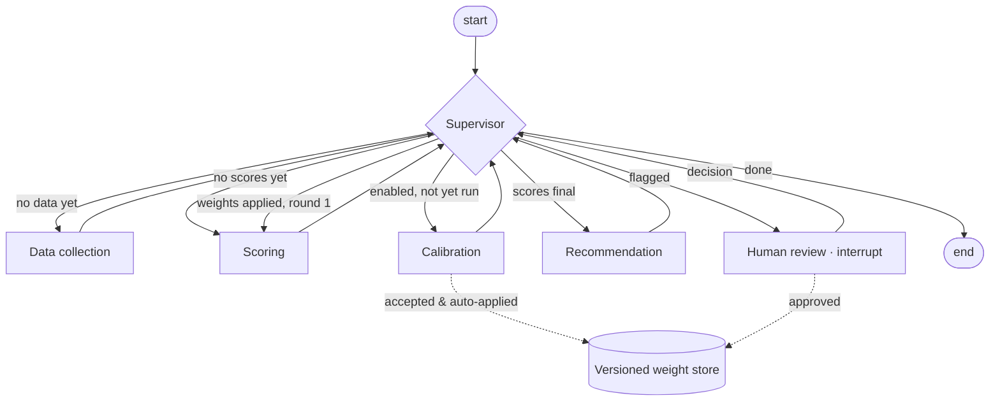

# Lean Agentic AI for Supplier Risk Evaluation

### Turning spreadsheet scorecards into transparent, expert-calibrated multi-agent systems: a benchmark of four approaches and an open-source demonstrator

*Csaba Bakay · Working paper, draft v0.3 · October 2026*

> **Draft status.** All sections (1–12) exist as a first, continuous draft. Remaining gaps are
> marked in the text and summarised in [paper-outline.md](paper-outline.md). Markers in the text:
> - **[TBD-RESULT]** — to be completed or confirmed with results from the local calibration runs
> - **[TBD-LIT]** — literature still to be cited (all such markers resolved in draft v0.2;
>   references verified via Crossref or OpenAlex, read at abstract level)
> - **[TBD-INPUT]** — needs a decision or input from the author
>
> Numbers quoted from the demonstrator come from runs of commit `6bb05b9` on synthetic data.

---

## Abstract

Supplier risk evaluation in mid-sized procurement organisations usually takes one of two forms:
- a spreadsheet scorecard, which is cheap and transparent but cannot learn or scale, and does not
  keep an audit trail
- a commercial supply-chain risk platform, which brings data coverage and workflows, but at a cost
  and with limited control over how scores are formed

Open-source agent projects show how such systems could be built, but mostly as demonstrators
without a defensible scoring method. A further problem cuts across all three: the weights that turn
criteria into a risk score are typically set once and never checked against the judgement of the
people who know the suppliers.

This paper makes three contributions.
1. It proposes fifteen success factors for supplier risk evaluation. They were derived and then
   corrected in a documented review that removed means-as-ends and added two factors on which
   commercial platforms are strong.
2. It profiles four approaches on these factors without aggregating them:
   - spreadsheet practice
   - two commercial platforms, Prewave and Sphera
   - five open-source repositories
   - the approach proposed here
3. It presents *Lean Agentic AI* and an open-source demonstrator. The approach starts from existing
   scorecard practice and builds on open agentic workflows. Its scoring is deterministic and
   configurable, with material-group-specific weights. Weights are calibrated against category
   managers' expert labels by constrained least squares. A human-in-the-loop step pauses the
   workflow for approval, and approved weights are versioned.

On synthetic portfolios whose labels were generated from a hidden weighting plus noise:
- **Cross-validated error.** Calibration reduced the cross-validated mean squared error between
  model score and expert label from 37.8 to 20.6 score points², close to the irreducible label
  noise of 18.1.
- **Recovery of the hidden weighting.** It moved the weights roughly half-way towards the hidden
  weighting.
- **Effect of regularisation.** Regularisation was essential: without it, calibration on eight
  labels was worse than the default weights in half of the runs.
- **A weakness found and fixed.** The validation exposed that the demonstrator's original
  acceptance rule, based on in-sample error, let through harmful calibrations. A cross-validated
  rule now replaces it. With eight labels it cut harmful acceptances from 50 % to 7 % of runs.

The paper states what this does not establish:
- the labels are synthetic and generated by the same linear model family that is fitted
- predictive validity against real disruptions is untested
- the demonstrator does not provide the external signal coverage that commercial platforms offer

No ranking of approaches is derived at any point.

---

## 1 Introduction

Supplier risk evaluation has moved from an annual formality to a recurring management task.
Disruptions in logistics, energy and geopolitics have made supply concentration visible. Supply-chain
risk management research has long described identifying, assessing, treating and monitoring risk as
one connected process (Tang, 2006; Ho et al., 2015; Fan & Stevenson, 2018). This paper is concerned
with the *assessment* stage. Due-diligence regulation expects documented risk analysis along the
supply chain. Procurement teams
are asked to show not only *which* suppliers are risky, but *why*, and what was done about it.

A common organisational response is to extend the supplier scorecard. The criteria sheet gains
columns for financial stability, supply-chain exposure and ESG. A weighted average turns the
columns into a score, and the score into a traffic light. Where budgets allow, a commercial
platform is licensed to supply alerts and external data.

Both responses leave a gap. The spreadsheet keeps the method in the procurement team's hands but
does not keep a record: weights drift between versions, and no one can say afterwards why a
supplier was rated as it was. The platform brings data coverage and workflows, but the method by
which its score is formed is, depending on the vendor, partly or largely outside the customer's
view and control. Open-source agent projects, the third option a technically minded team might
consider, offer modern architecture patterns but rarely a scoring method that could stand up in an
audit.

One problem cuts across all three options and is rarely named: **the weights are not validated.**
A scorecard may weight business impact at fourteen per cent and ESG at twelve. Those numbers
usually come from a workshop, a template or a vendor default. They are seldom checked against the
holistic judgement of the category managers who know the suppliers best, and seldom revised when
the two disagree.

This paper takes a deliberately lean route. It does not propose a new risk taxonomy or a new data
source. Instead it starts from the scorecard practice that already exists and asks what it would
take to make that practice:
- **transparent**, with method and weights documented and inspectable
- **reproducible**, with every number recomputable from its inputs
- **governed**, with human approval at the points where judgement is required
- **able to learn**, by systematically aligning weights with expert judgement

It also asks whether this can be done at the cost profile of open-source software rather than an
enterprise licence.

The argument proceeds in two steps.
- **A benchmark.** Fifteen success factors are proposed, and four approaches are profiled on them
  (Figure 1). The profile is read factor by factor, without weighting, total or ranking.
- **A demonstrator.** The proposed approach is implemented as an open-source multi-agent workflow.
  Each claimed property can then be inspected in code, tests and documentation rather than
  asserted.

The demonstrator runs on synthetic data. This is a deliberate constraint, and it has a cost,
discussed in Section 10. It also has a benefit: because the expert labels in the
calibration experiment were generated from a known hidden weighting, it can be checked whether
calibration recovers that weighting, which no field dataset would allow.


*Figure 1. Four approaches to supplier risk evaluation profiled on fifteen success factors (model
v0.2). Illustrative assessment based on public information and code review (October 2026).
Proprietary SaaS is plotted as the mean of Prewave and Sphera; shaded bars mark where the two
differ. Rationale and confidence for every value: Table 2 and `research/comparison-matrix.md`. No
weighting is applied, and no total or ranking is derived.*

**Contributions.**
1. **Fifteen success factors** for supplier risk evaluation, each with a definition and the
   evidence by which it can be assessed. They are presented as a working model, together with the
   documented review that produced the current version (Section 3).
2. **A profile benchmark** of four approaches on these factors. Every value comes from a single
   machine-readable source with a rationale and a confidence mark. The two commercial examples are
   rated separately and their spread is shown (Section 4).
3. **The Lean Agentic approach**: a synthesis of scorecard practice, platform expectations and open
   agentic architecture. Calibration against expert labels is its central distinguishing feature
   (Section 5).
4. **An open-source demonstrator.** It is a LangGraph workflow with:
   - deterministic, configurable scoring
   - material-group weights
   - constrained least-squares calibration
   - a graph-interrupt human-review step
   - a versioned weight store
   - an automated test suite (Section 6)
5. **An explicit statement of what is not established**, and of the work that would close each gap
   (Sections 10–11).

---

## 2 Background and related work

### 2.1 Supplier risk assessment in practice

Weighted multi-criteria aggregation is the dominant instrument for evaluating suppliers. Reviews of
the supplier-selection literature catalogue a wide range of methods: the analytic hierarchy
process, outranking, data envelopment analysis, mathematical programming, fuzzy and hybrid
approaches (Ho, Xu & Dey, 2010; Chai, Liu & Ngai, 2013). Most of them share one structure: criteria,
weights and an aggregation rule. Case studies of purchasing organisations show formal and informal
supply-risk assessment processes in use, frequently in scoring form (Zsidisin et al., 2004). A
typical supplier-risk scorecard has these parts:
- **dimensions.** A *severity* component asks how replaceable a supplier is and how badly a failure
  would hurt. *Likelihood* components cover financial stability, supply-chain exposure (country,
  sourcing strategy, transport) and ESG or compliance.
- **ratings** on an ordinal scale, often 1–5
- **weights** per criterion
- **an aggregation** into a single score and a class

The method is not in question here. What is in question is how it is run:
- definitions and scales are informal
- weights are set once
- results are not reproducible after the file has changed
- consequences are written as free text, if at all

### 2.2 Commercial supply-chain risk platforms

Commercial platforms address the data side of the problem. Two are used as named examples, assessed
**on public information only** (vendor websites, help-centre articles, press releases and
vendor-commissioned studies, as of October 2026). Nothing here is a product test.
→ `research/saas-references.md`.

**Prewave** combines continuous media and trade-data monitoring with supplier assessments and
due-diligence modules for several European regulations.
- **Signals.** It claims millions of processed signals per day in several hundred languages, and
  Tier-N mapping from trade data.
- **Scoring.** Unusually for the category, Prewave publishes the composition of its supplier
  score: a peer component (country, industry, commodity) at 30 %, alerts at 40 %, assessments at
  20 % and external data at 10 %. It describes the aggregation as non-linear and weighted.
- **Configuration.** Event types and their weights can be adjusted in customer-specific
  "perspectives", partly through the vendor's customer-success function.
- **Not disclosed:** how sources are weighted and how media signals are classified.

**Sphera Supply Chain Risk Management** (formerly riskmethods) offers:
- portfolio risk views, multi-tier mapping and early warnings
- response playbooks, incident management and supplier engagement campaigns
- a documented bundle for the German supply-chain due-diligence act (2023)

Its scores are described as "AI-scoring" tied to business impact, using indicator scorecards. No
public description of the scoring method or of customer-adjustable weights was found.

Two observations matter for this paper.
1. **"Platform" is not one methodological profile.** On methodological transparency the two
   examples differ by a full scale point. This is why they are rated separately in Section 4 rather
   than as a stereotype.
2. **Neither vendor documents calibration against the customer's own expert judgement** in public
   sources. Weight adjustment exists (Prewave), but as configuration, not as a fitted and reported
   procedure.

Other vendors were checked only briefly and are not part of the benchmark:
- **Resilinc:** fixed score components against universal standards.
- **EcoVadis:** published criteria with qualitatively described weighting.
- **Everstream, Interos:** no public scoring method found.

### 2.3 Open-source agentic supply-chain projects

Five public repositories were reviewed at source-code level (→ `research/github-references.md`,
`research/comparison.md`). They converge on one architectural pattern: specialised agents sharing a
typed state, coordinated either as a directed graph or by a supervisor. They diverge sharply on
scoring.
- **No scoring.** One repository returns fixed, simulated outputs and contains no scoring at all.
- **Deterministic, hard-coded weights.** Two compute deterministic weighted scores. One of them
  deliberately overwrites any numbers produced by the language model with values computed in code.
- **LLM-judged.** Two leave the risk judgement to a language model. In one of them, a published
  example contains arithmetic errors in the weighted totals, a small but telling illustration of
  why numbers should not be generated by a language model.
- **Licensing and tests.** Two repositories carry no licence, one is under a copyleft licence, and
  none ships an automated test suite.

The repositories are therefore valuable as **architectural blueprints**, not as methods. The
approach in this paper reuses ideas from them, but no code.

### 2.4 Calibrating weights against expert judgement

Two distinct practices both go by the name of "setting weights":
- **eliciting** weights directly, by asking experts how important each criterion is
- **inferring** them from holistic judgements, by asking experts how risky each supplier is overall
  and finding weights that reproduce those answers

**Direct elicitation is method-dependent.** Experimental comparisons show that different weighting
procedures (swing, SMART, trade-off, pairwise comparison and others) produce systematically different
weights for the same problem (Borcherding, Eppel & von Winterfeldt, 1991; Pöyhönen & Hämäläinen,
2001). Weight judgements are also subject to behavioural effects such as range insensitivity and
splitting biases (Weber & Borcherding, 1993). For practice, this means that weights agreed in a
workshop are one plausible answer among several. They are not a measurement, and they should be
checked.

**Inferring weights from holistic judgements has two research traditions.**
- **Judgement analysis and policy capturing**, rooted in Brunswik's lens model (Hammond, 1955).
  These studies regress holistic judgements on the cues presented, to recover the weights a judge
  implicitly uses (Aiman-Smith, Scullen & Barr, 2002; Karren & Barringer, 2002). Meta-analytic
  evidence indicates that linear models reproduce such judgements well (Karelaia & Hogarth, 2008). A
  linear model of a judge can even outperform the judge, because it applies the judge's policy
  consistently (Goldberg, 1970). This tradition also contains an important caution. Even "improper"
  weights, for example equal weights, often perform about as well as optimally fitted ones (Dawes,
  1979). Gains from fitting weights should therefore be expected to be modest, and fitted weights
  should not stray far from sensible priors without good reason.
- **Preference disaggregation**, or "inverse" MCDA, infers an additive value model from a decision
  maker's holistic evaluations. The UTA family does this by linear programming on rankings
  (Jacquet-Lagrèze & Siskos, 1982, 2001).

The calibration in this paper belongs to the same family. It differs in three respects:
- it fits *cardinal* risk scores by least squares instead of rankings by linear programming
- it constrains the weights to a simplex with a lower bound
- it shrinks them towards a prior

The inferential route has a practical advantage in procurement. Category managers often find it
easier to judge a supplier than to state the relative importance of abstract criteria. It also has a
known risk: with few judgements and many weights, the fit adapts to noise. Ridge regularisation
trades a small bias for a large reduction in variance (Hoerl & Kennard, 1970). Shrinking towards a
prior weight vector instead of towards zero is a direct generalisation (Hastie, Tibshirani &
Friedman, 2009, ch. 3). The approach in Section 5 combines the two practices: directly elicited
weights serve as the prior, and holistic labels adjust them under constraints.

### 2.5 Language models and determinism

Agentic systems invite the use of language models throughout. For risk scores this is the wrong
default.
- A score that changes when the same input is presented twice cannot be audited. Language-model
  outputs can vary across identical requests, even at temperature zero. This has been shown
  empirically for code generation (Ouyang et al., 2025), and nothing suggests that risk judgements
  are immune.
- A score that cannot be recomputed by hand cannot be challenged.

The reviewed repositories show both patterns:
- language-model-judged tiers without stable criteria
- language-model arithmetic that does not add up

The more mature designs among them compute numbers in code and reserve the language model for
language. This paper adopts that division strictly.

---

## 3 Success dimensions for supplier risk evaluation

An approach to supplier risk evaluation is easier to assess when the properties that matter are
named before any approach is rated. This section proposes fifteen such properties, called *success
factors*. Each is defined, and for each the observable evidence is named that would allow someone
else to check a rating (→ `research/success-factors.md`).

The factors form a **flat list**. They are not arranged in a hierarchy, not weighted and not
combined into a total. An approach is read as a **profile** across all fifteen. A profile that is
strong on twelve factors and absent on one is a different proposition from one that is uniformly
adequate. A single figure would treat the two alike.

**Table 1. Success factors for supplier risk evaluation (model v0.2).**

| # | Factor | What it means | Assessable by |
|---|---|---|---|
| 1 | Structured criteria & weights (objective + subjective) | Explicit criteria, scales and weights combining measurable indicators and structured expert assessment | Criteria with definition and scale; explicit weights; both input types with provenance |
| 2 | Traceability & reproducibility | Every result can be reconstructed afterwards and recomputed from documented inputs | Per-result record; change history; recomputation possible; tests |
| 3 | Methodological transparency | The method is documented and checkable *before* use | Published formula, weights, sources, rules |
| 4 | Expert calibration / ability to learn | Parameters are systematically fitted to expert judgement, with approval | Procedure; fit metric; logged old/new parameters; approval |
| 5 | Material-group-specific adaptation | Weights or thresholds can differ by commodity | Per-group weights and calibration |
| 6 | Action framework | Results map to defined actions, review cycles and owners | Actions per class and driver; tracking to closure |
| 7 | Human-in-the-loop & governance | Defined review and approval points, recorded decisions, roles | Approval steps; recorded overrides; roles |
| 8 | External signals & data coverage | Current external data and breadth of supplier coverage | Sources, update frequency, languages, Tier-N |
| 9 | Regulatory evidence | Support for due-diligence documentation duties | Regulation-specific workflows and reports |
| 10 | Cost / accessibility | Total cost of use and access barriers | Licence model, prices, implementation effort |
| 11 | Time-to-value | Time and effort to the first usable result | Time to first portfolio assessment |
| 12 | Customisability & data sovereignty | The organisation can change method and implementation and controls its data | Configurable without vendor; licence; data location |
| 13 | Scalability | Works as suppliers, users, groups and update frequency grow | Suppliers handled; marginal effort; automation |
| 14 | Extensibility & automation potential | New capabilities can be added without rebuilding the core | Extension points; APIs |
| 15 | Operational maturity & support | Production readiness | Support, SLAs, security, release process |

### 3.1 How the factor model was derived, and corrected

The fifteen factors are the second version of a working model. The first version (v0.1) was drawn
up from the requirements of the proposed approach. A critical review identified four problems.
Each was corrected, and the corrections are documented because they bear on how far the benchmark
can be trusted.

1. **Means presented as ends.** Two v0.1 factors named a *means*: "open source" and "multi-agent
   orchestration". Rating approaches on the means one has chosen makes the comparison circular.
   Both were reframed as outcomes: *customisability & data sovereignty* and *extensibility &
   automation potential*.
2. **Home-field bias.** v0.1 contained no factor on which commercial platforms are clearly
   stronger, apart from external signals. Two were added: *regulatory evidence* and *operational
   maturity & support*. Without them, the profile would flatter the proposed approach.
3. **Overlaps.** Two pairs measured the same strength twice and were merged:
   - *structured criteria* with *objective + subjective inputs*
   - *audit trail* with *determinism*

   *Methodological transparency* was kept separate from *traceability*. The first concerns
   understanding the method before use; the second concerns reconstructing a result afterwards.
4. **Validity, the factor that is missing.** No factor asks whether a score *predicts*
   disruptions. Calibration against experts measures agreement with judgement, not predictive
   validity. No approach reviewed reports predictive validity publicly, so the factor cannot be
   rated today. It is deliberately left off the radar and treated as an open question
   (Section 11).

The resulting model keeps fifteen axes, which is about the readability limit of a radar chart.
It now contains four factors on which the commercial examples are clearly ahead: 8, 9, 13 and 15.

---

## 4 Benchmark: four approaches profiled

### 4.1 Method

Four approaches are rated on the fifteen factors on a five-point scale (1 weak or absent, 3
adequate, 5 very strong). Each rating carries a short rationale and a confidence mark:
- **H**: verified from code or primary documentation
- **M**: plausible, partly documented
- **L**: assumption

All ratings live in one machine-readable file, `research/comparison-matrix.yaml`. Table 2 and
Figure 1 are generated from it by a script that also validates the file. A consistency check fails
if the published table no longer matches the source. The evidence differs by approach, and this is
disclosed rather than hidden:

| Approach | What is rated | Evidence |
|---|---|---|
| Excel / manual | A typical procurement scorecard (criteria sheet, weights, annual update) | Practitioner experience; assumption-based |
| Proprietary SaaS | Prewave and Sphera, **rated separately**; the profile plots their mean and shows the spread | Public information only, October 2026 |
| Open-source repos | The five reviewed repositories | Source-code review |
| Lean Agentic | The demonstrator **as implemented**, not its roadmap | Code, tests and documentation |

**Table 2 (condensed).** Strongest and weakest factors per approach. The full matrix, with a
rationale and confidence mark for every cell, is in Appendix A.

| Approach | Strongest (4–5) | Weakest (1–2) |
|---|---|---|
| Excel / manual | Cost; method transparency; time-to-value; customisability | Expert calibration; external signals; extensibility |
| Proprietary SaaS (Prewave, Sphera) | External signals & coverage; scalability; operational maturity; regulatory evidence; action framework; human-in-the-loop | Cost; customisability & data sovereignty; expert calibration |
| Open-source repos | Cost; extensibility | Expert calibration; material-group fit; regulatory evidence; operational maturity |
| Lean Agentic (this work) | Method transparency; customisability; traceability & reproducibility; expert calibration; material-group fit | External signals (1); regulatory evidence; operational maturity |

### 4.2 Reading the profiles

Figure 1 is read factor by factor. Four patterns stand out.

**Spreadsheet practice is strong where simplicity helps.** It is cheap, starts immediately and
keeps formulas visible. It is weak everywhere a system property is needed: an audit trail,
learning, external data, extension. The profile describes a stereotype. Real spreadsheet
practices vary widely, and a well-governed workbook can do better on traceability than the rating
suggests.

**The commercial platforms are strongest on data, scale and operations.** They lead on four
factors:
- external signals and coverage
- regulatory evidence
- scalability
- operational maturity

They are also well developed on workflows and review steps. They are weaker on four others:
- cost
- self-determined customisation
- recomputability by the customer, which is a design consequence of continuous monitoring rather
  than a flaw
- for one of the two, methodological transparency

The spread between them is largest exactly there. Prewave publishes its score composition; Sphera
does not.

**The open-source repositories are blueprints.** They are free, and their agent architectures are
their main asset. On almost every methodological factor they are rudimentary.

**The Lean Agentic demonstrator is strongest where the method itself matters:**
- methodological transparency
- traceability and reproducibility
- expert calibration
- material-group adaptation
- customisability

It is deliberately weak on three factors:
- external signals (rated 1: none are implemented)
- regulatory evidence
- operational maturity

These dips are not hidden. They define what the approach is not.

### 4.3 Complementary, not ranked

The profiles do not order the approaches. In particular, Lean Agentic does not replace the data
coverage of a platform. The most realistic reading of Figure 1 is **complementary**. A platform
subscription or open data can serve as the *signal source*. A transparent, calibrated model owned
by the procurement team turns signals and internal knowledge into risk classes and actions.
Section 8.2 develops this hybrid reading.

### 4.4 Threats to validity of the benchmark

- **Author bias.** The factors and the ratings come from the authors of one of the rated
  approaches. Mitigations:
  - the v0.2 correction against home-field bias
  - rating the demonstrator as implemented rather than as planned
  - a rationale and confidence mark for every value

  These reduce the bias; they do not remove it. An independent re-rating by three to five
  practitioners, reporting the spread of their ratings, is left to future work (Section 11).
- **Public information only for the platforms.** Hands-on evaluation could move several ratings,
  especially those on traceability, material-group adaptation, workflows and time-to-value.
- **Date dependency.** Products change. All platform ratings refer to public information as of
  October 2026.
- **Ordinal scale.** Ratings are ordinal judgements. Differences of one point should not be read as
  measured distances.

---

## 5 The Lean Agentic approach

### 5.1 Definition

*Lean Agentic AI* is defined here as an approach that:
- starts from the evaluation practice an organisation already has
- uses open agentic workflows as blueprints
- builds a tailored, transparent and low-cost system on top of that practice rather than
  replacing it

"Lean" means three things:
- **build only what adds value**
- **reuse open blueprints**
- **keep the method in the hands of the team that is accountable for it**

(→ `research/lean-agentic-positioning.md`.)

### 5.2 A synthesis of three traditions

The approach inherits deliberately from each of the three traditions in Section 2.

**From scorecard practice**, it takes the domain logic:
- named criteria and 1–5 ratings
- weighted dimensions, including a severity component that combines availability of alternatives,
  change complexity and business consequence
- a class-based action framework

Procurement keeps its method and its vocabulary. What changes is that the method becomes explicit,
versioned and testable.

**From commercial platforms**, it takes the expectations placed on a professional system:
- review and approval steps
- an audit trail
- integration of objective indicators with expert assessment
- an action framework with review cycles

External signal feeds are not implemented. They are intended to come from open data or an existing
platform subscription.

**From open-source agent projects**, it takes the architecture: a supervisor coordinating
specialised agents over a typed shared state. It also takes the lesson the better projects teach:
numbers are computed in code, and language models are reserved for language.

### 5.3 Distinguishing features

Six features distinguish the approach. The first is its central contribution.

**(1) Calibration against expert judgement.** Weights are not only configurable; they are fitted
to the holistic judgements of category managers.
- Each labelled supplier receives a risk score from 0 to 100 on the model's own scale.
- The weights are chosen to minimise the mean squared error between model score and label.
- Constraints: every weight stays above a minimum, and the weights sum to one.
- A ridge term pulls the solution towards the configured default weights. This keeps the
  procedure from overfitting small samples, and keeps it from silently switching off criteria the
  methodology considers relevant.

The anchor of the regularisation is always the configured default, never the result of a previous
calibration. This prevents repeated calibration on the same labels from drifting a little further
from the methodology each time. The problem was found by a test, and the fix is documented.

Calibrated weights are applied only if the *cross-validated* error falls by a minimum relative
amount, so that a fit which merely reproduces label noise is rejected (Section 7.6). Depending on
configuration, they are either applied automatically or proposed for approval. Old and new weights,
the error before and after, and the share of suppliers whose model class matches the class implied
by the expert label are all reported. Formulation: Section 6.4.

None of the reviewed repositories, and neither commercial example in its public documentation,
offers this. It turns the scorecard from a fixed instrument into one that learns from the people
accountable for it, while every weight remains explainable.

**(2) Weights as first-class, versioned objects.** Default weights, material-group weights and
calibrated weights are interchangeable objects. They are never hard-coded. Every applied weight set
is written as a new, never-overwritten version, recording:
- timestamp
- approver
- model version
- calibration metrics

**(3) Material-group awareness.** One weighting rarely fits every commodity. Weights can be set,
and calibrated, per material group. Each supplier is scored with the most specific weight set
available.

**(4) Human-in-the-loop as a real pause.** When data is insufficient or weights are proposed, the
workflow stops and waits for a decision. A reviewer can:
- approve the weights
- set a supplier's class manually, with a comment
- defer

The decision is recorded, and manual classes survive re-scoring.

**(5) Deterministic scoring.** Every number is produced by pure, tested functions. The same input
always gives the same score, and every score can be recomputed by hand. Language models are kept
out of the numbers entirely. Their planned roles are extraction from documents and narrative
explanation.

**(6) Governance by construction.** Several controls are built into the method rather than added
around it:
- Escalation rules set a class floor that no weighted average can hide, for example for a
  critical compliance finding or acute insolvency signals.
- A data-completeness check flags results that rest on too little data.
- The audit trail is append-only.
- Every feedback loop is bounded.

### 5.4 What the approach is not

Equally important for the positioning, the approach is **not**:
- a data provider: it monitors no news, disasters or Tier-N networks
- a regulatory compliance product
- production-hardened: it has no roles or permissions and no persistent run store
- empirically validated: its calibration has so far been shown on synthetic labels only

The claim of this paper is narrower. The *method layer* of supplier risk evaluation can be made
transparent, reproducible, governed and able to learn at low cost. It is a layer that commercial
platforms leave partly opaque and spreadsheets leave ungoverned.

---

## 6 Architecture of the demonstrator

This section summarises the demonstrator. Design details are in `docs/architecture.md`,
`docs/scoring-model.md` and `docs/calibration.md`.

### 6.1 Workflow

The demonstrator is a LangGraph state graph in hub-and-spoke form (Figure 3). A rule-based
**supervisor** inspects the shared state and routes to one of five workers:
- **data collection**: loads the suppliers in scope, optionally restricted to one material group,
  together with indicators and expert labels from a pluggable source
- **scoring**: rates factors, aggregates, normalises and classifies, applies escalation rules and
  checks data completeness
- **calibration**: optional
- **recommendation**: maps classes and elevated dimensions to actions and review cycles
- **human review**

Every worker returns control to the supervisor. The routing rules fit in one function, which is
also the single extension point for a language-model-based supervisor.



*Figure 3. Workflow of the demonstrator. Every worker returns to a rule-based supervisor; the
calibration loop and the human-review loop each run at most once per run. [TBD-INPUT: render as a
static figure for the typeset version.]*

```
collect_data → score → [calibrate → score] → recommend → [human_review ⏸ → score? → recommend] → end
```

Each loop runs at most once per run, by construction:
- calibration
- the re-score it triggers
- human review

### 6.2 Scoring model

**Ratings.**
- Each factor is rated on an ordinal scale from 1 (low risk) to 5 (high risk).
- A rating comes either from an expert or from a rule that converts a raw indicator, such as a
  credit score, a country risk index or the number of qualified sources.
- An expert rating always takes precedence, so judgement can override any derived value. The
  provenance of every rating is recorded.

**Aggregation.** With effective factor weights θ (non-negative, summing to one):
- dimension ratings are weighted means of their available factors
- the overall rating *R* is the weighted mean of the dimension ratings

**Normalisation.** *R* is mapped to a score *S* by min-max normalisation:

  *S* = (*R* − 1) / 4 · 100

The 1–5 scale has no zero. Min-max normalisation maps its actual range onto 0–100: the best
possible supplier scores 0, the scale midpoint 50 and the worst 100. A naive *R*/5 would start at
20 and leave a fifth of the range unused. The 0–100 scale is also the scale on which expert labels
are given. Because the mapping is affine, rankings are unchanged and calibration remains a linear
problem.

**Classes, escalations and missing data.**
- Classes follow from thresholds on *S* (in the default template: low below 30, medium below 50,
  high below 70, critical from 70).
- Escalation rules can raise a class but never lower it.
- Missing factors are excluded and the remaining weights re-normalised within their dimension. The
  share of weight actually backed by data is reported. Below a threshold, the result is flagged for
  review.

The default criteria, weights and thresholds are an **illustrative template**, not a
recommendation.

### 6.3 Weights as objects

The scoring engine never reads weights from code. It receives a *weight set* (effective factor
weights) chosen for each supplier from the most specific available source:
1. calibrated weights for its material group
2. configured weights for that group
3. calibrated global weights
4. configured global defaults

Applied weight sets are persisted in a versioned store and loaded at the start of the next run.

### 6.4 Calibration

For *n* suppliers with complete factor ratings **x**ᵢ and expert labels *y*ᵢ ∈ [0, 100], the
calibrated weights θ solve:

  minimise  (1/*n*) Σᵢ ((*s*ᵢ(θ) − *y*ᵢ) / 100)² + λ ‖θ − θ_anchor‖²
  subject to θ_f ≥ *w*_min for all *f*, and Σ_f θ_f = 1,

where *s*ᵢ(θ) = (**x**ᵢ · θ − 1) / 4 · 100, and θ_anchor is the configured default weighting.

The problem is a convex quadratic program, that is, least squares with linear equality and
inequality constraints (Lawson & Hanson, 1995). It is solved with a sequential least-squares method
and an analytic gradient. In the default configuration:
- λ = 0.05
- *w*_min = 0.02
- at least eight labelled suppliers with complete data are required
- acceptance requires a relative reduction of the *cross-validated* error of at least 5 %
  (5 folds × 3 repeats; the in-sample variant is kept only as an experimental option, see
  Section 7.6)

Only suppliers with complete data are used. Missing-data re-weighting would make the score
non-linear in θ.

The expert's class is derived from the label with the model's own thresholds. Labels are therefore
expected as scores rather than classes: a score carries more information than a class, and it keeps
the fit linear. Class agreement is reported alongside the error.

How well this procedure works, out of sample, across sample sizes and across random draws, is
examined in Section 7.

### 6.5 Human review

The review step uses the graph framework's interrupt mechanism.
- **Pausing.** The run is checkpointed under its identifier. A structured request lists the
  flagged suppliers with their reasons and any proposed weights with their error metrics.
- **Resuming.** The run continues with a decision object.
- **Effects of a decision.**
  - Approved weights are stored with the reviewer's name, and the portfolio is re-scored.
  - Manual classes are kept across re-scoring and marked as overrides.
  - Recommendations are rebuilt after any change.
- **Invalid decisions** are reported and ignored.

### 6.6 Engineering properties

These properties make the claims in Sections 5 and 6 checkable:
- **Tests.** The demonstrator ships with 57 automated tests. They cover:
  - scoring and weights
  - calibration, including recovery of known weights from noise-free labels
  - the weight store and the human-review flow
  - the consistency of the benchmark data
  - reproducibility of the synthetic datasets
- **CI.** Continuous integration runs linting and tests on two Python versions.
- **Checkpoint types.** The checkpointer restores only explicitly allow-listed state types.
- **Licence and data.** The code is MIT-licensed. All data is fictional or synthetic and labelled
  as such.

---

## 7 Demonstration on synthetic data

All numbers in this section are produced by deterministic scripts, run on commit `6bb05b9`:
- `examples/calibrate_weights.py`: the reference run
- `scripts/validate_calibration.py`: experiments E1–E3
- `scripts/plot_calibration_validation.py`: Figures 4–6

The tables behind every figure are in `docs/paper/results/calibration-validation/`, with
`SUMMARY.md` as the overview. The data is synthetic throughout. What that does and does not allow
is discussed in Section 7.6.

### 7.1 Design

**Generator.** Synthetic suppliers are drawn with random expert ratings and indicators. Each receives
an "expert label":
- its score under a **hidden weighting**
- plus Gaussian noise (σ = 4 score points)
- rounded to steps of five, the way category managers tend to state judgements
- clipped to [0, 100]

The hidden weighting differs from the default template. The simulated experts care more about
business impact (22 % instead of 14 %) and single sourcing (16 % instead of 8.75 %), and less about
the ESG rating (3 % instead of 12 %). Noise and rounding imply an **irreducible mean squared error of
18.1** score points² between labels and true scores (noise floor). No model can be expected to beat
it out of sample.

Because the generating weights are known, calibration can be judged on three questions:
- Does it reduce error *out of sample*?
- Does it move the weights *towards the truth*?
- How do both depend on the regularisation strength λ and on the number of labels?

**Datasets.**
- *Reference portfolio:* 36 suppliers (seed 42), of which 32 are labelled. This is the dataset
  shipped with the repository.
- *Training draws:* portfolios of 8 to 192 labelled suppliers, 30 seeds per size, plus 100 seeds
  at the reference size of 32.
- *Test set:* 2,000 independent suppliers. They are scored against noisy labels, and against the
  noise-free true scores, which isolate estimation error from label noise.

**Experiments.**
- **E1:** repeated five-fold cross-validation on the reference portfolio (20 repeats) over
  λ ∈ {0, …, 5}
- **E2:** sample size × λ ∈ {0, 0.05, 0.5}, evaluated on the test set
- **E3:** weight stability across 100 seeds at *n* = 32, λ = 0.05

### 7.2 Reference run

On the full reference portfolio, the default configuration (λ = 0.05) gives:
- **Error:** MSE between score and label falls from 37.8 to 13.3 score points².
- **Class agreement:** 84 % → 88 %.
- **Weights:** L1 distance to the hidden weighting falls from 0.345 to 0.138.
- **Classes:** re-scoring changes the class of 2 of 36 suppliers.

With the cross-validated acceptance rule (Section 7.6), the demonstrator accepts this calibration
on the basis of an out-of-fold MSE of 37.8 → 22.8 (5 folds × 3 repeats).

The figures above are **in-sample**. The calibrated in-sample MSE of 13.3 lies *below* the noise floor
of 18.1. This is the signature of in-sample optimism, not of a better-than-possible model: ten
weights fitted to 32 noisy labels partly fit the noise. E1 quantifies how much.

### 7.3 Out-of-sample error and the choice of λ (E1)

**Table 3.** *Repeated 5-fold cross-validation on the reference portfolio (32 labels, 20 repeats).
MSE in score points²; noise floor 18.1. Source: `e1_cv_summary.csv`.*

| λ | CV MSE, default weights | CV MSE, calibrated | in-sample MSE | class agreement (test), default → calibrated | L1 to hidden |
|---:|---:|---:|---:|---|---:|
| 0 | 37.8 | 22.9 ± 4.2 | 10.0 | 84 % → 81 % | 0.155 |
| 0.02 | 37.8 | 20.8 ± 2.7 | 10.7 | 84 % → 83 % | 0.142 |
| **0.05** (default) | 37.8 | **20.6 ± 2.0** | 12.4 | 84 % → 86 % | 0.163 |
| 0.2 | 37.8 | 24.4 ± 1.2 | 18.9 | 84 % → 84 % | 0.241 |
| 1 | 37.8 | 32.3 ± 0.5 | 29.9 | 84 % → 84 % | 0.309 |
| 5 | 37.8 | 36.4 ± 0.1 | 35.8 | 84 % → 84 % | 0.337 |

*(± = standard deviation of the pooled out-of-fold MSE across repeats.)*

Four observations.
1. **Calibration generalises.**
   - At the default λ, the cross-validated MSE falls from 37.8 to 20.6, a 45 % reduction.
   - That is within 2.5 points² of the noise floor.
   - The in-sample MSE overstates the gain by about 8 points².
2. **The default λ lies at the bottom of the curve.** Among the values tested, λ = 0.05 gives the
   lowest cross-validated error, with 0.02 practically equal. This is consistent with the default,
   but it is not evidence that the default is right in general. The default was set before this
   experiment, on data from the same generator.
3. **Regularisation buys stability more than accuracy.** From λ = 0 to λ = 0.05 the mean error
   improves modestly (22.9 → 20.6). Its spread across repeats halves (± 4.2 → ± 2.0). Strong
   regularisation (λ ≥ 0.5) pulls the weights back towards the default and gives up most of the
   gain.
4. **Error and class agreement can diverge.** Without regularisation, out-of-fold class agreement
   *falls* below the default weights (81 % vs. 84 %), although the MSE improves. Class agreement is
   a coarse, threshold-dependent metric, and it is sensitive to small shifts near class boundaries.
   Reporting both metrics, as the demonstrator does, is necessary.


*Figure 4. Cross-validated and in-sample MSE of calibrated weights versus regularisation strength
λ, on the reference portfolio (32 labels, repeated 5-fold CV). Horizontal lines: the
cross-validated error of the default weights, and the irreducible label noise. The gap between the
solid and dashed green lines is the in-sample optimism. Synthetic data.*

### 7.4 How many labels are needed (E2)

Against the noise-free true scores of the independent test set, the default weights have an error
of 29.7 points². This is their structural misfit to the hidden weighting.

**Table 4.** *Test MSE against true scores (mean over 30 seeds; default weights: 29.7) and share of
seeds in which calibration beats the default weights. Source: `e2_sample_size_summary.csv`.*

| labels *n* | λ = 0 | λ = 0.05 (default) | λ = 0.5 |
|---:|---|---|---|
| 8 | 37.7 (50 %) | 16.7 (90 %) | 22.0 (100 %) |
| 16 | 16.2 (90 %) | 9.9 (100 %) | 20.2 (100 %) |
| 32 | 6.1 (100 %) | 5.9 (100 %) | 19.0 (100 %) |
| 64 | 2.8 (100 %) | 4.2 (100 %) | 18.4 (100 %) |
| 192 | 0.8 (100 %) | 2.5 (100 %) | 18.1 (100 %) |

1. **Small samples need regularisation.**
   - With eight labels and no regularisation, calibration is *worse* than the default weights on
     average (37.7 vs. 29.7). It beats them in only half of the seeds.
   - With λ = 0.05, the same eight labels cut the error almost in half (16.7), and calibration
     wins in 90 % of the seeds.
   - From 16 labels onwards, it wins in every seed.
2. **The benefit grows steadily with *n*.** At the reference size of 32 labels, the default
   configuration removes about 80 % of the default weights' structural error (29.7 → 5.9).
3. **A fixed λ becomes a bias at large *n*.** Beyond about 48 labels, the unregularised fit is
   better than λ = 0.05 (0.8 vs. 2.5 at *n* = 192). With λ = 0.5, the error plateaus at about 18
   whatever the sample size. The reason is the form of the objective: the error term is a *mean*
   over suppliers while the penalty is not scaled, so the penalty's relative weight does not fade
   as labels accumulate. In practice, λ should be chosen by cross-validation, or scaled down with
   *n*. This is a concrete design improvement for the demonstrator (Section 11).


*Figure 5.*
- *(a) Test error of calibrated weights against the noise-free true scores, by number of labels
  and λ (mean over 30 seeds; band to the 90th percentile).*
- *(b) Share of runs in which the weights actually applied are worse than keeping the defaults,
  under the in-sample and the cross-validated acceptance rule.*

*Synthetic data.*

### 7.5 Stability of the recovered weights (E3)

Across 100 independent portfolios of 32 labelled suppliers (λ = 0.05):
- the mean L1 distance to the hidden weighting is 0.170, against 0.345 for the default weights
- every calibration was accepted

**Large deviations are recovered reliably.**

| Factor | Default → hidden | Calibrated mean | Moved in the right direction |
|---|---|---|---|
| Business impact | 14.0 % → 22.0 % | 19.5 % | in all 100 seeds |
| Sourcing strategy | 8.75 % → 16.0 % | 14.1 % | in all 100 seeds |
| ESG rating | 12.0 % → 3.0 % | 6.3 % | in all 100 seeds |
| Compliance status | — | — | in 94 seeds |

**Small deviations are not.** For availability and switching complexity, default and hidden weights
differ by half a percentage point. The calibrated weights move in the right direction in only 67
and 54 seeds respectively, which is close to chance. At this sample size the procedure cannot, and
should not be expected to, resolve differences that small.

**The estimates are shrunk towards the default,** as intended. Large shifts are recovered at
roughly two-thirds of their size (business impact +5.5 of +8 points; ESG rating −5.7 of −9
points).


*Figure 6. Effective factor weights: configured default, hidden generating weighting, and
calibrated weights (mean and 5th–95th percentile over 100 synthetic portfolios of 32 labels,
λ = 0.05). Factors are sorted by the size and direction of the default-to-hidden difference.*

### 7.6 Acceptance rules: in-sample versus cross-validated

The demonstrator originally accepted calibrated weights if they reduced the *in-sample* error by at
least 5 %. In E1–E3 this rule accepted practically every calibration, with very strong
regularisation (λ = 5) as the only exception. That included the eight-label, unregularised runs in
which the calibrated weights were worse than the defaults in half of the seeds. **An in-sample rule
is not a safeguard against overfitting.** It only protects against calibrations that change
nothing.

The rule has therefore been replaced. The demonstrator now tests the improvement **out of
sample**:
- the calibration is refitted on k − 1 folds and evaluated on the held-out fold
- this is repeated with reshuffled folds (5 folds × 3 repeats, deterministic)
- the pooled out-of-fold error must improve by at least 5 %

The in-sample rule remains available as a configuration option for experiments. E2 evaluates both
rules on the same runs and reports the error of the weights that *end up in use*: the calibrated
weights if accepted, otherwise the defaults.

**Table 5.** *Acceptance rules on the E2 runs (30 seeds each; error against true scores; default
weights 29.7). Source: `SUMMARY.md`, section E2b.*

| labels *n* | λ | accepted: in-sample / CV | error in use: in-sample / CV rule | harm rate: in-sample / CV |
|---:|---:|---|---|---|
| 8 | 0 | 100 % / 23 % | 37.7 / 30.8 | 50 % / 7 % |
| 8 | 0.05 | 100 % / 57 % | 16.7 / 20.8 | 10 % / 3 % |
| 12 | 0 | 100 % / 47 % | 25.7 / 27.7 | 37 % / 20 % |
| 12 | 0.05 | 100 % / 70 % | 12.1 / 16.3 | 7 % / 3 % |
| 16 | 0.05 | 100 % / 87 % | 9.9 / 11.8 | 0 % / 0 % |
| ≥ 24 | 0.05 | 100 % / 100 % | identical | 0 % / 0 % |

*Harm rate: share of runs in which the weights in use are worse than the defaults.*

Three findings:
1. **The cross-validated rule sharply reduces harm where harm occurs.** Without regularisation, it
   cuts harmful acceptances at eight labels from 50 % to 7 %. With the default λ, it cuts them from
   10 % to 3 %.
2. **It is conservative.** With few labels it also rejects calibrations that would have helped.
   With 8–16 labels and the default λ, the average error of the weights in use is therefore
   *higher* under the cross-validated rule (e.g. 20.8 vs. 16.7 at *n* = 8). It is still well below
   the defaults (29.7). The rule trades expected gain for a lower risk of making things worse,
   which is the appropriate trade-off for weights that drive supplier decisions.
3. **From about 24 labels, both rules agree.** The choice of rule matters only when labels are
   scarce. That is exactly when it should be made carefully.

On the shipped reference data, the new rule changes one visible outcome. A calibration restricted
to the ten labelled "plastics" suppliers looked excellent in-sample (MSE 36.8 → 10.4). It was
*worse* out of sample (36.8 → 41.7), and it is now rejected. Group-specific calibration therefore
needs enough labels per group. With the default settings, ten are not enough in this example.

### 7.7 What the demonstration shows, and what it does not

**It shows that, under controlled conditions,** the calibration procedure:
- generalises: the cross-validated error approaches the noise floor
- recovers the direction and roughly the size of substantial weight differences
- needs regularisation when labels are few

It also shows that the in-sample figures a user sees are optimistic by a quantifiable margin.

**It does not show that real expert judgement behaves like the generator.** The labels were
produced by the same linear, additive model family that is being fitted, with well-behaved
Gaussian noise. This is the *best case* for calibration. Real category managers may:
- weigh criteria non-linearly
- apply implicit knock-out rules
- disagree with each other
- change their policy over time

Policy-capturing research suggests that linear models often describe holistic judgements well
(Karelaia & Hogarth, 2008). Whether this holds for supplier-risk judgements is an empirical
question this paper cannot answer.

The demonstration also says nothing about **predictive validity**: whether calibrated scores
anticipate real disruptions better than default scores.

> **[TBD-RESULT] Still missing for Section 7:**
> - Robustness to **model misspecification**: labels generated with interactions or knock-out
>   rules instead of a linear policy
> - Sensitivity to **label noise** (σ = 2, 4, 8) and to label rounding
> - **λ selection by cross-validation** (or λ scaled with 1/*n*), and its effect on Table 4
> - Optional: a scatter of label vs. score before and after calibration for the reference
>   portfolio

---

## 8 Comparison and discussion

### 8.1 What the benchmark and the demonstrator show together

The paper set out to ask what it would take to make existing scorecard practice:
- transparent
- reproducible
- governed
- able to learn

and whether this can be done at the cost profile of open-source software. The two parts of the
paper answer this from different directions.

**The benchmark (Section 4, Figure 1) locates a gap rather than a winner.**
- *Spreadsheets* keep the method in the procurement team's hands but cannot hold it to account.
- *Commercial platforms* bring data, scale and operational maturity. Depending on the vendor, they
  keep the method partly or largely outside the customer's view.
- *Open-source agent projects* offer architecture without method.

No approach in the comparison is strong both on *data coverage* and on *ownership of the method*.
The profiles are complementary.

**The demonstrator (Sections 5–7) shows that the method layer can be built lean.**
- **Transparent and reproducible:** the scoring is deterministic, configurable and fully tested.
- **Governed:** the human review is a real pause in the workflow, not a notification, and weights
  are versioned with their approver.
- **Able to learn:** weights are fitted to expert judgement under constraints, with a
  cross-validated acceptance test.
- **At open-source cost:** the code base is small and MIT-licensed: about 2,300 lines of Python
  in total, with no agent longer than 150 lines.

On synthetic data, the calibration:
- generalises close to the noise floor of the labels
- recovers the direction of substantial weight differences
- with the cross-validated acceptance rule, rarely makes things worse than the defaults

**What neither part shows** is equally clear:
- that real category managers judge suppliers in a way a linear model can capture
- that calibrated scores predict disruptions
- that the approach scales operationally to an enterprise portfolio

These are empirical questions for future work (Section 11), not conclusions of this paper.

### 8.2 The hybrid reading: signals from outside, method in-house

The most useful reading of Figure 1 is not "which approach is best" but "which layer each approach
should provide". Supplier risk evaluation involves three layers with different owners.

**Table 6.** *A layered reading of supplier risk evaluation.*

| Layer | Question it answers | Who is strong here (Figure 1) | Suggested provider |
|---|---|---|---|
| **Signal layer** | What is happening to this supplier, its country, its tier-N network, right now? | Commercial platforms (external signals, coverage, scale) | Platform subscription, or open data (e.g. public governance indicators, sanction lists, insolvency registers) |
| **Method layer** | How do signals and internal knowledge become a risk class, with which weights, and why? | Lean Agentic (transparency, reproducibility, calibration, material-group weights) | In-house, owned by procurement: the approach of this paper |
| **Decision layer** | What do we do about it, and who decides? | Shared: platforms (workflows), Lean Agentic (review pause, versioned approvals) | Category managers and a named decision owner (Section 9) |

In this reading, the demonstrator does not compete with a platform. It *consumes* one. Technically,
the integration points already exist:
- **Rating sources.** A rating source turns any indicator into a 1–5 rating. This could be a
  platform's supplier score, an alert count or a country index (`tools/indicators.py`).
- **Data source protocol.** A pluggable data source can deliver those indicators.

Prewave's published score composition (Section 2.2) makes it possible to reason about what such an
input already contains. Where the composition is not published, the input has to be treated as a
black-box indicator. Its weight should then be calibrated like any other.

The hybrid reading has three practical consequences.
1. **Platform scores become inputs, not verdicts.** A platform score enters the model as one factor
   among others. The procurement team decides, and calibrates, how much it counts for which
   material group. The final class remains recomputable from documented inputs.
2. **Double counting must be managed.** A platform score that already includes country risk
   overlaps with a separate country-risk factor. Either the overlapping factor is dropped, or the
   calibration is left to down-weight one of them. The second option works only with enough
   labels (Section 7.4).
3. **Licence terms matter.** Whether a platform's scores or alerts may be stored, versioned and
   recomputed in an in-house model depends on the subscription contract. This paper did not
   examine any such contract. *(Assumption: constraints of this kind are common.)*

### 8.3 When which approach fits

Because the profiles are not ranked, the choice depends on the situation. The following
conditions are offered as orientation, not as a decision rule.
- **A spreadsheet with discipline** is adequate for a small portfolio with few critical suppliers,
  stable risk drivers and no regulatory documentation duty. It needs a written definition of
  every criterion, versioned weights and a fixed review date.
- **A commercial platform** is hard to replace where tier-N exposure, real-time monitoring or
  regulatory due-diligence evidence dominate the requirement. Building that data coverage
  in-house is neither lean nor realistic.
- **A Lean Agentic method layer** fits organisations that:
  - have outgrown the spreadsheet
  - want to own and justify their method
  - need material-group-specific weighting
  - want the judgement of their category managers to shape the model systematically

  It also fits *alongside* a platform, as in Section 8.2.

In practice, the most likely configuration for a mid-sized procurement organisation is the
combination: a signal source it buys or obtains openly, and a method it owns.

### 8.4 The cost of being lean

"Lean" and "open source" do not mean free. The demonstrator shifts cost from licences to:
- **Ownership.** Someone must maintain the model configuration, the code and the data
  connections.
- **Skills.** Changing the method requires familiarity with a configuration file. Extending the
  system requires Python.
- **Responsibility.** No vendor carries operational responsibility. The demonstrator has no
  support organisation, no service levels and no security hardening (operational maturity is
  rated 2 in Figure 1).

These costs are real and fall on the adopting organisation. The approach is lean in what it
*builds*, not necessarily in what it *requires* to run.

### 8.5 What the "agentic" part contributes, and what it does not

The demonstrator is a multi-agent workflow, but its scoring, calibration and recommendations use
no language model at all. This is deliberate (Section 2.5). It also raises a fair question: is the
agent architecture necessary?

**For the current scope, it is not strictly necessary.** The same logic could run as a plain
pipeline.

**The architecture pays off as the system grows,** which is why it was chosen:
- **Bounded loops.** The supervisor routes the calibration loop and the human-review pause
  explicitly, and each loop is bounded.
- **New capabilities as nodes.** Additions that are already foreseeable become new nodes rather
  than rewrites:
  - an external-signal agent
  - a document-extraction agent
  - an explanation agent that writes a narrative from locked numbers
- **Pausing and resuming.** The graph framework's checkpointing provides the interrupt-and-resume
  mechanism that human review needs.

The value of "agentic" here is **orchestration and extensibility, not autonomy**. The approach
gives agents no authority over scores or decisions. Following the positioning of this paper, that
authority stays with code that can be recomputed and with people who can be named.

---

## 9 Governance and decision ownership

A risk score does not decide anything. It informs a decision made by someone who can be held
accountable for it. The demonstrator's governance features are only as useful as the roles that
use them. This section proposes how those roles could be assigned. It is a recommendation; the
demonstrator does not enforce roles (Section 10).

### 9.1 Who owns what

**Table 7.** *Proposed ownership of the elements of the method.*

| Element | Owner (proposed) | Changed how | Recorded where |
|---|---|---|---|
| Criteria, scales, default weights, class thresholds, escalation rules | **Method owner** (e.g. procurement excellence) | Reviewed change of the model configuration, new model version | Version control of the configuration; model version on every result |
| Expert ratings per supplier (e.g. business consequence, change complexity) | **Category manager** for the supplier | During the supplier review | Supplier record; rating provenance on every factor |
| Holistic expert labels for calibration | **Category managers**, collected blind to the model score | Annual or periodic labelling round | Supplier record (`expert_risk_score`) |
| Calibrated weights | **Approver** distinct from the label providers (four-eyes, recommended) | Approval at the human-review pause | Versioned weight store, with approver, metrics and timestamp |
| Manual class overrides | **Decision owner** for the supplier | Review decision, with mandatory comment | Assessment (`manual_override`, `review_comment`); audit trail |
| Indicators from external sources | **Data owner** per source | Data refresh | Indicator provenance; [TBD: source versioning not yet implemented] |

Two principles follow from the method:
1. **The method owner sets the floor.** Escalation rules ("a critical compliance finding means at
   least *high*") express non-negotiable positions. They are not subject to calibration, because
   calibration optimises agreement with average judgement, and floors exist precisely for cases
   that averages hide.
2. **Calibration proposes, people decide.** For weights that drive supplier decisions, the
   recommended setting is to propose rather than auto-apply (`auto_apply: false`). Approval then
   happens at the review pause. The approver sees the following, and the approval is recorded:
   - the number of labels
   - the cross-validated and in-sample error
   - old and new weights

### 9.2 Separation of duties

The people whose labels drive a calibration should not be the only ones to approve its result.
Otherwise a team could, deliberately or not, steer the weights towards a preferred outcome by the
way it labels. The demonstrator records who approved a weight set, but it has no role model that
would *enforce* separation. That is a limitation for production use (Section 10) and a
straightforward extension (Section 11).

### 9.3 A calibration cycle embedded in the supplier review

The method fits naturally into the periodic supplier review that most procurement organisations
already run:
1. **Label before scoring.** Category managers record a holistic risk score (0–100) for the
   suppliers they know well, before seeing the model score. This avoids anchoring on the model.
2. **Score and calibrate.** The portfolio is scored. Calibration runs per scope (globally, or per
   material group with enough labels) and is accepted or rejected on cross-validated error.
3. **Review and approve.** The approver reviews proposed weights, together with suppliers flagged
   for insufficient data. Decisions are recorded, and approved weights become a new version.
4. **Communicate.** Changes in weights and the resulting class changes are communicated to the
   category managers concerned. A weight change that moves suppliers between classes is itself a
   decision that should be explained.
5. **Repeat.** In the next cycle, the previous approved weights are the starting point. The
   regularisation keeps anchoring on the method owner's defaults, so repeated calibration does
   not drift (Section 5.3).

### 9.4 Risks to governance

- **Label gaming.** Labels can be shaped to produce desired weights.
  - Mitigations: blind labelling; separation of duties; reporting how much each weight moved and
    why; the minimum-weight constraint, which prevents criteria from being calibrated away
    entirely.
- **Label drift.** Expert judgement changes with events, and a calibration may encode a
  temporary mood. Versioned weights make this visible over time; they do not prevent it.
- **Automation bias.** A precise-looking score invites more trust than its inputs deserve. The
  data-completeness flag and the stated number of labels behind each weight set are partial
  counter-measures. The class, not the decimal score, should be the unit of communication.
- **Accountability gaps.** The score supports a decision; it does not make one. For due-diligence
  documentation, the record must show who decided, on what basis, and what was done. The audit
  trail provides the basis; the decision owner remains responsible.

---

## 10 Limitations

**Evidence limitations.**
- **Synthetic data.** No field data supports the demonstration. All suppliers and expert labels
  are synthetic, and they are labelled as such.
- **Best-case labels.** The labels were generated by the same linear, additive model family that
  calibration fits, with Gaussian noise. This is the best case for the method. Robustness to
  non-linear or inconsistent expert policies is untested.
- **Agreement, not prediction.** Agreement with expert judgement is not predictive validity. No
  result here shows that calibrated scores anticipate disruptions better.
- **Literature access.** It was read at abstract level, and the claims drawn from it are phrased
  accordingly.

**Benchmark limitations.**
- **Who rated.** The success factors and all ratings come from the authors of one of the rated
  approaches. Rationales, confidence marks and the v0.2 correction reduce this bias but do not
  remove it. An independent re-rating by practitioners is future work.
- **Platform evidence.** The commercial platforms were rated on public information only, as of
  October 2026.
- **Excel profile.** The spreadsheet profile is a stereotype of common practice, not a survey.

**Method limitations, including known limitations of the demonstrator.**
- **Acceptance rule.** The original in-sample rule did not protect against overfitting
  (Section 7.6). It has been replaced by a cross-validated rule, which reduces but does not
  eliminate harmful acceptances with very few labels. The cross-validated rule is also
  conservative and forgoes some useful calibrations. The in-sample rule remains available as an
  option and should not be used for real decisions.
- **Fixed regularisation strength.** Because the penalty is not scaled with the number of labels,
  λ = 0.05 becomes a bias once labels are plentiful (Section 7.4). λ is not yet selected by
  cross-validation.
- **Default template.** The criteria, weights and thresholds are illustrative, not recommended.
- **Not production-hardened.** The demonstrator has:
  - no roles or permissions
  - review pauses held in memory only
  - no external signal feeds

---

## 11 Future work

Future work is grouped by what it would establish. Within each group, items are ordered by expected
value relative to effort.

**Method: making calibration robust.**
1. **Choose λ by cross-validation, or scale it with the number of labels.** This removes the bias
   at large samples (Section 7.4) while keeping protection at small ones. It is the most direct
   improvement suggested by the validation.
2. **Misspecification experiments.** Generate labels from non-linear policies, implicit knock-out
   rules and inconsistent experts, and measure how calibration and the acceptance rule behave
   outside the best case. Varying label noise (σ = 2, 4, 8) and rounding belongs to the same
   experiment.
3. **Uncertainty of weights.** Report bootstrap intervals for calibrated weights, so that
   reviewers see which shifts are well supported. Figure 6 shows that small shifts are not.
4. **Ordinal labels.** Some organisations will only collect classes (low to critical). Ordinal
   regression would allow calibration from such labels, at the cost of information.
5. **Hierarchical calibration across material groups.** Partial pooling would let groups with few
   labels borrow strength from the global fit. The "plastics" example (Section 7.6) shows why
   this matters.

**Evidence: from synthetic to real.**
1. **Field pilot with real expert labels.** One or two material groups, labels collected blind to
   the model score, and a pre-registered comparison of cross-validated error with and without
   calibration.
2. **Independent re-rating of the benchmark.** Three to five practitioners rate the comparison
   matrix independently, and the spread is reported as bands in Figure 1.
3. **Predictive validation.** Link scores to observed supplier incidents (delivery failures,
   insolvencies, compliance findings) over time. This needs incident data and a longitudinal
   design. It is the only route to the question this paper explicitly leaves open: whether
   calibrated scores anticipate risk better.

**System: from demonstrator to tool.**
1. **External-signal agent based on open data.** Turn the dip at "external signals" in Figure 1
   into a design choice the user can reverse. Possible sources are public governance indicators,
   sanction lists and insolvency announcements.
2. **Explanation agent.** A language model writes a short narrative per supplier from the locked,
   computed numbers, and never changes them.
3. **Roles and persistence.** A role model that enforces separation of duties (Section 9.2), and
   a persistent checkpointer so that reviews can be decided in a later session.
4. **Platform integration pattern.** A documented adapter that turns a platform score into a
   rating source, including handling of overlapping factors (Section 8.2).

**Benchmark maintenance.**
- Repeat the public-information review of the platform examples periodically, and record the
  date of each rating.
- Add further vendors where their methodology is publicly documented.

---

## 12 Conclusion

Supplier risk evaluation in mid-sized organisations sits between two imperfect options:
- a spreadsheet the team owns but cannot hold to account
- a platform that brings data and scale, but whose method the team does not fully own

A third option, open-source agent projects, offers architecture but rarely a method. Across all
three, the weights that turn criteria into a score are usually set once and never tested against
the judgement of the people who know the suppliers.

This paper proposed fifteen success factors and used them to profile four approaches without
ranking them. The comparison locates a gap rather than a winner: no approach combines data
coverage with ownership of the method. The paper then presented Lean Agentic AI as a way to fill
the method side of that gap:
- start from existing scorecard practice
- build on open agentic blueprints
- keep every number deterministic
- calibrate weights against expert labels under constraints, with a cross-validated acceptance
  test
- pause for human approval wherever judgement is required

On synthetic data, the calibration generalises close to the noise floor and recovers substantial
weight differences. With few labels it needs both regularisation and an out-of-sample acceptance
test. The validation found, and the demonstrator now corrects, an acceptance rule that would
otherwise have let harmful calibrations through.

What remains open is stated as plainly:
- The labels were synthetic and generated by the fitted model family.
- Agreement with experts is not predictive validity.
- The approach does not supply external signals.

The most realistic deployment is therefore hybrid. Signals come from a platform or from open data.
The method that turns them into risk classes and actions is transparent, versioned, calibrated
and owned by the procurement team that is accountable for it.

---

## Appendix A: Full comparison matrix (Table 2)

The full matrix (four approaches × fifteen factors, with per-cell rationale and confidence) is
generated from `research/comparison-matrix.yaml` into `research/comparison-matrix.md`. In the
typeset version, the generated table is inserted here verbatim.

---

## References (provisional)

**Software, vendor and web sources.** Access depth: [code] = source code reviewed; [doc] =
documentation page read; [web] = vendor or third-party web page read.

- aniket-work, *supply-chain-risk-intelligence*, GitHub. [code]
- Bhardwaj-Saurabh, *OmniSupply-AI Multi-Agent Supply Chain Intelligence Platform*, GitHub, GPL-3.0. [code]
- chinmaynadgir, *supplychain-ai-agent*, GitHub. [code]
- poshalanavateja, *Vendor-Bid-Evaluation-Ai*, GitHub. [code]
- mergisi, *awesome-openclaw-agents*, agent `vendor-evaluator`, GitHub, MIT. [code]
- Prewave, "How is the Prewave Score generated?", help.prewave.com. [doc]
- Prewave, product website, prewave.com. [web]
- Sphera, *Supply Chain Risk Management*, sphera.com. [web]
- Sphera, white paper on the German supply-chain due-diligence act, 2023. [web]
- LangGraph documentation: state graphs, interrupts, checkpointers. [doc]

**Academic literature.** Each reference was checked against Crossref or OpenAlex metadata. Content
was read at abstract level unless noted, and claims in the text are phrased accordingly.
[TBD: verify the exact wording against the full texts before final submission.]

- Aiman-Smith, L., Scullen, S. E., & Barr, S. H. (2002). Conducting studies of decision making in organizational contexts: A tutorial for policy-capturing and other regression-based techniques. *Organizational Research Methods, 5*(4), 388–414. https://doi.org/10.1177/109442802237117
- Borcherding, K., Eppel, T., & von Winterfeldt, D. (1991). Comparison of weighting judgments in multiattribute utility measurement. *Management Science, 37*(12), 1603–1619. https://doi.org/10.1287/mnsc.37.12.1603
- Chai, J., Liu, J. N. K., & Ngai, E. W. T. (2013). Application of decision-making techniques in supplier selection: A systematic review of literature. *Expert Systems with Applications, 40*(10), 3872–3885. https://doi.org/10.1016/j.eswa.2012.12.040
- Dawes, R. M. (1979). The robust beauty of improper linear models in decision making. *American Psychologist, 34*(7), 571–582. https://doi.org/10.1037/0003-066X.34.7.571
- Fan, Y., & Stevenson, M. (2018). A review of supply chain risk management: Definition, theory, and research agenda. *International Journal of Physical Distribution & Logistics Management, 48*(3), 205–230. https://doi.org/10.1108/IJPDLM-01-2017-0043
- Goldberg, L. R. (1970). Man versus model of man: A rationale, plus some evidence, for a method of improving on clinical inferences. *Psychological Bulletin, 73*(6), 422–432. https://doi.org/10.1037/h0029230
- Hammond, K. R. (1955). Probabilistic functioning and the clinical method. *Psychological Review, 62*(4), 255–262. https://doi.org/10.1037/h0046845
- Hastie, T., Tibshirani, R., & Friedman, J. (2009). *The Elements of Statistical Learning* (2nd ed.). Springer. https://doi.org/10.1007/978-0-387-84858-7
- Ho, W., Xu, X., & Dey, P. K. (2010). Multi-criteria decision making approaches for supplier evaluation and selection: A literature review. *European Journal of Operational Research, 202*(1), 16–24. https://doi.org/10.1016/j.ejor.2009.05.009
- Ho, W., Zheng, T., Yildiz, H., & Talluri, S. (2015). Supply chain risk management: A literature review. *International Journal of Production Research, 53*(16), 5031–5069. https://doi.org/10.1080/00207543.2015.1030467
- Hoerl, A. E., & Kennard, R. W. (1970). Ridge regression: Biased estimation for nonorthogonal problems. *Technometrics, 12*(1), 55–67. https://doi.org/10.1080/00401706.1970.10488634
- Jacquet-Lagrèze, E., & Siskos, J. (1982). Assessing a set of additive utility functions for multicriteria decision-making, the UTA method. *European Journal of Operational Research, 10*(2), 151–164. https://doi.org/10.1016/0377-2217(82)90155-2
- Jacquet-Lagrèze, E., & Siskos, Y. (2001). Preference disaggregation: 20 years of MCDA experience. *European Journal of Operational Research, 130*(2), 233–245. https://doi.org/10.1016/S0377-2217(00)00035-7
- Karelaia, N., & Hogarth, R. M. (2008). Determinants of linear judgment: A meta-analysis of lens model studies. *Psychological Bulletin, 134*(3), 404–426. https://doi.org/10.1037/0033-2909.134.3.404
- Karren, R. J., & Barringer, M. W. (2002). A review and analysis of the policy-capturing methodology in organizational research: Guidelines for research and practice. *Organizational Research Methods, 5*(4), 337–361. https://doi.org/10.1177/109442802237115
- Kohavi, R. (1995). A study of cross-validation and bootstrap for accuracy estimation and model selection. In *Proceedings of the 14th International Joint Conference on Artificial Intelligence (IJCAI)*, Vol. 2, 1137–1143.
- Lawson, C. L., & Hanson, R. J. (1995). *Solving Least Squares Problems* (Classics in Applied Mathematics 15; reprint of the 1974 edition). SIAM. https://doi.org/10.1137/1.9781611971217
- Ouyang, S., Zhang, J. M., Harman, M., & Wang, M. (2025). An empirical study of the non-determinism of ChatGPT in code generation. *ACM Transactions on Software Engineering and Methodology, 34*(2), 1–28. https://doi.org/10.1145/3697010
- Pöyhönen, M., & Hämäläinen, R. P. (2001). On the convergence of multiattribute weighting methods. *European Journal of Operational Research, 129*(3), 569–585. https://doi.org/10.1016/S0377-2217(99)00467-1
- Stone, M. (1974). Cross-validatory choice and assessment of statistical predictions. *Journal of the Royal Statistical Society: Series B, 36*(2), 111–133. https://doi.org/10.1111/j.2517-6161.1974.tb00994.x
- Tang, C. S. (2006). Perspectives in supply chain risk management. *International Journal of Production Economics, 103*(2), 451–488. https://doi.org/10.1016/j.ijpe.2005.12.006
- Weber, M., & Borcherding, K. (1993). Behavioral influences on weight judgments in multiattribute decision making. *European Journal of Operational Research, 67*(1), 1–12. https://doi.org/10.1016/0377-2217(93)90318-H
- Zsidisin, G. A., Ellram, L. M., Carter, J. R., & Cavinato, J. L. (2004). An analysis of supply risk assessment techniques. *International Journal of Physical Distribution & Logistics Management, 34*(5), 397–413. https://doi.org/10.1108/09600030410545445
